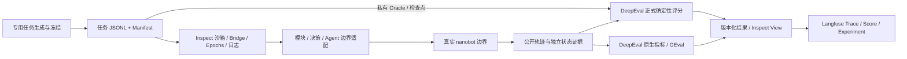

# Agent Eval Suite

用于工具型 Agent 的 **任务数据集 + Harness**：冻结任务与预期条件，运行真实 nanobot，保存可观察执行轨迹，再依据独立证据评分。

当前主线覆盖**程序模块、模型决策模块、关键链路与端到端**四类执行方式。**Inspect 负责沙箱执行、预算、重复与恢复、原生日志和查看器；DeepEval 负责正式业务评分，以及原生 Agent 指标和 GEval 诊断；Langfuse 展示已保存的轨迹、分数和实验。**职责与保留的必要适配见[框架复用说明](docs/benchmark/framework-reuse.md)。

[文档导航](docs/README.md) · [分层评测使用指南](docs/benchmark/v2-usage.md) · [七项问题与未解决清单](docs/benchmark/status-v2.md) · [v2 作品集输出](reports/file-tools-v2/index.html) · [真实失败案例](docs/benchmark/failure-case-v2.md) · [历史 v1 实验](docs/benchmark/portfolio.md)

v2 已完成 **444 个任务实例、112 个任务族、612 次真实执行**及评分 v2.1 复评：程序模块 60/60、模型决策 72/72、关键链路 151/180、端到端 273/300 通过。不同执行方式分别报告，不能把模块通过率混成模型成功率，也不能把重评分算作新执行。

真实 GEval 主评审有 **3,274 个适用项，3,273 项获得分数，1 项 ValidationError 保持未评分**。另对 69 个证据项各评 2 次，获得 138 条稳定性评分，平均极差 0.031884，最大极差 0.4。作品集总计包含两部分，共 3,411 条有效 Judge 分数。**人工校准尚未完成；六组已导出的 Langfuse 运行均通过服务端完整回读验证。**详见[实际报告](reports/file-tools-v2/index.html)。

## 评测覆盖与口径

| 范围 | 实例 / 任务族 | 本轮 PASS / Trials | 实际执行边界 |
| --- | ---: | ---: | --- |
| 程序模块 | 60 / 12 | 60 / 60 | 调用真实 nanobot ToolRegistry 与文件工具，不调用模型 |
| 模型决策模块 | 24 / 8 | 72 / 72 | 固定上下文 + 真实工具 Schema，真实 Provider 模型调用；不运行工具 |
| 关键链路 | 60 / 12 | 151 / 180 | 真实 AgentLoop，检查声明的步骤参数、轮次状态、顺序与恢复条件 |
| 端到端 | 300 / 80 | 273 / 300 | 用户请求 → 真实 Agent/工具 → 回复与独立文件终态 |

任务实例包含同族参数变体；重复执行不增加任务数。程序单元测试通过率、模型决策正确率和完整 Agent 成功率分别报告，pytest 框架回归数量不计入 Benchmark 样本量。

冻结资产见 [File Tools v2 数据集卡](data/benchmarks/file-tools-v2/README.md)和 [Model Decisions v1 数据集卡](data/benchmarks/model-decisions-v1/README.md)。文件套件采用固定追问，尚不代表动态用户模拟或完整 nanobot 产品覆盖。数据为 AI 辅助编写，尚无独立逐条人工审核。说明文档使用中文；冻结任务、第三方官方任务及原始证据保留原文，可按[中文逐条阅读页](docs/dataset-reading.html)查看任务；阅读页跨版本收录 744 条记录，其中包含 v1/v2 继承任务，不代表 744 个唯一任务。详见[语言与冻结边界](docs/dataset-language.md)。

新增 [nanobot Core v1](data/benchmarks/nanobot-core-v1/README.md)：32 条 Memory / Session / Context / Skills 组件任务，24 条 dev 与 8 条按家族留出的 reserved holdout。独立 [覆盖矩阵与运行报告](reports/nanobot-coverage-v1/README.md)区分源码存在、能力启用、任务定义、实际执行、评分与人工审核。组件重复不计入 LLM 或完整 Agent 成功率；Shell、Web、MCP 等仍有明确缺口。运行方式见[覆盖指南](docs/benchmark/nanobot-coverage.md)。

## 从安装到真实评测

需要 Python 3.11+。首次安装访问 Python 包源；Agent 使用自己的源码与解释器，Evaluator 保持独立环境。

```bash
python3.11 scripts/setup.py --only evaluator
make demo
```

`make demo` 运行 5 条历史 v1 离线参考任务，生成 `artifacts/benchmark-demo/inspect-view/index.html`、来源清单和 Inspect 日志。静态查看器需通过本地 HTTP 服务打开，也可用 `inspect view --log-dir artifacts/benchmark-demo/inspect`。它不调用模型或 Langfuse，**用于验证评测闭环，不能作为真实 Agent 成绩**。无 Make 时，使用根 CLI 的 `benchmark demo` 与 `benchmark report`。

真实评测需要复制 [nanobot.example.json](configs/benchmark/nanobot.example.json) 为本地配置，填写 nanobot 源码、解释器、模型和地址。模型执行默认使用 Inspect Docker sandbox，需要可用 Docker；模块可显式选择 `sandbox: "local"`。首次镜像构建下载基础镜像与 Agent 依赖。密钥通过 `api_key_env` 由 Inspect 读取，Agent 只访问本地 bridge。执行不会自动拉取最新 Agent 代码。

```bash
# 校验冻结任务；不调用模型，也不冒充模块实跑。
.venvs/evaluator/bin/python -m eval_framework.benchmark.cli validate \
  --dataset data/benchmarks/file-tools-v2

# 程序模块实际执行，无模型调用。
.venvs/evaluator/bin/python -m eval_framework.benchmark.cli run \
  --dataset data/benchmarks/file-tools-v2 --level module \
  --config configs/benchmark/nanobot.local.json --output artifacts/my-modules

# 关键链路小批量实跑；会调用配置中的真实模型。
.venvs/evaluator/bin/python -m eval_framework.benchmark.cli run \
  --dataset data/benchmarks/file-tools-v2 --level chain --limit 5 \
  --config configs/benchmark/nanobot.local.json --output artifacts/my-chain-pilot

# 从已有证据生成报告，不再次执行 Agent。
.venvs/evaluator/bin/python -m eval_framework.benchmark.cli report \
  --run artifacts/my-chain-pilot
```

同一身份的运行可以恢复；任务、源码、配置或评分身份发生变化时使用新目录。完整分层运行、重新评分、Judge、人工校准及 Langfuse 命令见[使用指南](docs/benchmark/v2-usage.md)。

## 架构：各部分实际做什么



- **任务生成**：当前数据由各数据集目录的 `build_dataset.py` 确定性构建并冻结；通用 `dataset-builder` 保留，但不是本轮主数据集的必经入口。
- **业务扩展**：真实执行边界适配、Oracle 与检查点、独立文件快照、版本绑定、四层分母与旧结果兼容。通用沙箱、进程管理、模型日志和重复恢复由 Inspect 负责。
- **Inspect**：执行任务、Agent Bridge、预算控制、原生模型/沙箱事件、epochs 与 eval_set 恢复、通用结果查看器。新文件与决策主线的指标判定归 DeepEval；旧 `eval` 兼容路径仍存在历史 Inspect 评分。
- **DeepEval / GEval**：确定性 `BaseMetric` 处理正式结果与硬约束；原生 TaskCompletion、ArgumentCorrectness、StepEfficiency 与 GEval 评价保存轨迹。未经人工校准的语义分数不覆盖正式 verdict。
- **Langfuse**：关联任务、模型、工具、轮次与相应分数；接收保存结果，不产生第二套正式判定。

## 轨迹评分的能力与边界

任务、generation、tool、turn、chain 范围的指标通过 `scope` 与 `event_id` 关联实际证据节点。轨迹记录公开模型输入/输出、工具参数/结果、每次工具前后状态和每轮快照，不收集隐藏思维链。

`tool_schema` 只代表参数结构正确，不代表参数语义正确；`tool_order` 只证明声明的先后关系，不证明完整数据流正确。参数语义、轮次状态和恢复检查仅对已声明的预期成立，不能写成“任意链路每一步都已完整验收”。缺失证据保留未评分或 INCONCLUSIVE，环境或执行基础设施问题保留 INVALID。

GEval 输出 0～1 评价尺度，不是正确概率。报告区分适用、已评分、缺失、错误与不适用，统计同一证据重复评分波动及 Judge 用量。**人工标签、一致性验收和阈值留出验证尚未完成。**已准备 [36 条空白校准样本](reports/file-tools-v2/calibration-sample.json)，从 chain-judge 按稳定 Hash 抽取三个维度各 12 条；这是标注起点，不是已经完成的人工审核。

当前评分 v2.3 将通用效率诊断交给 DeepEval StepEfficiency；v2.2 的同状态重复、错误重试分类保留为显式 `quality-audit`，不默认加入正式评分。[统一指标规格](docs/benchmark/metric-specification.md)列出公式、粒度、分母与范围；[离线质量报告](reports/evaluation-quality-v1/README.md)保留历史审计结果，不增加执行数。可使用[36 条盲标页](reports/evaluation-quality-v1/annotation.html)填写和导出人工标签，规则与分档说明见[标注指南](docs/benchmark/judge-annotation-guide.md)。

## Langfuse 与作品集

新增 `raw_model` 基线可在 Inspect Custom Solver 内运行自研循环，默认 nanobot 路径不变。无需真实模型的安装和演示见[自研 Harness](docs/benchmark/native-harness.md)。

Langfuse 已改为可选依赖。需要导出时运行 `python3.11 scripts/setup.py --only evaluator --with-langfuse`；默认安装保留 Inspect、DeepEval，核心执行和本地报告无需展示 SDK。重复的 `conversation` extra 已删除。Agent 接入复用现有 Provider 注册机制，详见 [AgentAdapter 与 Provider 复用](docs/benchmark/agent-adapters.md)。

导出、服务端回读和界面检查分别验收；API 接收成功不等于全链路展示验证完成。每次导出显式指定对应数据集：

```bash
.venvs/evaluator/bin/python -m eval_framework.benchmark.cli export-langfuse \
  --run artifacts/my-chain-pilot --dataset data/benchmarks/file-tools-v2
.venvs/evaluator/bin/python -m eval_framework.benchmark.cli verify-langfuse \
  --run artifacts/my-chain-pilot --dataset data/benchmarks/file-tools-v2
```

作品集生成器 `scripts/build_layered_report.py` 只读取已完成运行，不调用模型或网络。它生成独立离线 HTML、公开逐 trial 摘要和七项问题状态表；公开摘要不复制原始提示词、文件内容、凭据或绝对路径。原始详细轨迹保存在本地运行目录；有有效 Langfuse 回执时关联其 Trace ID 和可用链接。事后 Judge 关联到原执行 Trace 时，根 Span 的起止跨度会包含执行结束到评审发生之间的间隔；这不是 Agent 耗时，实际 Agent latency 沿用原执行记录，Judge 用量单列。

已完成一次 Langfuse 界面抽查：[节点评分截图](reports/file-tools-v2/langfuse-step-scores.png)展示模型决策节点上的 Schema、参数、工具选择与 GEval 分数，以及对应 Judge 子节点。界面抽查与服务端回读分别验收：模块、模型决策、链路、端到端、Judge 稳定性及 τ 试点六组导出均已 VERIFIED。链路与端到端另外保存了 179 / 479 个原文证据子节点，不增加执行或评分次数。

τ 系列是[独立领域适配](docs/benchmark/tau.md)。已使用固定官方 **τ²-bench v1.0.1 retail 任务 0，执行 1 次并得到官方 reward 1.0（PASS）**；实际参与者为 nanobot AgentLoop，Agent 使用 `deepseek-flash`，用户模拟器使用 `openai/deepseek-flash`。Inspect 编排外层批次，DeepEval 的 `OfficialTauRewardMetric` 原样呈现官方奖励。这一有界试点单列，不计入上面的 444 个实例 / 612 次执行，不代表全量复现或官方排行榜成绩。

## 历史、仓库结构与复现

历史 File Tools v1 的 300 个任务 × 3 次重复 × 2 组配置，共 1,800 次真实 nanobot 执行保持不变：基线 91.11%，工具说明候选 88.78%。详见[历史作品集](docs/benchmark/portfolio.md)及[勘误](docs/benchmark/dataset-errata.md)。v2 提示、任务与评分版本存在变化，其结果不能直接解释为相对 v1 的模型提升。

```text
data/benchmarks/file-tools-v2/     程序模块、关键链路、端到端冻结任务
data/benchmarks/model-decisions-v1/ 独立模型决策冻结任务
packages/evaluator/src/eval_framework/benchmark/
                                  Inspect 编排、执行适配、DeepEval/GEval、报告
packages/contracts/               共用契约与能力快照校验
packages/dataset-builder/         保留的通用生成、审核和冻结工具
packages/agent-trace-sdk/          Provider 业务取证、Inspect 存储适配与历史回读
examples/mini_agent/               可选参考 Agent 与历史回归
configs/benchmark/                无凭据配置示例
reports/                          可公开的结果摘要
artifacts/                        本地原始运行与详细证据，Git 忽略
```

旧资产工具和兼容入口未全部删除，原因见[兼容范围](docs/benchmark/legacy.md)。源码 commit、工作树 Hash、任务 Hash 和评分版本共同约束复现；模型服务的远端权重仍可能变化，不承诺逐字重现。费用缺少可靠证据时保留未知，不按零展示。

```bash
.venvs/evaluator/bin/python -m pytest -q -c packages/evaluator/pyproject.toml \
  packages/evaluator/tests/benchmark
python3 scripts/test_all.py
python3 scripts/verify_assets.py
```

默认测试不调用真实模型或托管服务。Builder 与 Evaluator 使用各自依赖环境；纯核心安装可使用 `scripts/setup.py --only core`，再给根 CLI 指定对应 `--evaluator-python`。
