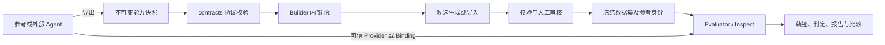

# 架构与责任边界

## 依赖关系

- `agent-eval-contracts`：提供 `capability_snapshot_kit` 与 `eval_contracts`，不依赖 Builder、Evaluator、mini_agent 或 Inspect。
- `agent-dataset-builder`：读取完整能力包，使用共享校验和数据模型；生成 IR、Policy、候选及生命周期属于 Builder 内部。
- `agent-evaluator`：执行与评分属于 Inspect，业务扩展提供编译、证据检查、报告和比较。历史 `eval_framework` 导入保留兼容出口。
- `agent-trace-sdk`：独立分发轨迹接入协议；当前保留已有 Inspect 依赖。
- `minimal-agent`：参考实现，快照协议依赖共享包；核心 Evaluator 可在未安装该包时通过外部适配器运行。
- `agent-eval-suite`：标准库 CLI，负责环境选择、命令转发、快照登记和显式源码同步。

## 三种身份

| 身份 | 绑定对象 | 更新规则 |
| --- | --- | --- |
| 快照发布版本 | Agent 名称、版本、相对路径及内容 Hash | 新版本新增；拒绝覆盖已有版本 |
| 参考身份 | 冻结数据集、参考能力包、评测配置 | 同一次基线比较必须固定 |
| 运行身份 | 实际 Provider / Binding、模型、源码及运行配置 | 可变，但应记录并经过兼容性检查 |

发布版本号和 Agent 快照内部的 `agent_version` 是不同字段。v3 的根快照 Hash 与 Bundle Hash 使用已有算法；登记层额外校验文件树，不能用登记信息取代协议校验。

把新版本登记到索引，不等于已有 Suite 自动改用新版本。Suite 明确绑定路径与 Hash，Builder 再复制并冻结所用能力包。这样历史结果不受后来发布影响。

`agent sync` 固定 Git commit/tree 并保存来源；它不能证明远端服务当前部署的二进制版本，也不能独自保证模型服务完全可复现。未取得的运行信息应在报告中明确缺失。

## 执行与答案隔离

Agent 接收执行输入、初始状态和允许的工具；Oracle、期望结果和判分规则留在评测端。demo 的静态适配器只处理提供的输入快照，预设答案仅进入 Scorer。

缺少足够证据时保留 `INCONCLUSIVE`；不把无法判断的 Case 作为成功。演示用例用于验证判定分支，业务评测需使用真实任务、合理的样本规模及明确统计口径。

## 保留范围

迁移保留历史 Suite、快照及冻结交付物，兼容层处理旧同级目录锚点。尚未把所有历史目录重排到根 `data/`，避免改写已经冻结的引用和 Hash。新快照使用根登记目录，历史文档作为来源资料保留。
