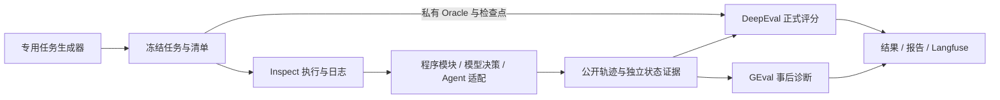

# 仓库架构与责任边界

当前主线是固定任务数据集与 Harness。Inspect 负责执行和日志，DeepEval 负责正式确定性评分，GEval 负责尚未完成人工校准的事后诊断，Langfuse 展示保存结果。分层执行、检查点与轨迹指标见[分层评测指南](benchmark/v2-usage.md)；下文同时说明保留的通用 Builder 与历史 Suite 路径，避免混用职责。

## 包的责任与依赖

| 包 | 责任与边界 |
| --- | --- |
| `agent-eval-contracts` | 提供 `capability_snapshot_kit` 与 `eval_contracts`，不依赖 Builder、Evaluator、mini_agent 或 Inspect。 |
| `agent-dataset-builder` | 读取完整能力包，使用共享校验和数据模型；生成 IR、Policy、候选及生命周期留在内部。当前固定 benchmark 不要求先走该入口。 |
| `agent-evaluator` | 当前 benchmark 由 Inspect 执行、DeepEval 评分；自研扩展负责适配、采证、检查点、报告与比较。历史 Suite 路径保留 Inspect Scorer 和 `eval_framework` 兼容导入。 |
| `agent-trace-sdk` | 独立分发轨迹接入协议，保留已有 Inspect 依赖。 |
| `minimal-agent` | 可选参考实现，使用共享快照协议；核心 Evaluator 可在未安装它时通过外部适配器运行。当前主要实测对象为 nanobot。 |
| `agent-eval-suite` | 标准库 CLI，负责独立环境选择、子进程命令转发、快照登记和显式源码同步。 |

旧 Builder 路径仍按“能力快照 → 共享契约校验 → 内部 IR → 候选生成或导入 → 校验与人工审核 → 冻结 → Suite / Provider 评测”工作，命令见[数据集工作流](dataset-workflow.md)。新旧路径的数据与评分结果分别维护。

## 三种身份

| 身份 | 绑定对象 | 更新规则 |
| --- | --- | --- |
| 快照发布版本 | Agent 名称、版本、相对路径及内容 Hash | 新版本新增，拒绝覆盖已有版本 |
| 参考身份 | 冻结数据集、参考能力包、评测配置 | 同一次基线比较必须固定 |
| 运行身份 | 实际 Provider / Binding、模型、源码及运行配置 | 可以变化，但须记录并通过兼容性检查 |

发布版本号和 Agent 快照内部的 `agent_version` 是不同字段。v3 根快照 Hash 与 Bundle Hash 使用原有算法；登记层额外校验文件树，不能取代协议校验。登记新版本也不会使已有 Suite 自动切换：Suite 绑定路径与 Hash，Builder 复制并冻结所用能力包。

`agent sync` 固定 Git commit/tree 并保存来源，但不能证明远端服务当前部署的二进制版本或模型权重，也不覆盖完整依赖环境。未取得的运行信息须保留缺失状态。命令和校验范围见[显式配置](../configs/README.md)。

## 执行与答案隔离

Agent 接收公开请求、初始状态和允许的工具；Oracle、期望结果和检查点留在评测端。旧静态演示的适配器只处理输入快照，预期答案仅进入 Scorer。新 benchmark 的参考执行只验证数据可执行，不能冒充真实 Agent 成绩。

缺少足够证据时保留 `INCONCLUSIVE`，基础设施或环境无效时保留 `INVALID`；执行进程成功不等于任务通过。程序模块、模型决策、关键链路与端到端分别统计，重评分和 Judge 重复评价不增加 Agent 执行次数。

## 历史资产与兼容

历史 Suite、快照及冻结交付物保持原字节；兼容层处理旧同级目录锚点。为避免改写冻结引用与 Hash，部分历史资产继续留在原包路径，新快照使用根登记目录。保留的协议与使用文档记录旧结果语义；已完成方案和重复阶段报告可查 Git 历史。来源及历史验收集中于[迁移记录](migration/provenance.md)，实现保留范围见[兼容说明](benchmark/legacy.md)。
