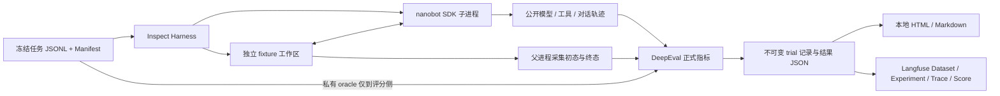

# 工具型 Agent Benchmark：任务数据集 + Harness

> **历史 v1 架构记录。** 本文对应 File Tools v1 的执行与评分边界，不作为当前 v2 能力清单。v2 已增加程序模块、隔离模型决策、逐轮 / 步骤检查点及事后 GEval；当前架构和命令请以 [v2 使用指南](v2-usage.md)为准，未解决部分见 [七项问题清单](status-v2.md)。下文关于“没有逐轮独立状态 oracle”等表述只适用于 v1。

这条项目主线使用固定任务集测试真实 nanobot SDK，通过独立文件终态判断任务结果。Inspect 负责调度和执行日志；DeepEval 负责正式评分；Langfuse 展示保存的轨迹、分数和实验记录。这里的 Harness 是完整的评测运行程序，不是另一种评分指标库。

## 核心组成

| 组件 | 代码或资产 | 实际职责 |
| --- | --- | --- |
| 任务集 | `data/benchmarks/file-tools-v1/` | 300 条可执行任务、80 个任务族、输入文件、固定 follow-up、oracle、参考变换操作和冻结 Hash |
| 任务契约 | `benchmark/tasks.py` | 结构与版本校验；按任务族划分 dev / holdout；产生不含 oracle 的执行投影 |
| Harness | `benchmark/runner.py` | Inspect 调度、独立初态、预算、重复试验、清理、增量保存、恢复、身份核对与汇总 |
| Agent 适配 | `benchmark/nanobot_runtime.py`、`nanobot_worker.py` | 独立解释器运行真实 `Nanobot` / `AgentLoop`；工具限制与过程采集 |
| 终态验证 | `benchmark/oracle.py` | 从公开回复和独立文件证据检查条件；参考执行只用于验证数据自身可执行 |
| 正式评分与诊断 | `benchmark/metrics.py` | DeepEval 自定义确定性指标、工具覆盖诊断与可选 G-Eval 诊断 |
| 展示 | `benchmark/report.py`、`langfuse_export.py` | 读取保存结果生成报告或导出 Langfuse；不重复执行或重新评分 |

上表中的 `benchmark/` 均位于 `packages/evaluator/src/eval_framework/benchmark/`。

## 被测对象与隔离边界

被测对象是**受限文件工具配置下的真实 nanobot SDK**，使用其 AgentLoop、会话持久化、模型 Provider 和原生文件工具行为。它只注册 `read_file`、`write_file`、`edit_file`、`list_dir`，不注册 shell、网页、MCP、消息或定时任务工具，也不启动用户的渠道连接。

这不是 nanobot 原生全工具模式的成绩。nanobot 的通用系统提示仍可能提到当前没有注册的工具；在分析“尝试调用 exec”等失败时，应同时考虑工具暴露和提示配置，不能直接推广为模型在生产系统中的安全性结论。提示词 A/B 实验可显式澄清工具范围，但必须将变化写入运行配置，使用相同冻结任务与评分版本重新执行。

每次 trial 创建新的 fixture 工作区。session、memory 和其他运行文件位于另一个私有目录，多轮请求在同一 trial 内共享会话，不跨 trial 共享状态。文件工具在执行前检查规范化路径、拒绝越界及符号链接；父进程单独读取文件初态和终态。这里实现的是应用层路径限制，**没有声称使用 Docker 或操作系统沙箱**。

Agent 仅收到 `id`、`prompt`、`followups`、`fixtures`、`allowed_tools`、`max_steps`。`oracle`、参考答案、参考操作与诊断用 `required_tools` 不会放入执行投影。工具不可用时的尝试会保留在轨迹中，并标注 `execution_started=false`；这证明一次被拒绝的调用尝试，不证明 shell 或外部动作真正发生。

## DeepEval 评分口径

正式评分不调用 Judge 模型。自定义指标继承 DeepEval 的公开 `BaseMetric`，读取已经采集的证据。

| 指标 | 类型 | 判定依据 |
| --- | --- | --- |
| `task_success` | 正式、确定性 | 任务完成状态、轮次要求、精确文件内容、指定响应标记等独立 oracle 条件 |
| `workspace_policy` | 正式、确定性 | 非目标文件保持不变、禁止意外新文件、禁止调用工具集合之外的工具 |
| `interactive_evidence` | 正式、确定性 | 对需要交互的真实任务，检查工具交互证据存在，避免仅重复回复标记即通过 |
| `tool_correctness` | 诊断、确定性配置 | DeepEval `ToolCorrectnessMetric` 检查参考工具名覆盖；不要求唯一调用顺序，不验证全部参数语义 |
| `response_groundedness` | 可选诊断、LLM Judge | DeepEval G-Eval 根据真实回复、工具结果及终态评估陈述是否有依据；显式调用才产生费用 |

所有正式指标均通过才产生 PASS，不用平均分抵消关键约束失败。环境、Provider 或评分执行异常为 INVALID；关键证据缺失为 INCONCLUSIVE；环境有效而任务结果或约束失败为 FAIL。超时等预算终止只有在证据足够时才能归因为 Agent 失败。

`ToolCorrectnessMetric` 的参考工具名覆盖不应否决一个正确且允许的替代方案，例如使用 `write_file` 完成原本参考操作使用 `edit_file` 的任务。它也不是 BFCL 官方评分或参数语义正确率。G-Eval 当前为未经过人工校准的诊断分，不决定正式 verdict；不能表述为已验证的人类一致性评审体系。

历史 pilot 的指标角色或版本可能不同。报告按照每次保存记录中的 `formal` 字段展示，不能用当前代码静默改写旧成绩；跨不同 oracle 或评分版本的数字不构成严格 A/B 对比。

## 资产、结果和复现

冻结任务通过 `manifest.json` 绑定 JSONL 内容 Hash。任务集有 240 条 dev 和 60 条 holdout，按完整任务族划分。300 是实例数，80 是任务族数；每族的参数变体不能表述为相互独立的 300 种业务能力。数据由 AI 辅助编写，未经过用户逐条人工审核，来源记录中的 `human_reviewed=false` 应保持真实。

每次运行保存选定 case、重复次数、配置、数据集身份、评分身份以及 nanobot commit 与工作树摘要。源码有未提交变更时保留工作树摘要和 dirty 状态；不能仅凭 commit 号声称精确复现。恢复执行必须符合原运行身份，跨配置或源码变化应创建新运行目录。

`results.json` 汇总已保存的 trial；每条包含公开输入/输出、真实模型和工具事件、Token 用量、独立文件证据、正式指标及理由。报告区分唯一任务数、实际 trial 数和计划 trial 数，分别展示 dev / holdout 与任务类别。请求的模型名与 Provider 实际响应的模型名分别记录，未知字段保留未知。

`all_trials_pass_rate` 表示一个任务的全部计划重复试验都通过的比例。它不能写成“至少一次通过”的 pass@k；缺失或无效 trial 不证明稳定通过。费用没有可靠价格证据时显示未知，不按零费用展示。Token 从模型响应读取；`byte_fallback` 仅影响 nanobot 上下文预算估算，不冒充 Provider 的计费 Token。

Langfuse 接收保存结果，不承担第二套正式评分。导出接口接受数据、服务端读回验证和浏览器界面验收是三个不同层次；作品集只能写已验证的层次。展示完整轨迹也不等于收集私有思维链：记录范围是模型公开请求/响应、工具调用与可观察状态。

## 原有模块的去留

新的 `benchmark` CLI 是本次任务数据集 + Harness 的入口。协议、能力快照、评测集构建器、mini_agent Provider、trace SDK 和历史 evaluator 路径仍在仓库中，用于原有用例兼容和工程材料。能力快照生成并不是执行这套固定文件任务集的必经步骤。

因此可以说明“新增 benchmark 主线，明确执行、评分与展示职责”，不能声称“已经删除全部历史框架”或“整个仓库没有 Inspect 评分代码”。新 benchmark 正式评分由 DeepEval 负责；历史兼容路径要与这条主线的结果分开展示，后续删除须先确认调用方和回归影响。

## 作品集必须保留的五项限制

1. **任务范围有限。** 只覆盖本地 UTF-8 文件任务，不包含浏览器、数据库、支付或生产消息，也不是 τ-bench、BFCL、SWE-bench 官方复现。
2. **数据与泛化证据有限。** 合成任务和参数变体不能替代真实业务采样；holdout 一旦用于调参，就不能再声称未见验收集。固定 follow-up 不等同动态用户模拟，也没有逐轮独立状态 oracle。
3. **Agent 配置受限。** 只提供四种文件工具，应用层限制不等于容器隔离；被拒绝的工具调用不等于真实副作用。通用系统提示与工具范围的关系是有效的归因维度。
4. **评分有明确语义。** 文件精确匹配会捕捉空格、换行或格式变化，应与业务数值错误分开归因；诊断指标不冒充正式成功率或经过人工校准的判断。
5. **实验结论受版本与规模约束。** Pilot、稳定性运行和正式重复实验分别报告；任务集、评分版本或关键控制变量不同的成绩不能直接解释成优化效果。未知费用、缺失证据和未完成的 Langfuse 验收应如实保留。
