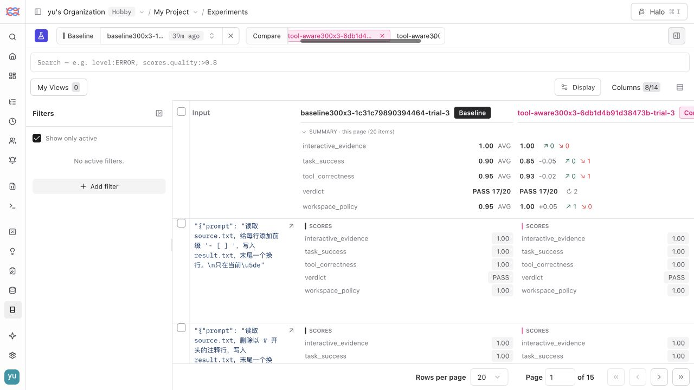
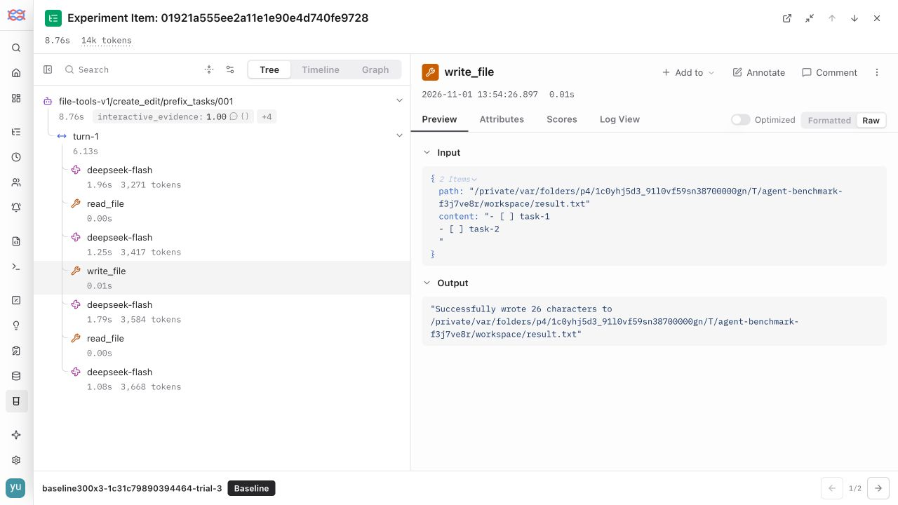

# Langfuse 实验与证据

[打开 Dataset](https://cloud.langfuse.com/project/cmvgd40xe02ecad0en362z7wd/datasets/cmvxeql6t00j8ad0n59ync0rt)：`file-tools-v1-348078451c89`。该链接需要此项目的访问权限。

每条任务重复执行 3 次；为保持每个 Experiment 中每个 Dataset item 对应一次执行，每组分成 3 个 Experiment，每项 300 条。总体 900 次成绩应查看本地汇总或作品集，不将其中某一次重复的平均分误当作三次总成绩。早期 `pilot20` 使用不同评分版本，不参与正式 A/B 汇总。

| 配置 | 重复序号 | 实验链接 |
| --- | ---: | --- |
| baseline300x3 | 1 | [300 条任务](https://cloud.langfuse.com/project/cmvgd40xe02ecad0en362z7wd/experiments/results?baseline=9d27ed684c65cbe1ee2362ef3b9de2ec) |
| baseline300x3 | 2 | [300 条任务](https://cloud.langfuse.com/project/cmvgd40xe02ecad0en362z7wd/experiments/results?baseline=cdf57c1bc3366ecd7eb770cb12b850d5) |
| baseline300x3 | 3 | [300 条任务](https://cloud.langfuse.com/project/cmvgd40xe02ecad0en362z7wd/experiments/results?baseline=38a00e4eeba8627094f60ec9898fde80) |
| tool-aware300x3 | 1 | [300 条任务](https://cloud.langfuse.com/project/cmvgd40xe02ecad0en362z7wd/experiments/results?baseline=44a266801dfb10d6c90384cc3fe631c9) |
| tool-aware300x3 | 2 | [300 条任务](https://cloud.langfuse.com/project/cmvgd40xe02ecad0en362z7wd/experiments/results?baseline=0811c1b47065cd6da37948a8561957b7) |
| tool-aware300x3 | 3 | [300 条任务](https://cloud.langfuse.com/project/cmvgd40xe02ecad0en362z7wd/experiments/results?baseline=bd724ab94a4d583ef60d4a625fdd00a9) |

## 查阅顺序

1. 打开 Dataset 或实验，按任务 ID 选择一条 Case。
2. 查看 `verdict` 与各 DeepEval 指标。`tool_correctness` 是诊断，不决定正式通过；其他正式指标由保存的评分结果导出。
3. 展开 Agent → Turn → Generation / Tool，查看公开请求、响应、工具参数、结果、时长和用量。`execution_started=false` 的未开放工具尝试没有真实执行。
4. 在根观察记录中查看 `before_files`、`final_files`、评分理由与代码/数据身份，回到本地失败分析定位具体文件差异。

## 验收方式

导出阶段逐批保存服务端接受的 observation/score ID；连接未建立时可安全重试，状态不确定的写入必须先核对，不能盲目重发。评分使用稳定 ID 和 timestamp，续传不会重新评分或调用 Agent。

回读阶段核对所有计划 trial、观测 ID、父子关系、类型、输入输出、时间戳、模型、用量、评分值、评分关联及每个 Experiment 的任务数；同时检查请求/响应模型名、工具调用 ID 和 execution_started 标记。CLI 在不匹配时返回非零退出码。

最终机器可读验收摘要记录在 `reports/file-tools-v1/langfuse-verification.json`；两组完整检查记录留在对应本地运行目录的 `langfuse_verification.json`。

本次全量 API 传输遇到本机代理 fake-IP 解析异常，使用仅在导出/回读进程内生效的实际解析地址恢复连接；HTTP Host 与 TLS 校验仍使用原 `cloud.langfuse.com`，没有改动系统 DNS、代理或证书校验。回读又遇到每分钟 30 次限制，由 SDK 遵循 Retry-After 等待。

## 浏览器实测

已在实际 Langfuse 界面打开正式 baseline 与 tool-aware 的第 3 次重复对比，确认各有 300 条任务（20 条/页，共 15 页），并从实验行下钻到 `prefix_tasks/001` 的 Agent → Turn → Generation / read_file / write_file 轨迹。核对了工具原始参数、返回结果、根输出文件快照与可见 Token 用量。

上图汇总明确标注为 **this page (20 items)**，不是全部 300 条或三次 900 条的总体通过率。整体结果以作品集汇总为准。

