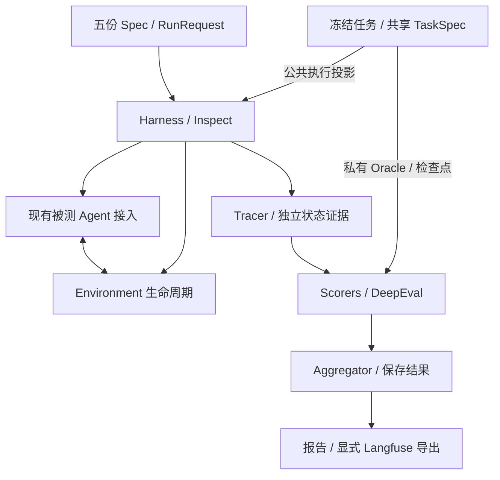

# Harness、Environment 与 Benchmark 分层

本轮依据四层架构图重构框架自身，继续使用 Inspect 执行和记录日志、DeepEval 正式评分。被测 Agent 的内部循环、工具实现与 Provider 接入协议保持原状；新结构通过旧入口接入，不改冻结任务和历史结果。

## 实际代码边界

以下路径相对于 `packages/evaluator/src/eval_framework/`。

| 层 | 模块 | 责任 |
| --- | --- | --- |
| 通用任务 | `eval_contracts.benchmark`（共享包）、`benchmark/schema.py` | 严格 TaskSpec、公开输入 allowlist、旧 file-tools 任务视图；不重写 JSONL |
| 插件契约 | `plugins/protocols.py`、`plugins/models.py` | Environment、ToolRouter、UserSimulator、Scorer 接口和精确版本类型 |
| Environment | `environments/file_tools.py`、`environments/inspect_file_tools.py` | 初态装载、隔离 workspace、独立 snapshot/final_state、清理；Inspect 版本实际服务现有 worker |
| Harness | `harness/loop.py`、`harness/tracer.py` | Inspect 执行边界、公开模型事件、用量和证据完整性采集 |
| 可组合循环 | `harness/conversation.py`、`router.py`、`user_simulator.py` | 同步外部 callback、工具解析与校验、固定 followups、轮次调度和资源释放 |
| Benchmark 评分 | `benchmark/scorers/` | ExecutableScorer、exact ReferenceScorer、显式 LLMJudgeScorer |
| 指标汇总 | `aggregator/summaries.py`、`judgments.py`、`levels.py` | 既有汇总算法、Judge 重复评价和五层保存证据视图 |
| 配置组合 | `orchestration/specs.py`、`config.py` | Model/Harness/Environment/Benchmark/Execution 五份 Spec、本地引用、迁移及 CLI 优先级 |

`benchmark/inspect_runtime.py`、`oracle.py`、`runner.summarize()`、`report.evidence_summary()` 和 `judging` 的既有入口继续可用。`trajectory.py` 实际承担私有 checkpoint 评分，继续属于 Benchmark，不迁入 Tracer。

## Environment 与 Harness 使用

现有 `benchmark.cli run` 无需更换入口；运行自动经 `InspectFileToolsEnvironment` 和新的 Harness 执行边界。Docker、本地执行、预算和子进程清理由 Inspect 保持原有语义。

另提供 `FileToolsEnvironment` 用于框架自己的确定性本地工具环境，可与 `run_conversation()`、`ToolRouter` 和 `FixedFollowupUserSimulator` 组合。它不是被测 nanobot 工具的替代实现，也不是 OS 沙箱。`reset()` 接收 `{相对路径: UTF-8 内容}`，TaskSpec 使用者明确取 `task.initial_state["files"]`；`final_state()` 返回独立文件快照。同步循环的 `max_steps` 按 callback 调用次数计数，调用包括返回工具请求的轮次。

固定 followups simulator 只读取公共 prompt/followups，按确定顺序提供消息；它不声称是动态用户模型。同步 callback 是可组合的框架接口，现有 nanobot/mini_agent 内部 AgentLoop 不被重写。τ 的官方环境、策略和动态用户模拟仍经既有独立入口运行，本轮没有改变官方行为。

## 私有评分边界

Oracle、参考答案、`expected_delta` 和 checkpoints 只留在可信任务/评分侧。共享 TaskSpec 的 `execution_input()` 使用显式 allowlist 并深复制可变对象；file-tools 兼容映射保持旧执行 JSON 的字段和顺序。

`Scorer.score(trace, final_state, task)` 的 file-tools 实现接收**完整可信 observation envelope**，包含独立的 before_files/final_files、status、turns、errors 和完整性标志；单独文件快照不足以证明执行有效。Environment 的终态必须先由 Harness 与这些证据组合。正式四态 verdict 仍以 DeepEval `score_task()` 为准，执行进程成功不能代替任务通过。

ReferenceScorer 只提供显式 exact 匹配诊断，不收窄原有正式 Oracle 的允许行为。LLMJudgeScorer 延迟加载原 GEval/native 评价路径，只有显式请求才调用模型；未校准诊断不决定正式 PASS/FAIL。重评分不会增加 Agent 执行次数。

## 聚合与身份

`aggregate_benchmark(saved_run)` 生成 Benchmark → Trial → Task → Turn → Step 保存证据视图。它关联已有 event_id/parent_id 和指标，不发明新分数；孤立事件与无法关联的指标单独保留。旧汇总 JSON 结构保持兼容，缺失 trial 不计成功，未知成本仍为未知。此处 Trial 兼容历史保存格式中的单 case 重复执行记录，不把它改写成整套 task set 的另一种 Trial 定义。

新运行身份覆盖抽出的 Harness、Environment、Scorer、Aggregator、配置和共享 TaskSpec 源码。既有任务 hash、旧记录身份和原 v3 bundle 结构不重写。新版恢复/比较会识别源码身份变化；跨版本继续使用旧结果展示入口，不静默改写成绩。

## 配置与当前扩展边界

使用示例见 [configs/README.md](../../configs/README.md)。旧 `--config` 仍可读取已支持的平铺选项；新组合配置从 `configs/benchmark/layered/run.json` 引用五份 JSON。显式 CLI flags 优先于配置，配置优先于历史默认值。新引用按引用文件所在目录解析；旧平铺路径沿用 cwd 语义。

Suite 新增四个可选插件引用，并在编译时解析精确版本、校验配置和保存实现指纹。未配置时不新增 null 字段，保持旧默认 Suite hash。**历史 `execute_compiled_suite()` 是 EvalCase/Provider 执行桥，尚不负责实例化这些分层插件**；显式配置后会返回 `LAYERED_HARNESS_REQUIRED`，避免配置被忽略。当前可用组合方式是可信 Python 显式向新 Harness 注入 Environment、Router 和 Simulator，并在可信评分端选择 Scorer。

本轮没有新增领域、任务或能力桶，也没有统一/改写被测 Agent。新五份配置服务现有 `run/demo`；core、coverage、judge 和独立 τ 入口继续使用各自配置。未来将 Suite 插件实例化接入新的组合入口、增加动态 simulator 或并行调用时，应另行明确运行协议和验收数据，不把类型槽位当成已支持的执行功能。

验收证据见[本轮验收记录](../migration/layered-harness-acceptance-2026-11-06.md)。
