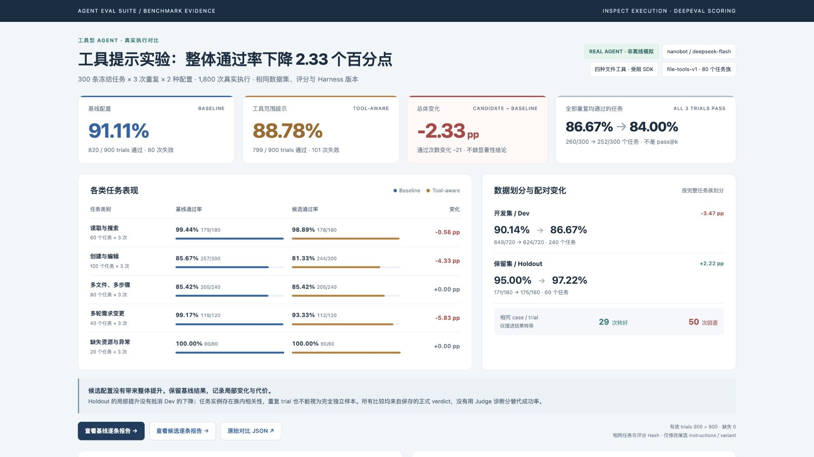

# 工具型 Agent Benchmark：从任务到可审计的评测结果

本项目将原来的评测集构建、执行与报告整理为一条 **固定任务数据集 + Harness** 主线。目标是回答：工具型 Agent 是否真正完成任务，失败发生在哪一步，一次提示词调整是否值得采用。

目前交付：**300 个可执行任务实例、80 个任务族、两组配置各重复 3 次，共 1,800 次真实 nanobot 执行**。Inspect 负责执行与日志，DeepEval 负责正式评分，Langfuse 展示保存的实验和轨迹。本页数据来自 2026-11-01 的固定实验，不将离线参考 Demo 或早期 Pilot 混入正式成绩。

## 真实结果

| 指标 | 基线提示配置 | 补充工具说明的候选配置 |
| --- | ---: | ---: |
| 计划 / 实际 / 有效 Trials | 900 / 900 / 900 | 900 / 900 / 900 |
| PASS / FAIL | 820 / 80 | 799 / 101 |
| 总通过率 | **91.11%** | **88.78%** |
| 每个任务 3 次全部通过 | 260/300（86.67%） | 252/300（84.00%） |
| Dev：240 任务 × 3 | 649/720（90.14%） | 624/720（86.67%） |
| Holdout：60 任务 × 3 | 171/180（95.00%） | 175/180（97.22%） |
| 中位延迟 / P95 | 9.89 / 15.15 秒 | 9.79 / 14.93 秒 |
| 输入 / 输出 Tokens | 14,632,153 / 394,085 | 14,529,923 / 378,069 |

**结论：保留基线作为当前默认。** 候选提示词整体下降 **2.33 个百分点**，不宣称优化成功。候选消除了基线中 33 次对未开放 `exec` 工具的调用尝试，但任务终态失败从 53 次增加到 101 次；任务成功和工具合规需要分别观察。被拒绝的调用没有执行 shell。

主要任务终态失败来自文件空白差异（基线 52 条、候选 99 条），不能将其一概描述成业务逻辑错误。另有 3 道标题任务存在文案歧义，影响候选的两次 FAIL；[数据集勘误](dataset-errata.md)记录全部受影响任务。两组对称排除该家族后，整体为 91.02% 对 88.89%，候选仍低 2.13 个百分点。此项为事后敏感性分析，正式成绩未改写。

两组使用同一个 nanobot、模型、任务集、评分版本和预算，只改变补充提示词及记录用的 variant 名称。候选在 Dev Pilot 后预先固定；正式 Holdout 结果未用于再次调参。这里是一次描述性对比；任务变体及重复试验具有相关性，未作统计显著性或模型整体优劣声明。

- [对比数据与两组逐条评分](../../reports/file-tools-v1/)
- [失败归因与代表案例](failure-analysis.md)
- [可随仓库保存的精简对比页](../../reports/file-tools-v1/comparison.html)（下载后可离线查看）
- [当前电脑上的完整对比看板](../../artifacts/benchmark/comparison.html)
- [基线完整报告](../../artifacts/benchmark/baseline300x3/report.html) · [候选完整报告](../../artifacts/benchmark/tool-aware300x3/report.html)（本地资产，不随 Git 下载）

## 我实现了什么

1. **固定任务资产。** 每条任务包括初始文件、用户指令、可选 follow-up 和独立终态条件。300 个实例覆盖读取搜索、创建编辑、多文件步骤、多轮需求修订与异常输入。240 Dev / 60 Holdout 按任务族拆分，任务 Manifest 和 Hash 固定版本。
2. **可执行 Harness。** 通过真实 nanobot SDK 执行任务，每次初始化独立文件工作区与会话，设置步数和时间预算。执行侧不接收 oracle、参考答案或参考操作；评测进程独立读取文件证据。保存逐条结果、Inspect 原生日志、配置和代码身份，支持恢复已完成结果。
3. **DeepEval 正式评分。** 自定义 BaseMetric 验证任务终态、工作区约束和交互证据；核心约束必须同时通过。ToolCorrectnessMetric 作为诊断，允许合法的替代工具策略。环境错误、证据不足和任务失败分别记录，避免失败样本被静默剔除。
4. **回归与可观测性。** 在同一任务集重复试验，对比总体、任务类别、Dev/Holdout、全部重复通过比例、耗时及实际 Token。Langfuse 导出来自已保存结果，关联 Dataset、Experiment、Trace 和 Score，可下钻公开模型请求/响应、工具参数/结果、文件终态与失败理由。
5. **可展示交付。** 统一 `benchmark` CLI、离线 Demo、独立安装环境、HTML/Markdown 报告、对比看板和截图。旧路径移出主 Demo 并明确为 legacy，保留原有结果的读取与回归兼容。

[架构与评分细节](architecture.md) · [数据集卡](../../data/benchmarks/file-tools-v1/README.md) · [兼容范围](legacy.md)

## Langfuse 证据

两组全部 **1,800 次执行、19,596 条观测、9,000 条评分**已导入并完成 API 回读核对，零不匹配；6 个正式 Experiment 各包含 300 条任务。核对覆盖输入输出、父子关系、类型、时间、模型、用量、工具执行标记和评分关联。

[Langfuse 实验入口及查阅指南](langfuse.md) · [机器可读验收记录](../../reports/file-tools-v1/langfuse-verification.json)

已完成实际网页验收：正式实验对比、300 条任务分页、Agent/Turn/模型/工具调用树，以及工具原始参数和输出均可查看；[界面截图](langfuse.md#浏览器实测)已保存。

当前工作区的在线展示需要访问该 Langfuse 项目的权限；截图可嵌入在线作品集文档，不应把需要登录的地址当作面试官可直接访问的公开作品集。

## 实验身份与复现

- 执行：nanobot SDK，四种工具 `read_file` / `write_file` / `edit_file` / `list_dir`；模型请求与响应名称均为 `deepseek-flash`，temperature=0，max_tokens=2048，max_steps=12，每次上限 180 秒，每组并发 12。
- 评分：`file-tools-deepeval-v1.1`，DeepEval 4.2.9；执行 Inspect 0.3.280；Langfuse SDK 5.0.2。
- 任务内容 SHA256：`5b3a4feb3f82ba9a6b2c2eeebc9904f0fbb19069cdf46087bfbaa4fb35fe666f`。
- Harness 源码身份：`c10daf50b5960a5b1a9b31306c1634524fbda2588b694d45cb07064332cbe4e7`。
- nanobot 基础 commit：`415df576b46464445121fe1bc68d24cd5b649635`；实际使用含未提交修改的源码，已记录工作树 Hash，并在本地保存匹配的源码归档与逐文件清单。
- 原始结果大小约 92 MB 和 91 MB，完整保存在本地 `artifacts/benchmark/`；[发布用摘要、逐条评分及原始结果 Hash](../../reports/file-tools-v1/sources.json)进入版本库。详细模型和工具轨迹同时进入 Langfuse。

本地验证：完整 evaluator 测试 688 项通过、2 项显式付费测试跳过；根集成测试 35 项通过；1,172 个导入资产与 fixture 校验通过。在全新独立 Python 环境实际安装 Core 后，pip check 和 5 条离线 Demo 均通过。

README 提供从安装到 Demo、真实运行、对比、导出和验收的命令。原始结果保持不变；报告生成不重新调用 Agent 或重新评分。`byte_fallback` 只用于上下文预算估算，表中 Token 来自模型响应；未取得可靠费用明细，因此不填造美元费用。云端模型别名无法固定远端权重，不能承诺再次运行的回答逐字相同。

## 边界与后续方向

数据由 AI 辅助编写，包含参数变体，尚未逐条人工审核；300 个实例不等于 300 种独立业务能力。本集只测 UTF-8 文件任务，不代表 shell、浏览器、数据库或生产业务 Agent 的综合能力，也不是 τ-bench、BFCL 或 SWE-bench 的官方复现。

隔离为应用层路径约束，不宣称 Docker/OS 沙箱。多轮为预先固定的需求修订，当前验收终态与轮数，尚未覆盖动态用户模拟和每轮中间状态独立判定。正式分数采用确定性证据；可选 G-Eval 诊断已实现，但本次未启用付费 Judge，也未声称经过人工校准。

下一轮应在新的 Dev 迭代中优先处理 `read_file` 展示格式被误复制到文件的问题，并为新的最终验收准备未使用的任务族。当前 Holdout 已执行，不能无条件重复称为未见数据。

## 简历表述草稿

> **工具型 Agent Benchmark｜Python / Inspect / DeepEval / Langfuse**
> 构建由固定任务数据集与 Harness 组成的 Agent 评测体系，沉淀 300 个可执行任务实例、80 个任务族，覆盖文件操作、多步骤及多轮交互；实现任务族隔离的 Dev/Holdout 切分、独立终态校验、重复试验及失败归因。
> 接入真实 nanobot SDK，完成两组配置共 1,800 次模型执行；通过 DeepEval 评估任务结果与工作区约束，并关联 Langfuse 任务、模型与工具轨迹，输出可回溯报告。发现候选提示词虽消除 33 次未开放工具调用尝试，却使整体成功率下降 2.33 个百分点，为配置回归提供依据。

这里的数字和职责可作为项目材料；面试时应能解释自己审阅、理解和维护的部分，不将 AI 协助生成的代码或数据表述为完全独立手写。
