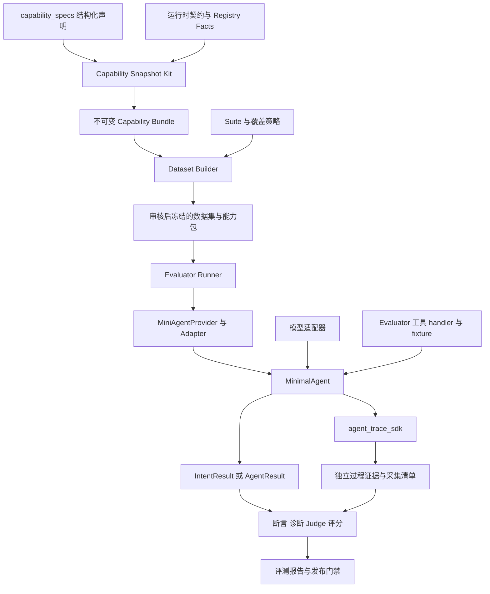
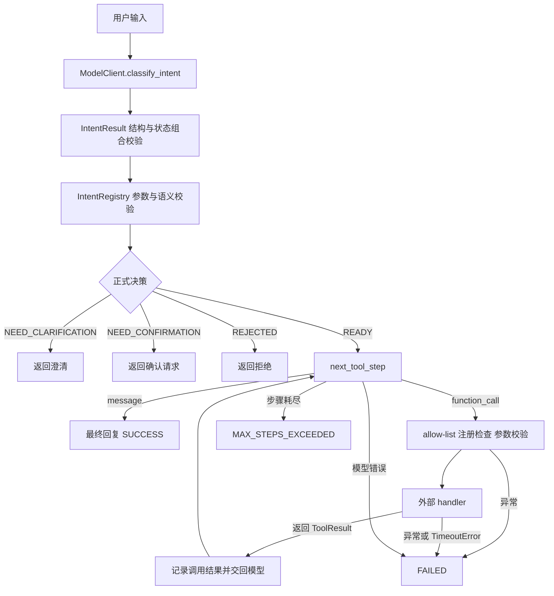

# Mini Agent 项目架构与 Builder Evaluator 接入总结

> 本文说明示例 Agent 与旧 Suite／Provider 的接入边界；当前任务基准入口见 [Evaluator README](../../../packages/evaluator/README.md)。命令在 `examples/mini_agent` 目录执行。

更新时间：2026 年 10 月 13 日。本文以当前工作区代码为准，包含尚未提交的独立证据通道改动；历史设计稿不等于当前已实现能力。

mini_agent 的核心交付有两项：一个可调用、可观察的 Agent 运行时，以及一份描述该运行时能力和边界的 Capability Bundle。Builder 根据 Bundle 生产评测集；Evaluator 根据冻结评测集和能力契约创建运行环境、调用 Agent、采集证据并判定结果。

整个系统通过三种协议衔接：**能力文件协议决定可以测什么，执行与结果协议决定如何运行，证据协议决定凭什么判定。** 评测题目、标准答案、评分和业务 fixture 由外部项目维护。

## 1 项目整体框架



| 项目或组件 | 主要职责 | 对外交付 |
| --- | --- | --- |
| mini_agent | 意图识别、正式契约校验、工具循环、执行边界、事件产生 | Python API、CLI、能力包、运行结果和事件 |
| capability_snapshot_kit | 加载 Spec，编译、校验、解析、比较、导出能力包 | 可迁移的能力协议实现；不导入 minimal_agent |
| agent_dataset_builder | 选择范围、组织覆盖、生成候选、编译用例、校验、审核与冻结 | 数据集、Manifest、Coverage 和冻结能力包 |
| agent_evaluator | 创建独立 Trial、桥接 Agent、执行断言与 Judge、输出诊断和报告 | Case／Trial 结果、证据文件、评分与门禁结论 |
| agent_trace_sdk | 通用事件收集、过滤、脱敏、落盘和完整性读取 | 独立证据通道；包由评测体系维护 |

Builder 在生成时不运行 Agent，也不读取 Agent 实际回答来反推标准答案。Evaluator 的 Agent 调用适配器只接收执行参数，标准答案留在判定侧。

## 2 mini_agent 的内部结构

| 代码域 | 内容 | 在链路中的作用 |
| --- | --- | --- |
| `src/minimal_agent/contracts/` | IntentResult、AgentResult、ToolResult、IntentRegistry、ToolContract | 固定输入输出、参数语义和状态规则 |
| `src/minimal_agent/runtime/` | Agent、IntentRouter、ModelClient、ToolRegistry、Trace | 真正执行一次用户请求 |
| `src/minimal_agent/capability_facts/` | Module、Intent、Tool、Evidence 的事实转换 | 从当前实现和注册配置导出事实 |
| `src/minimal_agent/capability_adapter.py` | MiniAgentCapabilityAdapter | 为通用 Kit 提供五组 Facts 和运行时绑定 |
| `src/minimal_agent/capabilities/` | 稳定 API、CLI facade | 对外提供 build、export、validate、resolve、diff |
| `packages/contracts/src/capability_snapshot_kit/`（仓库根目录） | 协议模型、编译器、校验器、解析器、Hash | 生成和消费可重复的机器制品 |
| `capability_specs/` | YAML Front Matter 加自然语言正文 | 定义 Scope、Chain、Boundary、Evidence 等通用要求 |
| `src/minimal_agent/testing/` | QueryUser 评测工具契约适配器 | 接受 Evaluator 注入的 handler，不持有业务 fixture |

快照中的 7 个 Module 是逻辑职责：`agent_orchestrator`、`model_gateway`、`intent_router`、`tool_loop`、`tool_registry`、`execution_guard`、`observability`。它们不代表 7 个服务或独立进程，例如工具循环实现在 Agent 类中，allow-list 检查实现在 ToolRegistry 中。

## 3 当前提供的能力

### 3.1 意图理解与正式校验

模型负责提出意图候选；IntentRegistry 负责参数规范化、严格字段校验、语义约束检查和最终状态决策。合法候选中的状态仍会被正式契约重新计算。

| Intent | 主要语义 | 对应工具名 | 参数完整后的决策 |
| --- | --- | --- | --- |
| `query_information` | 按资源类型和环境查询 | `query_information` | READY |
| `prepare_resource` | 资源类型、环境、正整数数量、request_id | `prepare_resource` | READY；当前契约配置为 read policy |
| `query_user` | 用户 ID、房间 ID、邮箱、手机号至少一种；多字段为 AND | `query_user_info` | READY |
| `query_gift` | gift_id、gift_ids、gift_name 三种模式择一 | `query_gift_info` | READY |
| `add_backpack_gift` | 环境必填，用户选择和礼物选择各择一种模式 | `add_gift_to_backpack` | NEED_CONFIRMATION |
| `query_pool` | pool_id 或 gift_id 二选一 | `query_pool_config` | READY |
| `unsupported` | 不支持的请求 | 无 | REJECTED |

默认有 **7 个 Intent、0 个 Tool**。声明对应工具名不等于工具已经注册，更不等于已有后端业务系统。

QueryUser 的协议比较完整：ID 为正整数，手机号为 11 位 ASCII 数字，邮箱按当前简化格式规则校验；裸数字需澄清用户 ID 还是房间 ID，OR、批量、同字段多个未消解值进入澄清。单条输入中的明确改口可以保留最终唯一值，这不代表具备跨轮上下文覆盖能力。

### 3.2 工具执行与安全边界

已实现同步工具循环、步数上限、工具注册、参数模型校验、ToolResult 类型检查、运行级 allow-list、异常／超时终止和可观测事件。OpenAI 与 DeepSeek 适配器实现同一个 ModelClient 接口。

几个会影响接入和评测结论的边界：

- `max_steps` 默认 4，限制工具循环中的模型步骤数，最终回复也占一个步骤。
- 一个模型步骤返回一个工具调用或一条最终回复；当前不是并行工具执行器。
- `allowed_tools=None` 表示不额外限制已注册工具，空集合表示本次不允许调用任何工具。
- handler 抛出 TimeoutError 才形成工具超时事件；运行时没有给任意同步 handler 设置可强制中止的计时器。
- 工具异常后直接终止，不自动重试。模型后续再次请求同一工具，也不等同于运行时提供自动重试策略。
- ToolContract 中风险、幂等、确认、结果码等字段可供快照消费；当前 Registry 不逐项执行所有元数据策略，也不按 `result_contracts` 对业务 data 再做通用校验。
- 默认写意图在 NEED_CONFIRMATION 停止；没有“接受下一轮确认并恢复原写操作”的业务状态机。

### 3.3 评测维度与支持状态

默认 Bundle 有 1 Agent、7 Module、7 Intent、0 Tool、5 Scope、3 Chain、5 Evidence、7 Boundary。

| 评测维度 | 快照标识 | 当前解释 |
| --- | --- | --- |
| 理解 | `scope.understanding` | QueryUser 等意图契约可独立评测 |
| 上下文 | `scope.context` | 明确 unsupported；无跨轮状态输入和状态快照输出 |
| 规划执行 | `scope.planning_execution` | 有循环框架；组合支持取决于所选工具实际注册情况 |
| 安全恢复 | `scope.safety_recovery` | 可观测失败、超时、拒绝等停止路径；不代表自动恢复 |
| 结果 | `scope.result` | 声明最终响应与终态证据要求 |
| 关键链路 | `chain.understanding_to_planning`、`chain.planning_to_result` | 描述节点、依赖、终止分支和证据要求 |
| 端到端 | `chain.end_to_end` | 描述完整单次运行；不自动包含跨轮记忆 |

Scope／Chain 文件存在，只说明这一评测维度已被描述。是否可测，要对所选 Intent、Tool 和 Evidence 做组合解析。默认零工具包下，QueryUser 理解层为 supported，规划执行和端到端组合为 unsupported。

`session_id` 当前用于关联事件，不提供会话记忆；Trace 的 `turn_index` 也只是观测关联。RAG、长期记忆、多 Agent 编排、Web 服务均不在当前实现范围内。

## 4 一次请求的完整运行链路



意图模块的模型调用失败、非法模型输出会抛出异常，并不保证得到 AgentResult。工具循环中的模型错误和工具异常则转换为 FAILED 结果。Evaluator 因而需要同时处理“正常返回的失败”和“调用抛出的异常”。

还有一个必须分开的语义：`ToolCallRecord.status=SUCCESS` 表示 handler 正常返回了 ToolResult，内部 `output.success` 可以是 false。当前 Agent 会把这个业务结果交回模型，不立即转换为 FAILED。模型返回最终 message 时，Agent 状态为 SUCCESS，也不保证业务目标真的达成。业务成功应由 Evaluator 结合结果码、参数、最终回复和可用环境状态判定。

## 5 提供给 Builder 的内容和协议

### 5.1 交付物是完整能力包目录

Builder 从交付目录内的 `agent.json` 开始读取，不需要安装或 import minimal_agent，不调用 Agent CLI，不读 Agent 源码、Prompt 或 capability_specs。目录名可以是 `capabilities`、独立导出目录或冻结副本，根协议保持相同。

```text
<bundle>/
  agent.json
  modules/*.json
  intents/*.json
  tools/*.json                 # 默认配置为空
  scopes/*.json
  chains/critical/*.json
  chains/end_to_end/*.json
  evidence/*.json
  boundaries/*.json
  schemas/*.schema.json
```

| 制品 | 提供给 Builder 的事实 | Builder 的用途 |
| --- | --- | --- |
| Agent | Agent 标识、入口、输入输出 Schema、运行时版本、全量引用、Bundle Hash | 确定根协议与能力包身份 |
| Module | 模块职责、能力声明、相关 Intent／Tool、事件、执行边界 | 理解能力由谁实现 |
| Intent | 参数 Schema、语义、决策规则、所需工具名及已注册工具引用 | 编译参数、澄清、拒绝、确认等用例 |
| Tool | 函数 Schema、结果协议、权限、风险、幂等、副作用、重试与模拟声明 | 判断工具链可以覆盖哪些行为 |
| Scope | 单层输入输出、入口、停止边界、requirements、完成条件 | 限定单层评测范围 |
| Chain | 有序节点、依赖、分支和完成条件 | 组织关键链路或端到端覆盖 |
| Evidence | 生产者、时机、payload Schema、事件类型、观测接口、可用性 | 判断要求是否存在可验证证据 |
| Boundary | 允许／禁止模块、入口／停止点、终态、禁止越界规则 | 确定该用例执行到哪里结束 |

这里交付的是能力事实和业务约束。数据规模、覆盖比例、候选题、expected、评分权重、Judge 和测试数据不由 Agent 决定。

### 5.2 能力包如何生成

```text
capability_specs 的 YAML Front Matter
    + MiniAgentCapabilityAdapter
        agent_facts()
        module_facts()
        intent_facts()
        tool_facts()
        evidence_facts()
    → Kit Compiler
    → 生成引用、Schema 和 Hash
    → 导出 Bundle
```

Spec 正文供人审阅，编译器只读取结构化 Front Matter，不调用模型解释自然语言。Tool Facts 来自实际 ToolRegistry；未注册工具不会被编译成“可执行工具”。迁移到其他 Agent 时，可复用 Kit 和通用 Spec，再实现该 Agent 的 Facts Adapter。

### 5.3 格式和完整性协议

所有快照的 `snapshot_format_version` 固定为 `"3.0"`。公共 API、CLI 和 Provider 名称不带协议版本选择器；内部类名出现 V3 不意味着 Builder 需要选择版本分支。

每份快照的公共信封包含：

| 字段 | 含义 |
| --- | --- |
| `snapshot_id` | 带类型前缀的 ID，如 `intent.query_user` |
| `snapshot_type` | agent、module、intent、tool、scope、chain、evidence、boundary |
| `snapshot_format_version` | 文件结构版本 |
| `contract_version` | 该能力契约的版本 |
| `source_hashes` | 生成源事实或声明的 Hash |
| `snapshot_sha256` | 当前快照内容 Hash |

强引用携带目标 ID、类型、格式版本、契约版本、Hash 和 Bundle 内相对 JSON 路径。路径禁止绝对路径和 `..` 等越界段；引用图必须是合法 DAG。

Hash 分三个层次理解：

1. **快照 Hash**：移除本文件的 `snapshot_sha256` 后，对排序、紧凑格式的 UTF-8 JSON 计算 SHA-256。
2. **Bundle Hash**：对按 snapshot_id 排序的全部子制品引用计算 Hash，并非目录字节整体 Hash；根文件另有自己的 snapshot Hash。
3. **交付文件 Hash**：Builder 冻结 Manifest 额外记录文件字节 Hash；可信 Schema、Adapter、IR、Suite、Policy 等也有各自追溯绑定。

Builder 的安全内核先验证路径、可信 Schema、单文件 Hash、引用闭包、DAG 和 Bundle Hash。结构损坏或 Hash 不匹配必须拒绝，不能记为 unknown 后继续生成。Builder 不仅信任交付目录自带的 Schema，还通过内部可信 Profile 固定 Schema 绑定。

### 5.4 选择和三态解析协议

Suite 的能力选择形状为：

```json
{
  "scope_or_chain_id": "scope.understanding",
  "intent_id": "intent.query_user",
  "tool_id": null
}
```

如果评测 QueryUser 工具链，则选择所需 Chain，并使用 `tool.query_user_info`；前提是同一个 Bundle 内已注册并导出了该工具。

每条 requirement 具有 capability_key、provider、mandatory 和 evidence_ids。Provider 角色为 `selected_intent`、`selected_tool` 或精确 `snapshot`。这里的 Provider 是能力事实绑定角色，与 Evaluator 的 Python EvaluationProvider 接口不是同一个概念。

| 状态 | 解析含义 |
| --- | --- |
| supported | 必需 capability claim 已声明支持，所需 Evidence 可用 |
| unsupported | 明确不支持，或 Intent 无所需工具、工具未注册、选择工具与 Intent 不匹配 |
| unknown | 缺少声明或 Provider，证据不足，或匹配工具存在但没有选择 |

组合状态按 mandatory requirements 聚合：unsupported 优先，其次 unknown，全部满足才是 supported。optional 缺口保留 diagnostics，不降低总状态。Kit 的解析结果包含 selection、support_status、snapshot_ids、逐项 requirements 和 diagnostics；Builder 还需要独立递归形成完整引用闭包，不能把解析结果中的 snapshot_ids 当成全部交付文件。

### 5.5 Builder 如何使用这些交付物

```text
完整 Bundle
→ 安全内核验证
→ 可信 Profile 和唯一 Capability Adapter
→ Builder 自有 Capability IR
→ 目标能力解析及 Source Pack
→ Suite 与六类 Policy
→ Coverage Slot
→ 模型候选或外部候选导入
→ 用例编译和自动校验
→ 人工审核与显式批准
→ 冻结数据集
```

六类 Policy 为 Source、Coverage、Generation、Validation、Review、Freeze。Suite 和 Policy 可以决定测多少、怎么覆盖和怎样生成，但不能提升 Agent 声明的能力或补写缺失业务规则。

因此，本项目给 Builder 的核心价值是：**参数与决策规则有来源，评测范围有边界，能力缺口有状态，预期行为有证据接口，所有输入能按 Hash 固定。**

## 6 Builder 与 Evaluator 之间的桥接

Builder 的 `evaluator_gate` 会调用 Evaluator 的 `load_dataset` 和 `validate_dataset`，在冻结前检查用例结构、能力约束和可支持的证据要求。该门禁不执行被测 Agent。

冻结交付包括：

```text
<dataset>.jsonl
<dataset>.manifest.json
<dataset>.coverage.json
capability_bundles/<bundle_sha256>/
  agent.json
  ...完整能力包文件
```

能力包绑定包含 provider_id、bundle_format_version、sha256、相对 path、files。Evaluator 读取绑定副本，检查 Hash；不能因为旧副本缺失就悄悄改用工作区当前能力包。

单个 EvalCase 主要分成执行部分和判定部分：

| 区域 | 典型字段 | 进入哪里 |
| --- | --- | --- |
| 用例元数据 | case_id、task_id、test_scope、target、labels | Runner 与报告 |
| `execution` | user_input、user_responses、tool_profile、allowed_tools、max_steps、timeout_seconds、fault_injection | Provider／Adapter；其中受支持的字段映射到 Agent 或运行环境 |
| `oracle` | expected_module_output、expected_agent_status、expected_tool_calls、forbidden_tools、goal_state、evaluation、judge | Evaluator 判定侧 |

Adapter 不接收整份 EvalCase，不把 case_id、expected 或评分规则传入 Agent。`fault_injection` 虽存在于通用 ExecutionSpec，MiniAgentProvider 当前会拒绝非空值；字段存在并不代表被测 Agent 支持该能力。

## 7 与 Evaluator 的执行桥接及协议

### 7.1 Provider 和 Adapter 分工

兼容桥接代码位于 `packages/evaluator`：

```text
Runner
→ MiniAgentProvider
    验证能力和执行配置
    创建 Runtime 与证据 Sink 绑定
→ RuntimeFactory
    创建 ModelClient、ToolRegistry、MinimalAgent
→ MiniAgentAdapter
    module → run_intent_only()
    link / end_to_end → run()
→ AdapterOutput
→ Evaluator 断言、诊断、评分与报告
```

EvaluationProvider 的公共职责包含 `create_runtime`、`run_module`、`run_full`、`cleanup`、`classify_exception`、`runtime_metadata`、`tool_version`。独立证据通道通过可选 `create_observed_runtime(execution, session_id, scope, sink)` 接入；MiniAgentProvider 已实现该扩展。

模块评测强制不注册可调用工具。link 只调用一次 Agent；end_to_end 可在前一轮需要澄清或确认时继续送入 user_responses。但 Agent 每次依然只接收该轮文本，Adapter 没有为它实现参数继承或确认接受逻辑。

### 7.2 Agent 公共调用协议

```python
agent = MinimalAgent(
    model_client,
    tool_registry,
    max_steps=4,
    evidence_sink=sink,  # 可选
)

intent = agent.run_intent_only(user_input, trace_context=context)

result = agent.run(
    user_input,
    session_id=session_id,
    allowed_tools=frozenset({"query_user_info"}),
    trace_context=context,
)
```

这是一组可用参数的接口示意，模块评测和完整运行通常二选一。`trace_context` 为 SDK 的 TraceContext，不是业务上下文。

ModelClient 协议有两个方法：`classify_intent(user_input)` 和 `next_tool_step(request)`。后者收到 user_input、正式 intent_result、当前可用 tool_schemas、已累积 tool_outputs 和 step，返回 function_call 或 message。

### 7.3 结果协议

**IntentResult** 字段为 intent、status、next_action、parameters、missing_parameters、reason。状态组合固定：

| status | next_action | 完整运行中的行为 |
| --- | --- | --- |
| READY | CALL_TOOL | 进入工具循环 |
| NEED_CLARIFICATION | ASK_USER | 返回澄清，不调用工具 |
| NEED_CONFIRMATION | ASK_CONFIRMATION | 返回确认请求，不调用工具 |
| REJECTED | REJECT | 返回拒绝，不调用工具 |

NEED_CLARIFICATION 必须有 missing_parameters；READY 和 NEED_CONFIRMATION 不允许存在 missing_parameters。模型候选的结构必须先合法，再进入正式契约校验。

**AgentResult** 字段为 run_id、可空 trace_id、status、intent_result、tool_calls、final_response、events。status 枚举为 SUCCESS、NEED_CLARIFICATION、NEED_CONFIRMATION、REJECTED、FAILED、MAX_STEPS_EXCEEDED。

**ToolCallRecord** 包含 call_id、name、arguments、status、output、error、duration_ms；调用状态为 SUCCESS、FAILED、TIMEOUT。

**ToolResult** 是 handler 的统一返回类型，包含 success、code、message、data。它表达业务结果，嵌在 ToolCallRecord.output 中。

**AdapterOutput** 是 Evaluator 自己的中立结构，包含 module_output、turns、before_snapshot、turn_snapshots、snapshot，以及可选 trace_events、evidence_status、evidence_manifest 和 execution_completed。Agent 不需要知道 Evaluator 如何评分。

### 7.4 工具和 fixture 桥接

QueryUser 使用 `query_user_evaluation_definition(handler)` 将外部 handler 绑定为 `query_user_info` 工具。工具契约版本为 `query-user-evaluation-adapter-v1`，implementation_profile 为 evaluation_adapter，声明只读、低风险、无副作用。

它声明 OK、EMPTY、BUSINESS_FAILURE、RATE_LIMITED 结果，以及 success、empty_result、business_failure、timeout、rate_limit、execution_failure 模拟能力。具体返回内容和触发条件属于注入 handler；Agent 包里没有对应用户数据库或固定响应。

Evaluator 的 MiniAgentRuntimeBindingFactory 为每个运行环境创建 Registry；默认能绑定 QueryUser，其默认 handler 返回 EMPTY。要评测真实匹配结果，需要提供 由 Evaluator 管理的 handler 工厂；其他原生工具需要显式实现绑定。

同一份 Registry 应同时用于导出能力包和创建 Agent。典型步骤是：注册工具 → 导出独立 Bundle → Builder 绑定该 Bundle → Evaluator 注入同契约 handler → 执行和观测。

Evaluator 另有可选 `gift_sqlite_v1` 状态环境，它属于评测侧的 fixture 和状态观测能力；不能据此推断 mini_agent 内置 SQLite，或默认写意图已实现确认后的执行。

### 7.5 冻结制品一致性与运行配置兼容性

这两种检查需要区分：

- **冻结能力包完整性**：Evaluator 加载冻结文件并核对引用和 Bundle Hash，证明用于本次评测的声明未被替换。
- **当前运行配置兼容性**：runtime binding 临时导出当前 Registry 的能力包，调用 `ensure_capability_compatibility`；当前实现检查 Provider、快照 ID 集合、可解析的契约主版本及部分 Module／Intent Schema。

第二项不是对当前运行实现的完整 Hash 等值验证：不会逐项比较所有 Tool 语义、Evidence 声明和所有 payload，也不证明 handler 行为与声明完全一致。主版本检查依赖版本字符串能被现有解析器识别。因此，“能力包可校验”不能表述成“运行时全部配置和实现已经严格一致”。这是接入方应继续维护的配置约束，也是当前桥接实现的局限。

另一个具体限制是：IntentRouter 和能力导出 API 支持传入 IntentRegistry，但 MinimalAgent 构造器当前没有公开该注入参数，它使用默认 IntentRegistry。直接导出自定义 IntentRegistry 后，不能假设普通 MinimalAgent 会自动采用该配置。

## 8 与 Evaluator 的独立证据协议

### 8.1 业务结果和过程证据有不同用途

业务返回仍通过 IntentResult／AgentResult 提供。过程事件可同时由 agent_trace_sdk 持续写入独立文件，这样调用抛异常、未得到最终 AgentResult 时，仍可读取已经产生的事件。

mini_agent 维护哪些事件有业务意义、允许哪些字段、哪些字段必需；SDK 负责通用采集。当前是本地同步文件通道，不是 OTLP、远程接收服务或自动插桩系统。

### 8.2 Trial 级生命周期和文件布局

```text
<run_directory>/
  execution.json
  evidence/<trace_id>/
    association.json
    events.jsonl
    collection.json
```

Runner 写 execution 与 association；SDK Sink 写 events 和 collection。trace_id 是不透明标识，案例、Trial 与 trace 的关联留在 association 中，避免把案例编号传进 Agent。

同一 Trial 共用一个 Sink；逐轮使用相同 trace_id 和递增 turn_index，每次 Agent 调用有独立 run_id。sequence 跨轮递增。所有轮次结束后由调用方 finish，单轮 Agent 不关闭 Sink。

```python
from agent_trace_sdk import EvidenceReader, LocalEvidenceSink, TraceContext

context = TraceContext()
sink = LocalEvidenceSink(
    "./evidence/" + context.trace_id,
    context,
    event_rules_version="mini-agent-events-v1",
)
agent = MinimalAgent(model_client, registry, evidence_sink=sink)
completed = False
try:
    result = agent.run("查询用户 ID 10001", trace_context=context)
    completed = True
finally:
    sink.finish(execution_completed=completed)
    events, collection = EvidenceReader().read(
        sink.directory, memory_manifest=sink.manifest()
    )
```

此示例展示 Agent 侧采集；完整评测还需要 Runner 的关联校验与断言。正常返回 FAILED 也应将 completed 设为 true，因为执行已到达终态；抛出异常或被中断则不能冒充正常完成。

### 8.3 事件信封与业务事件

| 字段组 | 关键字段 |
| --- | --- |
| 版本 | protocol_version=`1.0`、event_rules_version=`mini-agent-events-v1` |
| 关联 | trace_id、run_id、session_id、turn_index |
| 顺序与身份 | event_id、timestamp、sequence |
| 语义 | event_type、capability_layer、payload、source=`sdk` |
| 质量 | validation_status、validation_issues、redacted_fields、truncated、truncated_fields |

主要事件覆盖：运行开始／结束；意图请求、候选、契约解析、参数规范化、校验、决策；澄清、确认、拒绝；工具请求、开始、成功、失败、超时；模型失败、步数耗尽和最终回复。

Reader 核对序号、计数和记录完整性，Evaluator 还核对 association 与事件 trace_id。未知事件、字段缺失、脱敏或截断事件可被保留，但 INVALID 事件不能作为严格业务检查的有效证据。

`tool_started` 当前在 Registry 校验前记录，所以不能单凭这个事件证明 handler 已实际进入执行。断言需要结合后续终态和参数等证据。

### 8.4 采集状态与评测有效性

| 状态或字段 | 含义 |
| --- | --- |
| COMPLETE | 执行完成、采集关闭且无已知采集问题 |
| STILL_OPEN | 执行未确认完成或采集尚未结束 |
| PARTIAL | 部分事件无效、缺失、截断或完整性不足 |
| EXPORT_FAILED | 事件／清单等导出失败 |
| UNAVAILABLE | 没有可用证据来源 |
| evaluation_validity | Evaluator 的 VALID／INVALID，独立于 Agent 业务状态 |

有采集来源时主状态优先级为 EXPORT_FAILED > PARTIAL > STILL_OPEN > COMPLETE。业务 FAILED 可以有 COMPLETE 证据；业务 SUCCESS 也可以因通道故障而产生 INVALID 评测。

Evaluator 配置独立通道后，不回退到 AgentResult.events 来掩盖采集失败。必需证据或关联故障会使评测 INVALID，score 为 null，不能总体 PASS。异常后仍执行证据足够的检查；缺少证据的检查保持 `applicable=True, passed=None`，已有充分证据证明的失败可以保留。

采集故障不会改写 Agent 业务返回或触发工具重试。旧 AgentResult.events 和 intent_trace_snapshot 继续兼容，但其内容不等于独立通道已过滤、脱敏后的事件。

### 8.5 证据协议如何提前交给 Builder

新导出的 Evidence payload_schema 使用 `x-evidence-delivery` 注解声明版本、独立读取接口 `agent_trace_sdk.EvidenceReader.read`、关联字段、启用条件、不可用条件以及每种事件的允许／必需字段。Snapshot 整体格式仍然是 3.0。

Builder 通过 evaluator_gate 复用这些预检规则，提前判断断言是否有声明的证据来源；实际运行后的完整性再由 Evaluator 检查。预检通过不能代替本次采集完整性检查。

独立通道只包含声明的过程事件，不保证复制完整 AgentResult。例如 intent_decided 没有完整 parameters；意图字段断言仍需要 IntentResult 返回值。

## 9 当前快照与验证现状

仓库中的 `capabilities/` 是已有 Suite 按 Hash 绑定的冻结旧能力包。当前代码已加入独立证据声明和 AgentResult.trace_id，新导出会改变 Evidence、Agent 及引用它们的 Scope／Chain Hash。新 Suite 应绑定独立导出目录及新 Hash，旧冻结包应继续保留。

可在项目根目录使用以下命令导出和校验一个新的独立目录；不要用它覆盖已被 Suite 引用的旧目录：

```bash
../../.venvs/evaluator/bin/python -m minimal_agent.capabilities.cli export --output exports/integration_snapshot
../../.venvs/evaluator/bin/python -m minimal_agent.capabilities.cli validate --input exports/integration_snapshot
```

本次核对运行了 Builder 契约、组合解析、QueryUser adapter、Trace 通道和 Agent runtime 共 25 项已有测试，结果为 **24 passed，1 failed**。失败项是 `test_checked_in_bundle_equals_a_fresh_default_export`：它要求当前重新导出与仓库旧快照逐字节相同，与保留旧冻结包的现行策略冲突。新旧能力包均能正常加载校验；差异包括新证据交付注解、Agent 输出 Schema 和派生 Hash。

这不是一次三仓库完整端到端验收，也未调用付费模型 API。该测试假设、运行配置兼容性检查范围、确认后执行和跨轮状态能力均应按上述实际边界理解。

## 10 代码与协议阅读入口

| 想了解的内容 | 入口 |
| --- | --- |
| Agent 主链路 | [runtime/agent.py](../src/minimal_agent/runtime/agent.py) |
| 输入输出协议 | [contracts/agent.py](../src/minimal_agent/contracts/agent.py) |
| 意图参数与决策 | [contracts/intents.py](../src/minimal_agent/contracts/intents.py) |
| 工具执行与契约 | [tool_registry.py](../src/minimal_agent/runtime/tool_registry.py)、[contracts/tools.py](../src/minimal_agent/contracts/tools.py) |
| Builder 交付协议 | [CAPABILITY_SNAPSHOT.md](CAPABILITY_SNAPSHOT.md) |
| 机器协议模型与解析 | [Kit models.py](../../../packages/contracts/src/capability_snapshot_kit/models.py)、[resolution.py](../../../packages/contracts/src/capability_snapshot_kit/resolution.py) |
| 运行时事实转换 | [capability_adapter.py](../src/minimal_agent/capability_adapter.py)、[Evidence Facts](../src/minimal_agent/capability_facts/evidence.py) |
| QueryUser 工具适配器 | [query_user_tool.py](../src/minimal_agent/testing/query_user_tool.py) |
| Builder 侧读取与冻结 | [Builder README](../../../packages/dataset-builder/README.md)、[validation.py](../../../packages/dataset-builder/src/dataset_builder/validation.py)、[freezing.py](../../../packages/dataset-builder/src/dataset_builder/freezing.py) |
| Evaluator 中立接口与调用桥 | [provider.py](../../../packages/evaluator/src/eval_framework/provider.py)、[mini_agent_adapter.py](../../../packages/evaluator/src/eval_framework/mini_agent_adapter.py) |
| MiniAgent Provider 与运行配置 | [MiniAgentProvider](../../../packages/evaluator/src/eval_framework/providers/mini_agent/provider.py)、[runtime_binding.py](../../../packages/evaluator/src/eval_framework/providers/mini_agent/runtime_binding.py) |
| 独立证据协议 | [TRACE_PHASE1.md](../../../packages/evaluator/docs/TRACE_PHASE1.md)、[SDK local.py](../../../packages/agent-trace-sdk/src/agent_trace_sdk/local.py) |

这些链接对应当前本机工作区。Builder、Evaluator 的代码由相邻仓库维护，mini_agent 不应复制它们的 fixture、Oracle 或判定逻辑。
