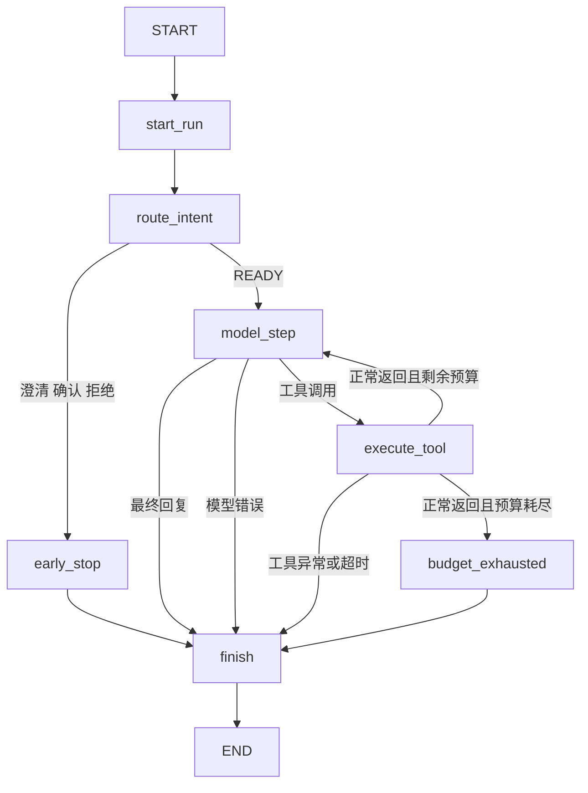

# LangGraph 编排改造设计

状态：待审阅。日期：2026-10-20。

## 目标和范围

将 MinimalAgent 内部的分支和手写工具循环迁移到 LangGraph StateGraph，使执行阶段与转移关系显式化。保留当前调用方可见的业务行为、结果类型和独立证据通道。

用户已确定使用 LangGraph 编排，并指出默认工具未注册导致能力快照缺少工具定义。第一阶段包含编排迁移及工具装配、导出配置的统一。新增真实业务后端、跨轮状态、确认后恢复、持久化 checkpoint、自动重试和并行工具属于后续独立功能，不因引入框架而宣称支持。

当前工作区已有独立 Trace 通道等未提交改动，实施时以当前工作区为基线，不恢复到旧提交或覆盖已有改动。

## 完整交付范围与验收口径

用户要求交付各层 JSONL 用例集、能力—案例覆盖矩阵、校验报告、人工审核清单和能力契约缺口清单。LangGraph 迁移和 QueryUser 首个闭环只是实施步骤，不能作为整体交付完成的依据。

能力清单必须包含以下 17 个目标，并追踪各自的 requirement、边界、分支及证据要求：

| 类型 | 数量 | 快照 ID |
| --- | --- | --- |
| Module | 7 | module.agent_orchestrator、module.model_gateway、module.intent_router、module.tool_loop、module.tool_registry、module.execution_guard、module.observability |
| Intent | 7 | intent.query_information、intent.prepare_resource、intent.query_user、intent.query_gift、intent.add_backpack_gift、intent.query_pool、intent.unsupported |
| Critical Chain | 2 | chain.understanding_to_planning、chain.planning_to_result |
| End-to-end Chain | 1 | chain.end_to_end |

五个 Scope 为 understanding、context、planning_execution、safety_recovery、result，是组织覆盖的维度，不能与七个 Module 等同，也不能把 17 个目标解释为只需 17 条案例。用例数量由契约内可判定的规则和分支决定，不预设没有依据的数量。

### 五类交付物

下列为交付目录的逻辑布局；文件名可按 Builder 既有规范落地，语义和可追溯要求必须保留：

```text
<delivery>/
  datasets/
    understanding.jsonl
    context.jsonl
    planning_execution.jsonl
    safety_recovery.jsonl
    result.jsonl
    critical_chains.jsonl
    end_to_end.jsonl
  coverage_matrix.json
  validation_report.json
  human_review_checklist.md
  capability_contract_gaps.json
  manifest.json
  capability_bundles/<sha256>/
```

| 交付物 | 必需内容 | 责任边界 |
| --- | --- | --- |
| 各层 JSONL 用例集 | 每条案例的执行输入、判定依据、目标边界、所需证据；按 Evaluator 实际接受的 Schema 编译 | Builder 生产，Evaluator 验证与执行 |
| 能力—案例覆盖矩阵 | snapshot_id、requirement／规则或分支、scope、case_ids、能力支持状态、可执行状态、证据来源、缺口引用 | Builder 汇总，结合执行结果补充 |
| 校验报告 | 文件与 Schema 校验、Hash／引用完整性、契约、覆盖、重复、泄漏、证据预检、Evaluator 兼容检查；已运行时关联执行结果 | Builder 与 Evaluator 各自产出事实 |
| 人工审核清单 | 每条案例及预期结果的依据、待核对风险、审核状态、审核人和批准记录 | 自动生成清单，人工完成审核 |
| 能力契约缺口清单 | gap_id、受影响目标、缺失字段／handler／入口／证据、阻塞案例与链路、负责组件、修复要求 | Agent 提供能力事实，Builder／Evaluator 汇总消费缺口 |

Manifest 绑定能力包、工具配置、数据集文件、规则版本及交付物 Hash。生产、评测适配器、测试 fixture 配置分别标识；不能将不同配置下的案例合并成一个未注明配置的覆盖结论。

### 覆盖和阻塞如何表达

能力支持状态继续使用 supported／unsupported／unknown；另设可执行状态和审核状态，避免把“案例存在”“已验证”“已执行”“已通过”混成一个字段。

1. 每个目标必须在矩阵中出现，即使暂无可执行案例。
2. 对已支持且可执行的 requirement，必须有对应案例与可检查的证据；不能只按模块名挂一个通用成功案例。
3. 对契约明确规定的拒绝、澄清、未注册工具等边界，可编写验证该边界的负向案例，但这些案例不计作缺失正向能力的覆盖。
4. 未实现的上下文、确认恢复、缺失 handler 或不可观察的行为写入缺口清单，并关联矩阵中的阻塞项。不能伪造预期成功输出。
5. 某层暂无合法可执行案例时，可交付空 JSONL 作为清单占位，但 Manifest、矩阵和校验报告必须明确该层 blocked／未覆盖；该文件不得提交为可运行的冻结评测集，也不能宣称该层已交付完成。
6. 七个逻辑 Module 未必都有独立公共入口。能通过公开运行边界观测的，使用映射明确的链路案例；确需模块独立执行却没有入口的，记录入口缺口，不能直接冒用 intent-only 入口。
7. 人工审核清单初始为待审核；未经实际人工批准，不生成“已审核”结论或升级为已批准的冻结集。

交付分为“产物清单齐全”和“全部目标可执行覆盖完成”两个判定。只要还有阻塞的必需覆盖项，最终报告必须说明部分交付与剩余缺口，不能把完整缺口报告当作全部能力验收通过。

### 实施顺序

1. 固定当前能力清单和行为基线，先生成契约／工具／入口／证据缺口清单。
2. 实施 LangGraph 编排和统一工具装配，输出可验证的新能力包。
3. 依照实际契约补齐可执行绑定和必要的评测入口；尚需业务定义的部分保留明确阻塞，不能猜测。
4. 在 Builder 生成各层案例、覆盖矩阵、校验报告和待审核清单，复用其既有生命周期。
5. 用 Evaluator 验证并运行可执行部分，回填证据与结果；人工审核完成后按冻结流程交付批准产物。

本次工作可以涉及相邻 Builder／Evaluator 的接入和交付流程，但应保持三者职责边界：不得把 Oracle、评分或 fixture 数据写入 mini_agent 运行时。新增业务后端或跨轮恢复若成为覆盖阻塞，应明确扩展其设计和验收条件后实施。

## 方案选择

| 方案 | 收益 | 代价与判断 |
| --- | --- | --- |
| 显式 StateGraph 接管意图分支和工具循环 | 保留正式契约，可直接控制边界、步数与事件 | 推荐；需要拆分运行状态与节点实现 |
| 使用 LangChain create_agent | 快速获得通用 Agent 循环 | 与现有 ModelClient、ToolRegistry、状态协议重叠，迁移映射更多 |
| 同时引入 checkpoint 和跨轮恢复 | 立即扩展会话能力 | 改变确认、清理和隔离语义，需扩展 Builder／Evaluator 协议，不纳入本阶段 |

采用第一种方案。不能仅把原有整个循环装进一个 LangGraph 节点；工具循环本身必须由图的条件边驱动。

## 组件结构

- `runtime/agent.py`：保留 MinimalAgent 公共门面，负责参数检查、创建每次调用的 Trace 和运行上下文、调用编排图、输出既有结果。
- `runtime/graph.py`：定义状态、图节点、条件路由与编译入口。若节点实现过长，拆为职责明确的内部模块。
- `runtime/intent_router.py`：保留模型候选解析与 IntentRegistry 校验。
- `runtime/tool_registry.py`：保留工具授权、参数校验及 handler 调用。
- `runtime/trace.py`：保留业务事件规则，继续调用 agent_trace_sdk。
- `versions.py` 与 CapabilityAdapter：记录编排实现版本和实际 LangGraph 依赖版本。

使用 StateGraph 与现有模型适配器，不引入 LangChain 的高层 create_agent 或通用 ToolNode 替换现有工具契约。

## 工具定义、注册与快照完整性

当前缺口有两层：

1. 能力 CLI 的 `_default_adapter()` 固定构造空 ToolRegistry；重复执行默认导出不会产生工具快照。
2. 生产源码仅有 QueryUser 的专用评测 ToolContract／适配器。QueryGift、AddGiftToBackpack、QueryPool 有参数模型，但参数模型并不包含完整结果协议、执行行为和 handler。Evaluator 另有其自有 Gift fixture 契约，不能直接当作生产工具实现。

采用统一装配入口，显式接收工具契约、外部 handler 绑定和运行配置，产生同源的 IntentRegistry 与 ToolRegistry。Agent 创建和能力导出都使用这一入口；导出 CLI 增加受信任的显式配置／factory 选择能力，不从不可信 Bundle 动态导入代码。默认空配置仍用于意图独立评测，但命令输出必须明确提示 tool_count=0。

定义与可执行性分别管理：

- 工具契约目录负责维护名称、版本、参数、结果码、安全与业务语义，可报告哪些声明仍缺少实现。
- Runtime Registry 只注册已绑定 handler 的 ToolDefinition。
- Snapshot 3.0 的 ToolSnapshot 要求 registered=true，因此只导出实际注册工具；不能把纯定义填成“已注册”，也不能用永远返回空结果的占位 handler 冒充业务实现。
- 若需将未绑定工具定义交付 Builder，必须另行设计声明协议并修改 Builder 解析，不能将新含义悄悄塞进现有 3.0 ToolSnapshot。本阶段不采用该协议扩展。

装配时核对 6 个业务 Intent 的 required_tool_name：query_information、prepare_resource、query_user_info、query_gift_info、add_gift_to_backpack、query_pool_config。输出已定义、已绑定、缺失契约、缺失 handler 的清单。选择完整工具配置时，存在缺口就拒绝按“完整包”导出；允许明确命名的部分配置导出，并报告覆盖范围。

评测 handler 和 fixture 继续由 Evaluator 或接入方提供，使用 evaluation_adapter／test_fixture 标识；生产绑定单独使用 production 标识。正式结果协议尚缺失时必须先明确契约，不能仅从 Intent 参数推导成功返回结构、幂等规则或写入效果。

首个可验证闭环使用已有 QueryUser adapter 和调用方提供的确定性 handler：显式注册 → 同源导出 → 验证 tools/query_user_info.json 及 Intent 引用 → 运行工具链 → 读取结果和 Trace。这证明统一装配有效，不代表其余五种工具已经实现。

工具齐全也不自动证明所有链路可执行。特别是 AddGiftToBackpack 当前停在 NEED_CONFIRMATION，Context 当前不支持；解析和交付报告不能仅按注册数量把这些业务能力标记为完成。

新增验收项：

- 配置中的工具集合与导出的 tool_refs 和运行时 Registry 一致；
- 缺少契约／handler 的完整配置给出可定位的错误；
- 默认零工具导出给出明确提示；
- QueryUser 显式配置能生成非空 ToolSnapshot，成功通过绑定与执行测试；
- 评测工具与生产工具的实现类别可辨识；
- 未完成确认恢复和上下文支持时，报告继续明确这些边界。

## 完整运行图



节点职责：

1. `start_run`：生成与当前实现一致的 run_started 和 intent_requested 事件。
2. `route_intent`：调用现有 IntentRouter，记录既有契约事件，不额外调用模型。
3. `early_stop`：记录 clarification_returned、confirmation_required 或 request_rejected，设置对应终态与响应。
4. `model_step`：增加业务步骤计数，构造既有 ToolLoopRequest，校验 function_call／message，处理现有模型异常语义。
5. `execute_tool`：一次 Registry 调用，记录 ToolCallRecord 和既有工具事件，返回新的累计结果。
6. `budget_exhausted`：设置 MAX_STEPS_EXCEEDED 并记录对应事件。
7. `finish`：只记录一次 run_finished，构造 AgentResult。

意图识别阶段的异常继续向调用方抛出；不伪造 IntentResult。工具循环中的模型异常和工具异常继续转换为既有 FAILED 结果。

## 意图独立入口

`MinimalAgent.run_intent_only()` 使用独立的短图：START → route_intent → END。它复用意图校验实现，但保持独立入口的事件语义，不新增 run_started／run_finished，不允许到达模型工具步骤或工具执行节点。

模块级 `run_intent_only(user_input, model_client)` 可保留现有 IntentRouter 快捷路径，因为它没有需要编排的分支或循环。两条入口均使用同一正式意图契约。

## 状态和隔离

使用明确的内部状态类型，包含：

- 输入 user_input；
- intent_result；
- step、当前 model_step；
- tool_calls、tool_outputs；
- terminal_status、final_response、最终 result。

ModelClient、ToolRegistry、TraceCollector、allow-list 和 max_steps 通过调用上下文传入；不作为持久化业务状态。图编译后可复用，但每次 invoke 必须使用新的状态和调用上下文。

累计工具记录采用节点返回新列表的方式更新，不依赖共享列表原地 append。无默认跨轮 state、无 checkpointer、无节点缓存、无重试策略。顺序重复调用不得继承上次的参数、工具结果或终态。

既有 `_last_intent_trace` 的“最近一次调用”行为保留；本阶段不承诺同一 Agent 实例可并发复用。Evaluator 继续为 Trial 创建独立运行环境。

## 步数和终态

max_steps 仍表示工具循环中模型请求次数，最终 message 占一步，意图识别不占该预算。不能用 LangGraph recursion_limit 替代业务步数。

图引擎的 recursion_limit 根据最终节点拓扑计算为足够覆盖最大合法业务路径的上界，并保留收尾余量；长循环测试需超过框架默认限制，证明不会提前抛 GraphRecursionError。

max_steps=1 时：

- 模型直接回复：SUCCESS；
- 模型调用工具且工具正常返回：执行该工具后 MAX_STEPS_EXCEEDED；
- 工具异常：FAILED，而非 MAX_STEPS_EXCEEDED。

意外图引擎异常向外抛出，不笼统冒充业务步数耗尽。

ToolResult.success=false 但 handler 正常返回时，仍保持当前“调用 SUCCESS、结果交回模型”的行为。本阶段不改变业务成功判定。

## 对外兼容

保留 MinimalAgent 构造参数、run／run_intent_only 参数、IntentResult、AgentResult、ToolCallRecord、ToolResult、ModelClient 和 ToolRegistry 公共协议。

Builder 仍读取 Snapshot 3.0；Evaluator 仍调用公共 Python 接口。二者不直接依赖 LangGraph State、节点名称或内部回调。

业务事件名称、payload、顺序及 trace_id／run_id 关联保持现有语义。框架内部调试事件不直接进入正式证据通道。Sink 生命周期继续由调用方管理。

不默认配置 LangSmith 上传；agent_trace_sdk 继续作为本项目的正式过程证据接口。

## 能力快照和版本

引入独立编排版本标识，并记录安装的 LangGraph 版本。同步更新相关模块事实，避免执行引擎发生变化但导出仍无法追溯。

Snapshot 格式仍为 3.0，公共结果 Schema 本阶段不因图引擎改变。Context、确认恢复、自动重试等支持声明不升级。

新导出写入独立目录，例如 `exports/langgraph_v1/`。保留 capabilities/ 与 exports/trace_v1 中已冻结的历史包，不能为使测试通过而覆盖历史制品。

现有“新导出逐字节等于历史 capabilities/”测试应改为分别验证：

1. 历史快照按其自身 Hash 可完整加载；
2. 相同当前配置的重复导出确定一致；
3. 当前导出声明新的编排版本，解析仍符合实际能力。

实施前先运行测试基线，区分当前工作区已有问题与迁移引入的问题。

## 依赖和验收

增加兼容 Python 3.11 的 LangGraph 依赖，实施时确认实际安装版本与 API，限定在验证过的主版本范围内。不能因为框架可配置而默认开启 retry、checkpoint 或并行。

必须验证以下可观察行为：

- 意图独立入口不会调用工具；
- 澄清、确认和拒绝分支不进入工具循环；
- 多次工具调用按顺序将结果反馈给模型；
- 无工具直接回复；
- allow-list、未知工具、非法参数、非法返回值；
- 模型非法输出、模型异常、工具异常和 TimeoutError；
- max_steps 边界与较长循环；
- 同实例顺序调用无状态残留；
- 业务失败结果仍维持原有语义；
- 业务事件顺序、终止事件唯一性、Sink 故障不改变业务行为；
- 能力快照可重复导出、版本可追溯、历史包不被覆盖；
- 现有公共 API、CLI、Schema 和 Snapshot 测试回归。

使用确定性测试客户端验证编排，不依赖付费网络模型。完成后运行本仓库测试与 lint；Evaluator 的接入验证使用其实际可用入口，单独报告是否完成跨仓库验证。

## 官方依据

StateGraph 以 State、Node、Edge 描述循环工作流，适合保留现有业务组件并替换执行编排：[Graph API](https://docs.langchain.com/oss/python/langgraph/graph-api)。

图的递归限制约束引擎执行步骤，需与业务模型调用预算分别处理：[GRAPH_RECURSION_LIMIT](https://docs.langchain.com/oss/python/langgraph/errors/GRAPH_RECURSION_LIMIT)。
