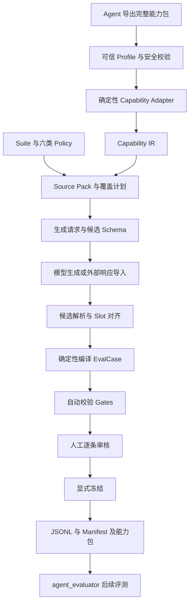

# Agent Dataset Builder：框架、架构、实现与能力总结

整理日期：2026-10-13。本文依据当前工作区代码和配置，包含尚未提交的改动；介绍实际实现，并单独标明扩展方向。

## 1. 项目定位

Agent Dataset Builder 是一个**根据 Agent 公开能力契约，生产可校验、可追溯、经人工审核后冻结的评测数据集的 Python 框架**。

它把评测集生产拆成三类工作：代码负责协议、结构和一致性；生成模型负责自然语言案例候选；人工负责语义正确性和最终批准。这样既能利用模型生成不同表达，又能控制评测范围、执行配置与发布过程。

输入是 Agent 导出的能力包、评测 Suite、Policy 和覆盖计划。输出是 evaluator 可加载的 JSONL、配套 Manifest、覆盖报告和冻结能力包。

目前最完整的应用是 `mini_agent` 的意图理解评测：检查输入是否被正确识别为指定意图，参数提取是否正确，以及应该调用工具、追问还是请求确认。项目本身不运行被测 Agent，也不计算其实际任务得分。

## 2. 在整体系统中的位置

三个项目通过文件协议和 Python 数据模型协作：

| 项目／角色 | 负责什么 | 交给下一环节什么 |
|---|---|---|
| Agent，例如 `mini_agent` | 实现业务能力，导出能力契约 | 完整 Capability Bundle |
| 本项目 `agent_dataset_builder` | 编制、校验、审核和冻结评测集 | JSONL、Manifest、Coverage、冻结 Bundle |
| `agent_evaluator` | 定义 EvalCase、校验数据集，并负责后续评测运行 | 数据集校验结果及其自身评测流程的产物 |

Builder 依赖 `agent-evaluator` Python 包，复用其 `EvalCase`、`load_dataset` 和 `validate_dataset`。它不需要 import `mini_agent`，但内置 Suite 仍通过目录路径读取相邻 mini_agent 项目导出的能力包。

“不依赖 Agent 实现代码”与“当前示例需要外部能力包文件”是同时成立的。

## 3. 总体架构



可以按五层理解：

| 层 | 主要职责 | 关键模块 |
|---|---|---|
| 能力接入层 | 验证来源、协议和引用图，解析支持状态 | `capability_profiles`、`capability_bundle`、`capability_adapters` |
| 评测配置层 | 定义测什么、多少条、如何编译和校验 | `suite_config`、`suite_definition`、`policies` |
| 生成编译层 | 组织模型输入，接收候选，装配 EvalCase | `source_pack`、`prompt_builder`、`generation_client`、`candidate_parser`、`intent_compiler` |
| 质量发布层 | 校验草案、生成审核清单、冻结版本 | `validation`、`coverage`、`leakage`、`freezing` |
| 流程支撑层 | CLI、阶段输入绑定、日志及插件接口 | `cli`、`pipeline`、`orchestration`、`plugins` |

## 4. 技术栈与工程形态

当前包版本为 `0.1.0`，要求 Python 3.11+，使用 setuptools 打包，源码位于 `src/dataset_builder/`。

| 技术 | 用途 |
|---|---|
| Pydantic 2 | 配置、候选、IR、请求和批准数据模型；动态生成候选 Schema |
| JSON Schema / jsonschema | 能力快照及参数结构校验 |
| OpenAI Python SDK | 可选的 Responses API 候选生成客户端 |
| SHA-256 + 规范化 JSON | 绑定能力、配置、来源、草案与产物 |
| pathlib / dataclass | 路径处理、阶段记录和不可变数据容器 |
| pytest / Ruff | 自动化测试和静态检查 |

这是本地文件驱动的库与 CLI。当前没有 Web UI、HTTP 服务、数据库、任务队列或分布式调度服务；JSON、JSONL 和 Markdown 承担配置、交换、记录与审核功能。

## 5. 核心概念

| 概念 | 含义 | 为什么存在 |
|---|---|---|
| Capability Bundle | 以 `agent.json` 为根的完整能力快照目录 | 固定本次评测依据的能力事实 |
| Trusted Profile | Builder 信任的协议定义和 Schema Hash | 防止输入方自行放宽协议 |
| Capability IR | 原始能力快照转成的内部统一表达 | 让后续生成与编译不依赖 Agent 特定字段结构 |
| Suite | 一组评测任务的装配配置 | 绑定目标、能力子图、版本、路径和策略 |
| Policy | Source、Coverage、Generation、Validation、Review、Freeze 六类规则 | 将可变规则从公共代码中移出 |
| Coverage Slot | 一条预先定义的覆盖位置 | 要求每个测试点恰好生成一条候选 |
| Candidate | 模型产生的语义候选 | 限制模型可控制的字段范围 |
| EvalCase | evaluator 认可的完整评测案例 | 将用户输入、执行设置与预期答案明确分离 |
| Workspace | 一次生成任务的工作目录 | 保存来源、响应、草案、审核与阶段记录 |
| Manifest | 生成或冻结产物的元信息 | 说明产物由哪些输入、版本和批准产生 |

其中最重要的分工是：**IR 描述能力事实，Suite 和 Policy 描述评测组织方式，Candidate 描述具体测试表达，Compiler 把它们组装成 EvalCase。**

## 6. 关键实现

### 6.1 能力包先验证，再使用

`load_trusted_profile` 从本地信任表加载固定的 `capability-snapshot / 3.0` Profile；`verify_bundle_schemas` 核对能力包提供的 Schema 文件字节 Hash。

`load_validated_bundle` 加载包内快照，检查 JSON Schema、单快照 Hash、ID 唯一性、引用目标与版本一致性、引用无环、根节点可达性以及 Bundle Hash。Suite 还会检查实际 Bundle Hash 是否与配置绑定相同。

因此，一个结构损坏、引用缺失或 Hash 不匹配的包会被拒绝，而不是被当作“暂时未知的能力”继续生成。

### 6.2 Adapter 将能力图变成 IR

Suite 选择一个 Scope／Chain、一个 Intent，以及可选 Tool。Adapter 沿引用得到相关快照闭包，解析必需条件、能力声明和 Evidence 可用性，生成稳定排序的 IR。

IR 保留参数 Schema、决策规则、参数语义、语义规则、来源快照绑定和支持状态。状态包括 `supported`、`unsupported`、`unknown`；必需条件中不支持优先于未知，未知优先于支持。

这里判断的是快照声明能否满足所选评测范围，不是现场执行 Agent 证明它一定成功。当前编译器仅接受整体 `supported` 的 IR。

### 6.3 规则主要配置化

`load_suite` 发现 `suites/*/suite.json`，加载路径、Policy、覆盖计划和候选协议。六类 Policy 使用独立模型约束，路径和类型错误直接拒绝。

Generation Policy 决定允许意图、状态、动作、场景、难度、编号方式、标签和断言；Validation Policy 决定参数、缺参、状态和质量规则；Coverage Policy 决定哪些分布需要精确匹配。

Policy 不能关闭内核要求的 Hash 绑定、逐条审核和冻结禁止覆盖。配置化发生在固定生产边界内。

### 6.4 给模型的输入经过组织

`build_source_pack` 组合 IR 和 Suite 显式声明的来源文件；`build_prompt` 加入动态候选 JSON Schema 及输出限制。

三个专用 v2 Suite 使用 `generation.json + coverage_plan.json` 作为补充来源；通用意图 v2 Suite 使用 `generation_policy.md + coverage_plan.json`。seed catalog 主要供离线脚本和测试提供候选，不会自动作为标准答案传给在线生成模型。

生成请求还绑定 Prompt、来源、协议、Adapter、IR、Suite、Policy 和覆盖计划等元信息，供后续追溯。

### 6.5 三种候选来源

| 方式 | 实现 | 使用场景 |
|---|---|---|
| 在线生成 | `OpenAIResponsesGenerationClient` | 显式配置模型和 API Key 后生成新候选 |
| 外部导入 | `ingest_response` | 在其他环境生成 JSON 后导入 |
| 脚本响应 | `ScriptedGenerationClient` | 离线测试、固定样例和可复现流程验证 |

在线客户端读取 `OPENAI_API_KEY` 与 `DATASET_GENERATOR_MODEL`，请求严格 JSON Schema 输出；默认超时 60 秒、最多尝试 2 次。这里的重试是请求异常重试，不包含根据校验报告自动改写案例的闭环。

### 6.6 模型写语义，代码写执行结构

候选包含用户输入、预期意图／状态／动作、JSON 字符串形式的参数、缺参、场景、难度、标签，以及按 Policy 要求提供的规则引用。

解析器要求每个 Slot 恰好出现一次，意图和状态与 Plan 对齐，并拒绝额外字段、解释文字和需要修复的 JSON。

编译器按照 Plan 顺序生成 case_id，装配任务标识、执行 Profile、工具许可、故障注入、超时、cleanup、固定 reason 和断言。案例再经过 evaluator 的 `EvalCase` 模型校验。

编译是确定性的，但 Oracle 的语义内容仍主要来自候选。模型写错语义时，编译器不会天然知道正确答案，因此需要后续契约检查与人工审核。

### 6.7 七类自动校验

| Gate | 解决的问题 |
|---|---|
| evaluator | 文件能否被评测框架加载，案例结构与数量是否合法 |
| capability_snapshot | 生成时能力绑定是否与当前能力和请求一致 |
| contract | 参数类型、缺参词表、状态动作、Slot 与规则标签是否合法 |
| coverage | 条数和意图／状态／场景分布是否满足覆盖计划 |
| duplicate | 是否存在重复 case_id 或完全重复输入；报告规范化近重复 |
| leakage | 执行输入是否混入答案、评分或 Oracle 提示 |
| quality | 是否违反最短长度、敏感短语和配置的复合意图规则 |

自动校验调用 evaluator 的数据集验证，不会执行被测 Agent。自然语言含义、规则适用和答案唯一性仍由人工复核。

### 6.8 审核与冻结形成交付边界

`build_review` 生成中文逐条审核清单。`approval_from_review` 检查草案 Hash 与勾选案例集合，构造包含 reviewer 和审核文件 Hash 的 Approval。

`freeze_dataset` 重新验证草案；`freeze` 核对批准、能力包、IR 和执行 Profile，并拒绝覆盖任何已有目标数据集或配套文件。输出包含可移植能力包，便于后续评测不再依赖原导出目录。

这里的不可变主要通过 Hash 和禁止覆盖实现，不是文件系统只读权限、数字签名或身份认证系统。

### 6.9 阶段账本与插件基础设施

`PipelineEngine` 在执行阶段前绑定输入和 Policy 指纹，在结束后记录成功／失败、结果 Hash 和异常到 `stage_ledger.jsonl`。同一账本不允许重复记录相同 `stage_id`，包括已有失败记录的阶段。

`StageLedger.assert_reusable` 可以检查已有成功记录与输入是否一致，但主流水线没有自动缓存恢复、断点续跑或失败阶段重试机制。修改输入重新生成时，使用新的工作区更符合现有行为。

`plugins.py` 定义九类角色及 `role + protocol + version` 注册键，并提供实现 Hash 检查。当前 Capability Adapter 实际通过注册表解析；多数主流程仍直接调用内置函数，阶段中的 PluginKey 主要用于标识和追溯。不能把九类接口已经定义理解为九类实现都能通过配置自由替换。

## 7. 当前已经具备的能力

| 能力 | 当前状态 |
|---|---|
| 完整 v3 能力包校验 | 已实现 |
| 确定性 IR 转换与支持状态解析 | 已实现 |
| Suite 与六类 JSON Policy | 已实现 |
| 动态候选 Schema 与严格解析 | 已实现 |
| 预设 Coverage Slot 全量匹配 | 已实现 |
| 模型生成、外部导入、脚本候选 | 已实现 |
| 意图理解案例编译与七类 Gate | 已实现 |
| 逐条审核、Hash 绑定批准、显式冻结 | 已实现 |
| 可移植冻结能力包和来源追溯 | 已实现 |
| 同协议下复用其他 Agent | 有合成第二 Agent 测试；仍需符合现有协议与编译结构 |
| 任意协议、任意评测层的通用生成 | 尚未实现 |

当前四个 v2 Suite 均配置目标数据集版本 `2.1`：

| Suite | 条数 | 主要评测内容 |
|---|---:|---|
| `mini_agent_query_user_intent_v2` | 42 | 用户查询字段、格式、歧义、AND、纠正和批量边界 |
| `mini_agent_query_gift_intent_v2` | 23 | 礼物查询模式、参数提取、边界与追问 |
| `mini_agent_add_backpack_gift_intent_v2` | 28 | 用户／礼物选择模式、数量、期限、环境和写入确认 |
| `mini_agent_intent_v2` | 15 | 多意图理解回归与不同决策状态 |

合计 108 个配置中的 Slot，不代表 108 个互不重叠的业务能力，也不代表这些数据已经全部获得人工批准并正式冻结。v1 Suite 保留旧能力绑定，用于历史复现。

## 8. 当前边界与不足

| 边界 | 实际影响 |
|---|---|
| 编译器主要面向 module intent | 虽然元数据允许 critical_path／end_to_end，但没有对应通用 Oracle 编译流程 |
| `semantic_rules` 没有完整通用解释器 | AND/OR、纠正关系、模式互斥等不能只靠 Schema 保证 |
| Coverage Plan 仍是预设文件 | 尚未从能力图自动推导覆盖空间、配额或测试组合 |
| 记录的 Hash 比实际 STALE 检查范围更广 | Suite、Policy、Prompt、来源文件等变更并非全部会被重新计算并触发 STALE |
| 质量与泄漏检查主要为规则匹配 | 不能全面识别语义重复、隐私内容、提示注入或自然语言歧义 |
| IR 只保留 Boundary ID 等部分信息 | 尚未把全部 Boundary 正文转成可执行约束 |
| StageLedger 不是任务调度器 | 不支持同工作区自动重跑、并行任务调度或恢复缓存结果 |
| 插件接口未全面接入主流程 | 替换编译器、覆盖规划器等仍需要开发接线 |
| 冻结包含多个文件写入 | 尚无覆盖所有最终产物的统一原子事务；中途失败可能需要处理部分产物 |
| 人工批准依赖文件与 reviewer 字符串 | 具备审核绑定，但不具备组织账号权限或签名认证 |

此外，CLI `validate` 默认将结果打印到标准输出；API `validate_draft(..., workspace=...)` 才会落盘各报告并更新生成 Manifest。没有独立 `approve` CLI 命令，Approval 在 freeze 流程中构造。

## 9. 目录与阅读顺序

```text
agent_dataset_builder/
├── src/dataset_builder/      核心 Python 实现
├── protocol_profiles/       可信协议及信任表
├── schemas/                 配置、Policy、IR 等机器 Schema
├── policies/common/         共用 Source、Review、Freeze Policy
├── suites/                  各 Suite、覆盖计划、生成与校验配置
├── workspaces/              各次生成的中间产物
├── scripts/                 离线再生成、历史配置迁移脚本
├── tests/                   协议、编译、校验、生命周期等测试
├── README.md                项目入口与基本命令
├── AGENT_DATASET_CONSTRAINTS.md 生产约束细则
└── PROJECT_OVERVIEW.md       本文
```

建议阅读顺序：先看一个专用 Suite 的 `suite.json` 和 `coverage_plan.json`，理解“要测什么”；再看 `pipeline.py`，理解整体流程；随后看 `capability_bundle.py` 和 `capability_adapters.py`，理解能力来源；最后看 `intent_compiler.py`、`validation.py` 和 `freezing.py`，理解如何形成可交付评测集。

## 10. 一次典型使用流程

从仓库根目录执行，先准备请求，再导入外部模型生成的严格 JSON：

```bash
.venv/bin/python -m dataset_builder.cli prepare \
  --suite mini_agent_query_user_intent_v2 \
  --workspace workspaces/query_user_new_run

.venv/bin/python -m dataset_builder.cli ingest \
  --request workspaces/query_user_new_run/generation_request.json \
  --response response.json \
  --workspace workspaces/query_user_new_run

.venv/bin/python -m dataset_builder.cli validate \
  --suite mini_agent_query_user_intent_v2 \
  --draft workspaces/query_user_new_run/draft.jsonl

.venv/bin/python -m dataset_builder.cli review \
  --suite mini_agent_query_user_intent_v2 \
  --draft workspaces/query_user_new_run/draft.jsonl \
  --output workspaces/query_user_new_run/review.md
```

需要在线生成时，可用 `generate --request ... --workspace ...` 替代 ingest，前提是显式配置模型和 API Key。`generate` 与 `ingest` 都会在 CLI 内继续编译。

人工审核每条案例并勾选后，再调用 `freeze --suite ... --draft ... --reviewer ... --review-file ... --output ...`。输出文件必须不存在；不能用修改旧文件的方式更新正式数据集。

## 11. 如何扩展

新增同类意图评测时，优先新增或调整 Suite、覆盖计划及 Generation／Validation Policy。如果能力包已表达所需事实，且 Oracle 仍是现有意图结果结构，通常可以复用编译与校验主流程。

接入另一个 Agent 时，先让它导出符合当前可信 v3 协议的完整能力包，再为其建立 Suite。现有跨 Agent 测试使用合成的 `echo_agent` 验证同一流水线可复用；它验证的是同协议场景，不代表任意厂商协议已经兼容。

新增关键链路或端到端评测时，需要补充对应 Candidate 与 Compiler，生成工具轨迹、最终响应或状态目标等 Oracle，并提供对应校验和审核展示。仅把 `test_scope` 改成 `end_to_end` 不足以完成支持。

新增协议时，需要扩展可信 Profile、Schema 和 Adapter，并调整当前固定协议选择逻辑。这属于框架开发，不是 Suite 级配置变更。

## 12. 后续建设优先级建议

以下为基于现有实现的建议，不是已完成功能：

1. **先补齐绑定漂移检查。** 对当前 Suite、Policy、Coverage Plan、Prompt 和来源逐项重算并比较，确保规则变化后旧批准无法继续使用。
2. **把高价值语义规则转为可执行检查。** 优先覆盖查询模式互斥、批量边界、写入确认等容易生成错误 Oracle 的规则。
3. **完善生成任务的恢复与发布。** 明确失败重试、工作区版本、报告落盘与多文件冻结事务。
4. **再扩展评测层与插件调度。** 为链路／端到端引入独立编译器，并让角色接口真正接入主流程。
5. **最后增加自动覆盖规划与更深质量检测。** 在可信边界和语义正确性可靠后，再扩大自动生成规模。

## 13. 本次验证结果

2026-10-13 在当前本地环境执行：

```bash
.venv/bin/python -m pytest -q -m 'not dataset_generation_smoke'
```

结果为 **173 passed，耗时 15.43 秒**。测试覆盖能力包与可信 Profile、IR、候选协议、配置驱动编译和校验、Policy、生命周期、追溯与过期检查、阶段编排、插件注册及同协议跨 Agent 场景。

该结果说明当前测试覆盖的代码行为通过，不代表在线模型生成质量、真实 Agent 任务成功率或全部业务语义已获验证。本次没有发起付费模型生成、执行被测 Agent 或批准冻结数据集。

详细生产约束见同目录 `AGENT_DATASET_CONSTRAINTS.md`。本文侧重项目全貌，约束文档侧重每一步必须满足什么条件。
