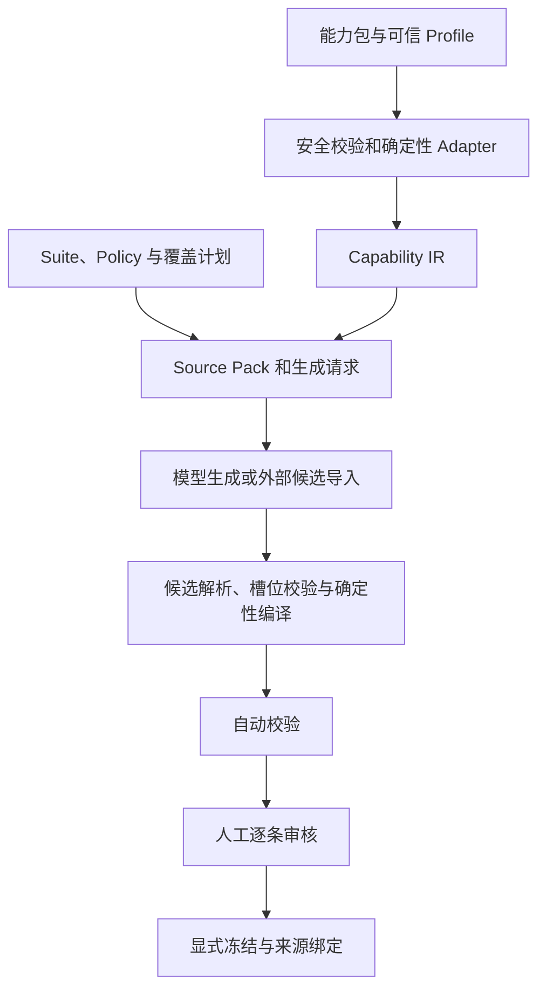

# Agent Dataset Builder 架构与扩展边界

本包根据 Agent 的公开能力契约，生产可校验、可追溯、经人工审核后冻结的评测数据集。安装、命令和支持的 Suite 见 [README](README.md)，逐阶段的强制约束见[生成约束](AGENT_DATASET_CONSTRAINTS.md)。本文说明现有职责分工，不作为新任务基准的数据集规范。

## 输入、输出与依赖

Agent 交付完整 Capability Bundle；Builder 结合 Suite、Policy 和覆盖计划，生成候选、EvalCase、Manifest、覆盖报告和冻结能力包。代码负责协议和一致性，生成模型负责语义候选，人工负责语义正确性与最终批准。Builder 不执行被测 Agent，也不根据其实际回答反推答案。

公共能力和评测结构由 [contracts](../contracts/) 包维护；`capability_snapshot_kit` 与 `eval_contracts` 的 Python 命名空间不变。Builder 只依赖共享契约，不需安装 evaluator、Inspect 或 mini_agent。生成用的 Capability IR 留在 Builder 内部。包内历史 Suite 的旧项目相对路径由兼容解析器映射到本仓库制品。

## 主流程与模块

| 层 | 关键模块 | 职责 |
| --- | --- | --- |
| 能力接入 | `capability_profiles`、`capability_bundle`、`capability_adapters` | 校验 Schema、Hash、引用和闭包；转换支持状态 |
| 评测组织 | `suite_config`、`suite_definition`、`policies` | 选择目标、数量、候选协议和编译规则 |
| 生成编译 | `source_pack`、`prompt_builder`、`generation_client`、`candidate_parser`、`intent_compiler` | 组织输入、限制候选权限并装配 EvalCase |
| 质量发布 | `validation`、`coverage`、`leakage`、`freezing` | 检查草稿、覆盖和来源，绑定人工批准并冻结 |
| 流程支撑 | `cli`、`pipeline`、`orchestration`、`plugins` | 命令入口、阶段输入绑定、日志与显式扩展 |

Suite 绑定能力子图和来源；Policy 管理 Source、Coverage、Generation、Validation、Review、Freeze 六类规则。它们不能关闭 Hash 绑定、逐条审核或禁止覆盖等内核约束。

## 能力事实与候选权限

可信 Profile 固定 Snapshot 3.0 的 Schema 与 Hash 语义。路径越界、Schema 损坏、引用不一致、环或摘要不匹配直接拒绝；不能把这些错误降级为 `unknown`。

Adapter 沿 Scope／Chain、Intent 和可选 Tool 的引用闭包产生 IR。必需条件中的 `unsupported` 优先于 `unknown`，`unknown` 优先于 `supported`。支持状态描述快照声明，不是实际运行成绩；当前意图编译器只接受整体 `supported` 的选择。

模型只生成候选 Schema 允许的用户表达和预期字段。Case ID、执行范围、Source Hash、断言框架和冻结信息由代码装配。候选还须匹配覆盖槽位、规则引用及已声明的接受条件；来源缺少 Oracle 映射时保留阻塞，不能复制旧种子或猜测预期。

## 生成方式与适用范围

- `ingest` 导入外部模型的严格 JSON；默认 `generate` 使用显式配置的 OpenAI 兼容客户端。
- 可选 DeepEval Synthesizer 面向带规则引用的单轮意图槽位，沿用相同的编译与发布约束，见[接入说明](docs/DEEPEVAL_SYNTHESIZER.md)。
- `generate-full` 为完整 mini_agent fixture 分开输出行为案例、静态检查和阻塞义务；包含该 fixture 的明确业务规则，不是任意 Agent 的通用语义编译器。
- `generate-nanobot` 使用独立 `nanobot_candidate` 协议，不能直接作为 EvalCase 执行；候选仍需运行适配与环境绑定。

2026-10-28 的 Direct／DeepEval 小样本生成实验见[实测记录](docs/GENERATOR_COMPARISON.md)。生成程序接受、AI 初审、人工批准、冻结与 Agent 执行通过是不同状态，不能相互替代。

## 生命周期与扩展

来源、Suite、Policy、覆盖计划、Prompt 或实现绑定变化后，应重新准备草稿和审核。当前 `capability_snapshot_gate` 检查能力及实现绑定，但没有逐项重算所有来源、策略和 Prompt；记录了 Hash 不等于已完整校验过期，具体缺口见[生成约束](AGENT_DATASET_CONSTRAINTS.md#11-需要明确保留的实现边界)。阶段账本保存输入身份；失败后重试应使用新工作区，不能覆盖原始证据。冻结要求自动校验通过、逐条人工批准、批准绑定当前草稿 Hash，且输出不存在。

新增同类意图优先通过 Suite、Policy 和覆盖计划实现；新输出结构或测试层级需要相应 Candidate、Compiler、校验和审核展示。仅修改 `test_scope` 不代表已经支持关键链路或端到端执行。

接入不同协议时，需要扩展可信 Profile、Schema 和 Adapter。Collector／Extractor 的模型抽取只能提供待核实事实，不能擅自提高能力支持状态。项目保持本地文件和 CLI 形态，不提供 Web 服务、分布式调度或自动人工审批。
