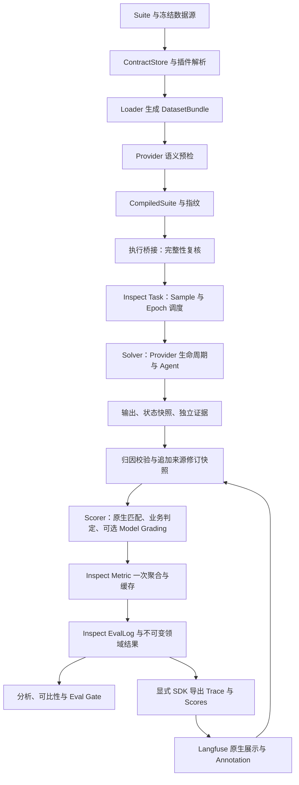

# Evaluator 架构与运行流程

2026-10-20 更新：Inspect 是唯一执行与正式判分底座；Evaluator 在其扩展点提供业务政策与适配；Langfuse Cloud 负责在线展示和人工标注。每项能力一个主要负责方，每个正式指标只计算一次，每类数据一个权威来源。总体决策见[技术方案](evaluator_technical_design.md)，接入细节见[Langfuse 说明](langfuse.md)。

本文描述截至 2026-10-20 当前工作区的实现结构，包括尚未提交的实现。它补充技术方案中的设计理由，不把目标架构当作已经完成的代码结构。能力范围见[能力清单](capabilities.md)，接口细节见[接入规范](integration_contracts.md)。

## 1. 核心设计

框架把“评测什么”“如何执行”“如何判定”分开：Suite 和冻结数据声明本次评测条件；Provider 执行 Agent 并返回观察；断言及 Judge 使用 Oracle 和证据判定结果。正式判分在 Inspect Scorer 内完成，完整 Case × Trial 到齐后由 Metric 阶段一次聚合并缓存。原始结果保存后，分析、比较、门禁、Langfuse 导出及复核导入生成派生产物。

当前源码主要位于 `src/eval_framework/`，并没有全部迁移为目标方案中的 kernel/plugins 分层目录。理解架构应以职责与实际调用关系为准。

## 2. 模块地图

| 职责 | 当前模块 | 关键边界 |
| --- | --- | --- |
| 命令与组装 | [cli.py](../src/eval_framework/cli.py)、[composition.py](../src/eval_framework/composition.py) | 显式注册可信实现，接收命令参数；仍保留历史兼容桥接 |
| 契约读取与编译 | [contracts/](../src/eval_framework/contracts/) | 校验根目录、Hash、严格模型、引用和语义预检，产出 CompiledSuite |
| 插件身份与解析 | [plugins/](../src/eval_framework/plugins/) | 精确匹配 kind/id/version，校验配置与实现指纹；当前执行选择主要覆盖 Loader/Provider |
| 数据规范化 | [dataset_loader.py](../src/eval_framework/dataset_loader.py)、[dataset_validator.py](../src/eval_framework/dataset_validator.py) | 外部数据转为 DatasetBundle / EvalCase，执行输入与 Oracle 分离 |
| 编译结果执行 | [compiled_execution.py](../src/eval_framework/compiled_execution.py) | 重验编译内容与 Provider 指纹，再创建 Provider 并调用既有 Runner |
| Trial 生命周期 | [runner.py](../src/eval_framework/runner.py) | 编排隔离运行、证据收尾、观测快照和清理；由 Inspect Solver 调用，未评分 Trial 交给 Scorer |
| 评测主引擎 | [inspect_engine.py](../src/eval_framework/inspect_engine.py)、[evaluation_policy.py](../src/eval_framework/evaluation_policy.py) | Inspect Task/Sample、Solver、Scorer、Epochs 与原生 EvalLog |
| Agent 接入 | [provider.py](../src/eval_framework/provider.py)、[providers/mini_agent/](../src/eval_framework/providers/mini_agent/) | 运行时构建、工具环境、异常映射和 Agent 特有规则 |
| 独立取证 | [agent_trace_sdk](../packages/agent_trace_sdk/)、[evidence.py](../src/eval_framework/evidence.py) | Inspect Transcript / EvalLog 采集与持久化；适配层校验业务字段、完整性和 Trial 关联 |
| 断言与评分 | [assertions.py](../src/eval_framework/assertions.py)、[turn_assertions.py](../src/eval_framework/turn_assertions.py)、[scoring.py](../src/eval_framework/scoring.py) | 确定性检查、逐轮匹配、权重及关键失败规则 |
| 语义和观察分析 | [judge.py](../src/eval_framework/judge.py)、[trace_analysis.py](../src/eval_framework/trace_analysis.py)、[diagnostics.py](../src/eval_framework/diagnostics.py) | Judge 评价声明维度；Trace 和诊断提供调查线索 |
| 正式指标扩展 | [inspect_metrics.py](../src/eval_framework/inspect_metrics.py)、[stability.py](../src/eval_framework/stability.py) | 在 Inspect Metric 中执行；保留业务分母、无效证据及稳定性语义，完成后缓存 |
| 审计输出 | [reporting.py](../src/eval_framework/reporting.py) | 只序列化已保存结论与指标；不重算通过率，不提供第二套交互看板 |
| Cloud 导出 | [observability.py](../src/eval_framework/observability.py) | 官方 SDK 导出不可变结果，检查点跳过已接收 observation，网络不确定先核对再恢复；不运行或判分 |
| 运行后决策 | [comparison.py](../src/eval_framework/comparison.py)、[gating.py](../src/eval_framework/gating.py)、[adjudication.py](../src/eval_framework/adjudication.py) | 可比性、发布策略、Langfuse 复核快照导入 |

## 3. 一次评测的数据流

这是职责层级的数据流；图中 Judge 是已有可选评分能力，不表示 Suite 的 Judge Profile 已完成迁移。

### 3.1 编译与预检

1. 加载严格的 SuiteDefinition，拒绝未知字段和越界路径。
2. 解析明确注册的 Loader/Provider 精确版本及配置。
3. 读取显式声明的数据源、Manifest 和能力契约，校验内容 Hash 及依赖引用。
4. Loader 把数据转为统一 DatasetBundle，校验 Case 与能力、执行范围及评分要求的兼容性。
5. Provider 执行语义预检，拒绝不支持的环境或运行条件。
6. 保存规范化 Suite、源文件与实现指纹，生成 CompiledSuite。

预检失败不创建 Agent Runtime 或模型客户端，也不输出虚假的 Agent 通过率。执行桥接在创建 Provider 前再检查编译快照完整性与 Provider 指纹，防止编译后内容被改变。

### 3.2 Trial 执行与取证

Runner 为 Trial 准备会话及证据关联，向 Provider 传入 ExecutionSpec。Provider 构建运行时，按 scope 执行模块或完整 Agent；启用独立证据时通过可选 create_observed_runtime 接收 Sink。

Sink 的生命周期覆盖整个 Trial，多轮共享一个 Sink。Provider 不应在每轮结束时关闭它。独立事件持续写入磁盘；AdapterOutput 返回实际输出、轮次及状态快照。采集状态描述证据是否完整，业务状态描述 Agent 的执行结果，两者不能互相替代。

当前 mini_agent 的 module 是一次纯意图调用，link 是一次 Agent.run，end_to_end 在允许的等待节点继续预声明输入。外部数据库的隔离不是 Runner 自动提供的，需要 Provider 创建和清理限定范围的资源。

### 3.3 清理与 Inspect 判定

Solver 内在清理前保存独立观测快照，清理后由 Inspect 调度 Scorer 完成断言与判定。通用值匹配和包含关系调用原生 pattern/includes，证据语义、权重和有效性由领域策略扩展。断言从 Oracle 读取预期，并核对输出、状态和证据。Judge 仅在显式配置时评价语义维度，不能推翻确定性关键失败。未知断言或必需证据不足不能通过移除权重变成通过。

Runner 收尾过程中尽可能保留原始执行结果和可用证据，并尝试清理。证据读取、断言执行或清理等 Evaluator 错误写入 evaluation_issues，可使 Trial 为 INVALID；不覆盖已经记录的 Agent 业务状态。已证实违规可以与评测无效同时存在，后续 Trial 仍继续。

### 3.4 持久化与派生处理

框架原生结果保存为 inspect/*.eval；领域结果导出为 results.json、results.jsonl、逐 Trial Case 文件及证据；report.md 提供解释，JSON 是程序接口。analyze、compare、gate 不改写原始 results.json，人工复核在 Langfuse 编辑，导入到 langfuse_reviews.jsonl，active 状态以完整同步清单为准。

独立证据位于 `evidence/<trace_id>/`，包含原生 trace.inspect.json（事件及采集状态）和业务 association.json；旧 JSONL 只读兼容。具体产物、统计口径和结论优先级见[报告规范](evaluation_report_spec.md)与[证据规范](TRACE_PHASE1.md)。

### 3.5 Cloud 展示与数据权威

正式业务结果以不可变 `results.json` 为权威，执行日志以 Inspect `.eval` 为权威；冻结 Dataset/Oracle/Rubric 由仓库引用的冻结版本定义。Langfuse Trace、Score、图表及离线报告是派生视图；人工编辑以 Langfuse Annotation 为唯一入口，本地只导入修订快照。基线是 compare 的显式输入，不能由实验页面选择或人工评分改变。

导出回执绑定源 Hash、项目、内容模式和稳定 ID。Langfuse v4 observation 不可变且不能依赖服务端去重：已确认批次保存检查点，不重传；不确定批次保存 inflight ID，先核对后恢复。首次成功导出后再导出只 upsert Scores；`context.scenario_type` 是场景标签，不参与判分。导出失败不会触发模型重跑或改变正式结果。

当前 Cloud 配置为一个原生看板（9 组件）、42 行 Trial 保存视图、限定本轮范围的 Scores Analytics 和原生 Experiments。旧失败页、空工具页及 7 个组件已删除。每个 Trial 一条根记录，汇总 Trace 和子事件不计入案例数；只有真实采集的工具、模型和评分数据才进入图表。没有 Judge 对照数据时不构造一致性矩阵。

本次回读验证 42 个唯一 Trial、293 条唯一 observation、520 条 Score，其中 42 条为场景分类；数据来源及验收边界见[运行说明](/Users/yuanyu/Documents/ChatGPT/agent_evaluator/artifacts/langfuse_full_20261020_154130/README.md)。这属于查询用户意图模块验收，不代表完整客服 Agent 或多 Trial 稳定性验证。

## 4. 必须维持的架构约束

- **Oracle 隔离**：运行时和模型工厂接收 ExecutionSpec，不接收期望答案、评分权重或目标状态。
- **声明与执行分离**：约束文档是数据，不能指定任意模块入口或命令；可信代码经组装入口注册。
- **显式绑定**：不得根据文件名、邻近文件或工具名称静默推断执行能力与工具 Profile。
- **失败前置**：可确定的版本、配置、Hash 和能力不兼容在运行前拒绝。
- **证据关联**：不能把不属于当前 Trial 的事件用于证明通过或违规；独立通道失败不回退内嵌证据。
- **结果不可变**：派生报告、人工复核和比较保留原始事实与自动判定。
- **单一生产路径**：原生替代验收后删除旧实现与无用依赖，不保留第二套 Runner、Judge、指标聚合或复核写入口。
- **自研保留依据**：每项扩展对应业务规则、适配或已验证的原生能力缺口；历史投入不构成保留理由。

## 5. 当前架构与目标架构的差距

| 当前实现 | 目标方向 |
| --- | --- |
| Loader/Provider 经 PluginCatalog 解析，默认 Inspect eval 调度 Solver 与 Scorer | 按业务需求扩展原生 Task/Scorer 和声明式 Profile |
| Judge 在 Inspect 领域 Scorer 中调用可选 Model Grading，但配置仍使用兼容入口 | 完成 Suite Judge Profile 编译接入 |
| 断言、Trace 词汇、报告标签和 Gate 检查仍有固定实现 | 版本化 Profile 引用注册规则 |
| Suite 模型存在多个 Profile 引用字段 | 对每类 Profile 实现完整的编译、执行与一致性验收 |

尤其是文件形式的 Suite 当前不能启用 judge_profile 或 run_config.judge，编译器会报 PROFILE_STAGE_NOT_MIGRATED。字段存在不等于能力已经接通。目标设计见[插件架构方案](superpowers/specs/2026-10-08-contract-driven-plugin-architecture-design.md)，阶段范围见[阶段报告](../PHASE_END_REPORT.md)。

## 6. 阅读源码的建议顺序

先读 Suite 模型与 composition.py，理解输入和可选实现；再读 compiler.py、compiled_execution.py、runner.py，理解主路径；随后按关注点进入 Provider、证据、断言或报告模块。对应行为验收从[示例手册](acceptance_examples.md)进入，无需先通读所有实现。
