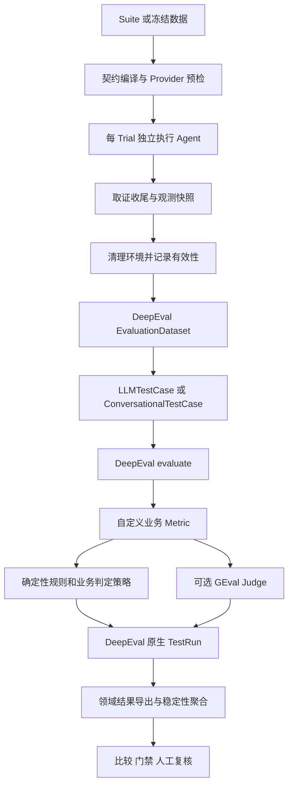

# DeepEval 主评测引擎与业务扩展

> 历史方案：DeepEval 主引擎与源码迁移方向已被 [Inspect AI 方案](inspect_engine.md) 取代。下文记录迁移前状态，不代表当前运行架构。

2026-10-15：默认评测入口已使用 DeepEval 4.2.9。单轮和多轮观测转为 DeepEval 标准 TestCase，由 `evaluate()` 调度自定义业务 Metric，并保存原生 TestRun。现有项目负责业务接入、冻结契约、证据和发布决策。

本文描述当前已实现状态。后续迁移遵循已确定的三条原则：重叠能力按 DeepEval 原生方式改写并删除重复实现；本项目独有能力通过扩展或源码二次开发保留；DeepEval 独有能力保留原生支持。具体目标见[能力对照及迁移方案](deepeval_capability_mapping.md)，下述组合 Metric 与领域实现不代表全部需要长期保留。

## 当前职责划分

| 能力 | 当前实现 | 当前接入边界 |
| --- | --- | --- |
| 通用指标调度 | DeepEval `evaluate()` | 默认运行路径，关闭指标缓存和自动重跑 |
| 运行期数据集 | DeepEval `EvaluationDataset` | 外部冻结数据先经原有 Loader / 契约校验，再转换；Builder 格式不变 |
| 单轮与多轮评测对象 | `LLMTestCase` / `ConversationalTestCase` | 每个真实 Trial 对应一个 TestCase；不补造后续输入或回复 |
| 业务判定 | 自定义 `AgentEvaluationMetric` / `ConversationalAgentEvaluationMetric` | 在 `measure()` 内计算断言、权重、关键失败、有效性及可选 Judge，不接收预先算好的评分 |
| 通用语义评分 | DeepEval `GEval` | 通过已有 Judge 适配调用 DeepSeek；沿用脱敏、超时及错误分类 |
| 框架运行结果 | DeepEval 原生 `TestRun` JSON | 包含案例、Metric 分数、是否通过、理由及结构化业务明细，可用 DeepEval inspect 查看 |
| Agent 与环境执行 | 保留 Provider | 初始化、真实调用、状态读取、隔离及清理；Oracle 不进入 Agent |
| 业务规则和证据核验 | 保留为 Metric 的领域实现 | 工具参数、确认前禁写、逐轮行为、幂等和终态仍需精确检查 |
| 冻结契约与版本约束 | 保留编译器和预检 | 校验 Hash、能力声明、插件身份及执行条件 |
| 稳定性、比较与门禁 | 保留领域层 | 真实重复执行、无效评测阻断、严格可比性及人工复核 |
| 领域结果与旧报告 | 保留 `results.json` 等导出 | 为审计、Gate 和历史读取提供稳定接口，不再独立调度指标 |

## 默认运行路径



`run_evaluation()` 和 `run_provider_evaluation()` 保留为公开兼容入口。`runner.py` 负责预检和执行生命周期，实际评分进入 [当前 Inspect 引擎](../src/eval_framework/inspect_engine.py)。业务规则与策略集中在 [evaluation_policy.py](../src/eval_framework/evaluation_policy.py)，继续复用断言、诊断、Judge 和 Trace 分析实现。

多轮转换只导出已返回的轮次；没有任何轮次返回时，保留初始输入和执行失败状态，不补造 Assistant 回复。执行观测在清理前复制保存。Metric 读取脱离运行时的输出和证据，不访问已清理的业务数据库。所有 Trial 执行完成后，按单轮和多轮分组交给 DeepEval；两组归入同一原生 TestRun，最后恢复原始 Case / Trial 顺序。

## 为什么保留一个组合业务 Metric

现有业务策略允许非关键项按权重汇总，关键项失败则直接失败。把每条断言都当成独立的阻断 Metric，会让 DeepEval 的整体通过规则改变原有语义。因此，当前将整套业务策略实现为组合 Metric，逐条断言保存在原生 Metric 的 `verboseLogs` JSON 中。

原生 Metric 的 `score` 是确定性得分除以 100；`success` 由完整业务判定决定。即使分数达到阈值，关键断言失败或 required Judge 未通过，`success` 仍为 false。证据不足时分数保留 null，不伪装成 0。

| 领域结论 | 原生 success | 明细 |
| --- | --- | --- |
| VALID 且 PASS | true | 可通过 |
| VALID 且 FAIL | false | 已确认失败 |
| VALID 且 INCONCLUSIVE | false | 证据不足或必要评分无法判定 |
| INVALID | false | 评测基础设施无效；可以同时保留已确认违规 |

DeepEval 原生通过率将后三类合并为未通过。发布门禁继续读取领域结论与有效性，不能仅凭原生的布尔通过率判断 Agent 质量。语义维度分数和 token 使用量保存在同一明细的 `judge` 字段及领域 Judge 产物中。

## 使用与原生产物

原有 CLI 和 Python 入口自动走新引擎，无需额外选择后端。离线完整示例：

```bash
.venv/bin/python examples/stateful_gift.py --output-dir artifacts/deepeval_engine_demo
```

示例覆盖 4 个案例、每例 2 次真实执行，使用本地 SQLite 状态和脚本化模型。当前原生 Agent 的行为应得到 4 PASS、4 FAIL；这验证框架执行与判定集成，不验证真实 Judge 的语义准确性。

运行目录包含：

```text
eval_run_.../
  deepeval/test_run_YYYYMMDD_HHMMSS.json   # 原生框架记录
  execution.json                        # 执行身份
  evidence/                             # 独立证据和领域快照
  results.json                          # 领域审计与历史兼容结果
  run_manifest.json                     # 条件与版本指纹
  report.md                             # 领域解释
```

`run_provider_evaluation()` 保存原生 TestRun 和执行证据；`write_report()` 补充领域导出。`native_artifacts.test_run` 是相对运行目录的路径，报告迁往另一目录时会复制原生文件。

将下列路径替换为实际运行目录，即可启动 DeepEval 自带的交互式查看器：

```bash
.venv/bin/deepeval inspect /absolute/path/eval_run_xxx/deepeval
```

该原生记录包含 TestCase 和 Metric 数据；独立取证的完整事件链仍通过本项目的证据文件及 Trace 分析查看。

## 本地运行与版本管理

默认环境仍通过固定版本依赖使用 DeepEval。2026-10-15 已将同版本上游源码 clone 到 `third_party/deepeval`，用于后续源码开发；在临时加载该源码的条件下，完整业务回归已通过。业务代码迁移与可编辑安装尚未执行，详见 [本地源码迁移评估](superpowers/specs/2026-10-15-deepeval-source-migration-assessment.md)。

本项目显式关闭遥测、缓存写入和隐式 dotenv 加载，使用同步评测并对 DeepEval 全局 TestRun manager 加锁。评测作用域内关闭 DeepEval 的后台软超时线程，退出时恢复设置；Judge 继续使用自己的传输超时和重试预算，避免外层提前退出却留下仍在运行的评分任务。适配层调用固定版本的 `_skip_reset` 路径和原生本地 writer，统一终结两类测试，避免自动上传 Confident、自动弹出界面或在工作目录写滚动缓存。DeepEval 的 READ_ONLY 提示针对它的隐式文件；本项目仍显式写入运行目录中的原生 TestRun。

`evaluation_backend` 记录 DeepEval 版本、适配策略版本和运行模式，并参与可比性检查。旧结果继续读取，但旧引擎与新引擎不自动视为可比；应在相同新引擎下重新跑基线。升级 DeepEval 时必须复跑 [引擎集成测试](../tests/test_inspect_engine.py)、Judge 测试和完整回归，核对原生结构及生命周期 API。

## 当前扩展入口与后续改写

- 当前断言注册表由组合 Metric 调用。后续新增或迁移规则先使用原生指标；仅原生未覆盖的业务规则采用自定义 Metric，补充证据需求和异常行为测试，避免增加重复通用实现。
- 增加语义维度：声明 Judge Rubric 和 Case 的 Judge 配置，使用 GEval 计算。使用方式见 [Judge 说明](deepeval_judge.md)。
- 接入新 Agent 或业务数据库：通过原生执行接口挂接 Provider 和状态观察；公开接口不足时，按已记录的缺口进行源码二次开发。
- 直接增加其他 DeepEval 指标：需要在引擎适配层声明其数据映射、是否影响结论及版本指纹；目前不支持 Suite 文档任意指定 Python Metric 类。

文件形式 Suite 的 Judge Profile 编译迁移仍未完成，当前继续使用已支持的兼容 CLI / Python Judge 入口。DeepEval 托管平台、在线观测服务、自动造数及随机用户模拟未接入。冻结评测集、发布门禁和人工复核仍由项目的业务层管理。
