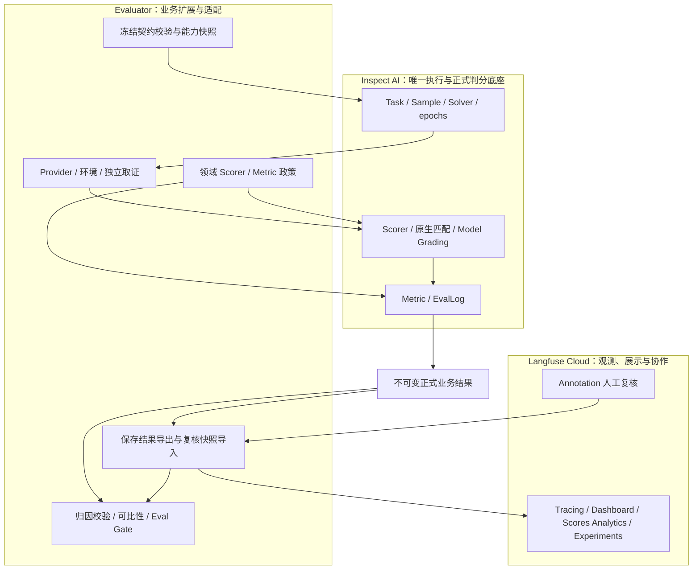
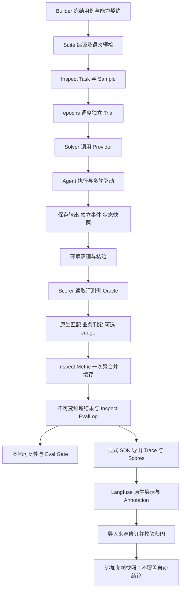

# 基于 Inspect AI、Evaluator 与 Langfuse 的 Agent 自动化评测技术方案

修订日期：2026-10-20。本次修订同步三方职责、唯一数据来源、Langfuse 原生分析视图与导出可靠性。

本方案以 **Inspect AI 为评测运行框架，以 Evaluator 为业务评测扩展**，加载 Builder 输出的冻结评测集，驱动被测 Agent 执行，结合任务输出、独立过程证据和业务状态完成质量判定，输出可审计的报告、版本比较和发布门禁结果。Inspect 原生 Model Grading 提供正式语义 Judge；Langfuse Cloud 接入负责展示与复核，实连状态见 [验收边界](langfuse.md)。

当前已完成 Inspect 迁移、Langfuse Cloud SDK 接入及原生看板改版。本次查询用户 v2.0 全量运行包含 42 Case × 1 Trial，252 条业务断言均通过；云端验证 42 个唯一 Trial、293 条唯一 observation、520 条 Score，其中 42 条仅为场景分类。历史 QueryUser v2.1 与 SQLite 记录单列于第十一章，不作为本轮对比基线。当前真实验收仍以意图模块为主，完整客服 Agent、安全工具链路、多 Trial 稳定性及正式发布基线尚未完成。

## 一、方案背景与目标

### 1.1 方案目标

评测需要同时回答“Agent 是否给出了正确答案”和“任务是否按要求完成”。重点覆盖：

- 是否理解意图、提取参数，并在需要时澄清或处理上下文；
- 是否正确选择工具、传递参数并遵守执行顺序；
- 是否遵守权限、确认及禁止行为约束；
- 出现失败或超时后，是否安全停止或按约定恢复；
- 业务目标是否达成，是否存在错误操作或重复副作用；
- 当前版本相对可比基线是否发生不可接受的质量退化。

框架提供执行、取证、判定与治理机制；各项业务能力是否被充分验证，取决于冻结用例、Provider 支持范围和实际验收结果。

### 1.2 建设原则

1. **共性能力复用原生实现。** 案例调度、重复执行、评分扩展与原生日志使用 Inspect；通用匹配直接调用原生 Scorer，不在外层计算答案后仅包装原生名称。
2. **业务差异通过扩展实现。** 冻结契约、独立证据、业务终态、判定有效性和发布治理保留在 Evaluator；只有公开扩展接口无法满足明确需求时，才考虑修改上游核心。
3. **保留框架原生扩展空间。** 项目尚未使用的原生 Solver、Scorer、模型和 Sandbox API 保持可用，但不自动承诺它们已接入本项目 Suite 配置。
4. **以验证结果推进覆盖。** 先确保已知正确、已知错误和证据不足的行为得到正确判定，再扩大业务范围；全通过结果仍需检查用例与规则的区分能力。
5. **每项能力只有一个主要负责方。** Langfuse 或 Inspect 能完整承担的能力，迁移验收后删除旧路径与无用依赖；只允许迁移期间临时对照，不保留两套生产实现。
6. **同一正式指标只计算一次。** Inspect Metric 阶段产生并缓存汇总，报告、导出及看板读取同一结果；探索性分布不得另立正式通过率口径。
7. **每类数据只有一个权威来源。** 冻结契约、正式结果、人工复核及基线各有独立权威，展示副本不成为第二个编辑入口。每段自研代码必须说明业务规则、适配需求或已验证的原生能力缺口。

### 1.3 适用场景

支持模块能力验证、工具执行链路验证、状态型任务评测、安全边界检查、版本回归及重复执行分析。当前工程统计包括耗时、错误与稳定性；Token 或其他资源指标只有在采集覆盖和统计口径满足要求时才能用于预算判定，不能把缺失值视为零消耗。

## 二、框架选型与能力归属

### 2.1 技术定位

| 组成部分 | 定位 | 当前接入方式 |
| --- | --- | --- |
| Inspect AI | 主评测运行框架 | 本地 clone 0.3.280，以 editable 方式安装；实际调用 Task、Solver、Scorer、epochs、EvalLog |
| Evaluator 扩展 | 业务规则、适配与发布治理 | 校验冻结契约，提供 Provider、独立证据及 Scorer/Metric 扩展；生成审计文件、比较与门禁 |
| Langfuse Cloud | 唯一在线观测、展示与复核平台 | 官方 Python SDK 5.0.2 显式导出；不 clone、不 fork、不部署自研前端、不运行第二套实验循环 |

Inspect 提供基础机制，Evaluator 决定这些机制如何满足业务评测要求。例如，原生日志能记录执行过程，但不能替代“工具记录是否完整、证据是否属于本 Trial、数据库是否真实发生变化”的检查。

### 2.2 原生替换与业务扩展

| 能力 | 实现归属 | 关键约束 |
| --- | --- | --- |
| 样本调度与重复执行 | Inspect Task、Sample、epochs | 每个 epoch 实际执行；当前业务入口顺序调度 |
| 执行与评分分离 | Inspect Solver、Scorer | Solver 执行 Provider 生命周期，Scorer 评价已保存的观测 |
| 严格值比较、文本包含 | 原生 pattern、includes | 保留大小写、标点、空白、类型及缺失字段语义 |
| 参数投影、多轮对象定位 | Evaluator | 只选择和转换业务对象，通用比较仍调用 Inspect；不复制通用 Scorer |
| 冻结集加载、哈希与语义预检 | Evaluator | 不因原生 Dataset 可加载就跳过业务契约校验 |
| 独立证据、确认时序、数据库终态 | Evaluator 与 Provider | 原生通用指标不代替独立事实核验 |
| 权重、关键项否决、有效性判断 | Evaluator 领域 Scorer | 保留失败、无法判定及无效评测的区别 |
| 原始执行日志、交互记录、查看器 | Inspect EvalLog、Transcript、View | SDK 事件以来源明确的记录接入，不伪造原生工具 span |
| 正式语义 Judge | Inspect 原生 Model Grading | Evaluator 只映射冻结 Rubric、模型配置、异常与证据语义 |
| 正式指标与稳定性聚合 | Inspect Metric 阶段 | 业务扩展定义分母、有效性与全部 Trial 规则；一次计算并缓存 |
| Trace 检索、调用树、看板与实验展示 | Langfuse | SDK 只传已有事实和结果；不自建同类页面 |
| 补充语义实验 | Langfuse（可选） | 独立来源；不影响正式结论与 Gate |
| 严格比较、门禁 | Evaluator | 领域审计结果作为业务决策依据 |
| 人工复核 | Langfuse | Evaluator 只校验归因并导入来源快照 |

### 2.3 本地源码组织

```text
agent_evaluator/
  third_party/inspect_ai/
    src/inspect_ai/                    # 原生框架源码
    extensions/agent_evaluator/
      src/eval_framework/              # 权威业务实现
      packages/agent_trace_sdk/        # 独立证据 SDK
      tests/ datasets/ suites/
      examples/ docs/ schemas/ policies/
      scripts/ pyproject.toml
  artifacts/                          # 运行产物
  .venv/                              # 本地运行环境
```

Inspect、Evaluator 和独立证据 SDK 从本地源码可编辑安装；Langfuse SDK 为官方依赖包，Langfuse 服务运行在 Cloud。外层同名业务目录通过相对符号链接指向扩展目录，避免维护两份实现。上游核心当前未做业务补丁；固定提交和安装方式见 [Inspect 主框架说明](inspect_engine.md)。

## 三、整体架构与职责边界

### 3.1 参与方职责

| 参与方 | 核心职责 |
| --- | --- |
| Builder | 根据能力快照设计覆盖、生成与审核案例，输出冻结用例、Manifest 和 Capability Bundle |
| 被测 Agent | 接收执行请求，完成业务处理，输出结果并支持约定的观测接入 |
| Provider 与测试环境 | 构建运行时、绑定工具、准备初始数据、独立读取状态、映射异常并清理资源 |
| Inspect AI | 调度样本与 epochs，执行 Solver/Scorer，维护原生评测日志 |
| Evaluator 扩展 | 编译契约、适配 Provider、校验证据；在 Inspect 扩展点实现领域政策，输出审计与门禁产物 |
| Langfuse | 接收 Trace 与 Scores，提供原生看板、检索、实验展示和人工标注入口 |

Evaluator 不生成或修改正式 Benchmark，也不替 Agent 实现上下文记忆、确认放行或异常恢复。

### 3.2 三方责任边界



三方是责任边界，不是三套评测引擎。**最终正式判分由 Inspect Scorer 管线执行，业务判定政策由 Evaluator 扩展提供；Langfuse 接收和展示结果。** 自研规则不是独立 Runner，Langfuse 的评测功能也不是正式主路径。

Trace 与业务证据用途不同：通用在线检索和调用树交给 Langfuse；业务确认、状态快照、采集完整性及 Trial 归属仍需独立证据通道。Agent Graph 只展示真实采集的调用关系，不从事件名称拼造工具链路。

### 3.3 六个内部能力模块

| 模块 | 核心作用 |
| --- | --- |
| 数据集接入与预检 | 解析冻结输入，校验结构、版本、哈希、能力与执行条件 |
| 执行接入 | 适配 Case → Inspect Sample；调度由 Inspect epochs 负责，自研不另建循环 |
| Agent 与环境适配 | 实现执行入口、工具环境、初始状态、状态查询和资源清理 |
| 证据采集与关联 | 保存实际输出、SDK 事件和状态快照，校验完整性及归属 |
| 质量判定 | 运行原生匹配与领域规则，按需调用 Judge，保留异常及无法判定 |
| 分析与交付 | 读取 Inspect 已保存汇总；生成离线审计文件、可比性与门禁结论，在线展示交给 Langfuse |

上述模块是三方边界中的实现职责；后文五层能力是被测 Agent 的评价维度，不是五套基础设施或五个必建看板。

### 3.4 执行与判定边界

每个 EvalCase 分为 `execution` 与 `oracle`。运行时和模型客户端只接收 `ExecutionSpec`；Oracle 包含预期、权重、检查项和目标状态，仅在评测侧使用。

业务 Inspect Sample 的 `target` 为空，Scorer 通过评测侧私有映射取得 Oracle。该隔离防止标准答案通过正常调用链进入被测 Agent，但不构成对同一 Python 进程中恶意代码的安全隔离。部署不可信 Agent 时，还需独立进程或沙箱边界。

### 3.5 唯一权威数据来源

| 数据 | 唯一权威来源 | 其他位置的性质 |
| --- | --- | --- |
| 数据集、能力快照与案例 Oracle | Builder 发布、仓库引用的冻结版本与 Hash | Inspect Sample 是执行映射；Langfuse 不维护第二份可编辑正式集 |
| 正式评分规则与 Judge Rubric | 仓库内版本化并冻结绑定的评分契约 | Inspect 读取执行，Langfuse 不维护第二份可编辑正式标准 |
| 原始执行与评分日志 | Inspect `inspect/*.eval` | 领域结果关联原生日志；Langfuse 是可检索镜像 |
| 正式业务结论与汇总 | 同次 Inspect 运行生成的不可变 `results.json` | JSONL、summary、Markdown、Langfuse Scores 都是派生表示 |
| 独立业务证据 | 本 Trial 的 Inspect 原生日志、关联记录与独立状态快照 | Trace 事件和 evidence refs 是定位入口，不替代源证据 |
| 人工复核记录 | Langfuse Annotation | 本地 JSONL 是追加的来源修订快照，不能直接编辑成新决定 |
| Error Taxonomy 定义与校验 | Evaluator 版本化标签体系 | Langfuse 承载标注与结构化 comment；导入时校验标签及主因/次因结构 |
| 基线选择与发布政策 | compare 的显式输入及 Gate Policy | 实验页面临时选择、看板筛选、人工评分均不自动更改正式基线或 Gate |

### 3.6 自研保留与删除依据

| 内容 | 处理 | 必要性或验收要求 |
| --- | --- | --- |
| 通用 Judge 调用、DeepEval 桥与依赖 | 已由 Inspect 替换并删除生产路径 | 保留历史结果可读；评分后端变更后重新校准和建立基线 |
| Runner 在 Inspect 之后再计算汇总 | 已删除 | 汇总只在 Inspect Metric 阶段产生 |
| 本地 `adjudicate` 写入与重复复核入口 | 已删除 | 人工编辑统一在 Langfuse；保留历史文件审计 |
| 自研 Trace / Dashboard / 复核前端 | 不建设 | 复用 Langfuse 原生 UI；本地 Markdown/JSON 只用于离线审计 |
| 旧失败分析页、空工具页与重复组件 | 本次删除 2 个看板、7 个组件 | 当前保留一个有数据支撑的看板，避免无效展示 |
| Provider、冻结校验、独立取证、领域断言 | 保留 | 业务事实与执行契约，通用框架无法推导 |
| 稳定性与统计中的通用计算 | 使用 Inspect 原生 `mean`、`median_score`、`pass_at`、`pass_k` | 移除手写通过率、至少一次成功和全部成功计算；保留业务样本选择与计划分母适配 |
| 业务稳定性口径、可比性、Eval Gate、归因校验 | 保留为业务扩展 | 仅实现业务分母、政策和原生语义缺口，不能以注册了扩展点为由保留重复算法 |
| Langfuse 导出/导入适配 | 保留 | 身份映射、来源 Hash、不可变上传检查点和修订校验，不另写判分 |

后续替换按“确认语义覆盖 → 临时对照 → 验收 → 删除旧入口、依赖及过时测试”推进。不能以保留已有代码为目标；历史审计材料与第二套生产实现应区分。

### 3.7 重复能力复核（2026-10-21）

**选择规则：原生语义匹配即使用原生；业务新增要求通过扩展实现；只有可验证的差异才构成自研保留理由。** 同时存在多个文件、SDK 或扩展函数，并不能证明不存在重复。

#### 日志、证据与展示

Inspect 本身具备 Transcript、模型/工具事件和 EvalLog，Langfuse 也具备 Trace 采集与展示。因此不能把“采集 Trace、保存事件、展示调用链”笼统描述为本项目自研优势。本地 Inspect 还包含增量事件存储，不能声称“Inspect 不支持持久化或中断恢复”。

| 当前组件 | 保留的具体职责 | 不应重复承担的职责 |
| --- | --- | --- |
| Inspect Transcript / EvalLog | 原生评测执行与评分日志；接收外部 Provider 的事实记录 | 不根据通用日志是否存在，推断业务证据是否完整 |
| `agent_trace_sdk` | 保留包名的业务适配层，内部使用 Inspect 原生采集和存储；保留字段白名单、脱敏、Trial 关联、序列完整性与状态政策 | 不作为通用 APM、Trace 平台或第二套调用树；不宣称比 Inspect 日志系统整体更强 |
| Provider | 从受控业务环境独立读取前态、逐轮状态与终态 | 不把 Agent 自述“执行成功”当成数据库终态证明 |
| Langfuse 导出适配 | 显式上传已保存的正式结果、事件及证据引用，提供检索、图表和人工复核 | 不在评测执行时启动第二套 Agent 采集或重新判分 |

原生 `InfoEvent.data` 接受通用 JSON，不直接实现本项目的事件字段规则、Trial 关联或证据完整性政策。当前保留 SDK 的理由是这些业务协议及其失败处理，而不是 JSONL 格式本身。后续经用户授权，已将通用采集与存储替换为 Inspect `Transcript`、`write_eval_log` 和 `read_eval_log`。新 `InspectEvidenceSink` 只承担业务协议适配，`LocalEvidenceSink` 是兼容别名。旧 JSONL 写入和独立 collection 检查点已移除；历史格式仅只读兼容。事件和完整性状态一起存入每 Trial 的原生 `trace.inspect.json`，主执行日志记录引用，不再逐条复制业务事件。该路径每事件保存一次原生快照，长轨迹吞吐尚未验收。

保留依据可由 `tests/test_independent_evidence.py` 和 `tests/test_evidence_boundaries.py` 验证：错误关联不得证明违规；字段缺失/截断不能被视为完整；写入失败时 Agent 返回的完整事件不能恢复正式有效性；进程退出后已刷新的业务证据可读取。这里的“独立”指交付路径及状态核验，不意味着对恶意 Agent 提供安全隔离。

#### 评分与统计

| 能力 | 原生实现 / 业务差异 | 当前处理 |
| --- | --- | --- |
| 严格值匹配、包含匹配 | Inspect `pattern` / `includes`；业务侧只投影字段、保留严格类型语义并绑定证据 | 已使用原生 Scorer |
| LLM Judge | Inspect `model_graded_qa`；业务侧提供冻结 Rubric、参考事实、独立配置与结论政策 | 已使用原生，不保留 DeepEval 并行主路径 |
| 完成率、通过率、均值、中位数 | Inspect `mean`、`median_score` | 本轮移除相应手写通用计算 |
| 多 Trial 至少一次成功、全部成功 | Inspect `pass_at(k)`、`pass_k(k)` | 原始二元成功观测直接送入 Reducer，不先自算结果再包装 |
| 缺失 Trial、未知结果、NOT_APPLICABLE | 冻结计划定义分母；缺失或未知仅表示“未证明成功”，其正式质量分仍为 `None`；不适用 Case 排除 | 保留输入适配；补齐计划中缺失的成功指示为 0，重复或超计划 Trial 拒绝 |
| 断言权重、关键项否决、未知证据 | Decimal 两位 `ROUND_HALF_UP`、关键项一票否决、执行/有效性/质量三态分离 | 保留业务政策，运行在 Inspect Scorer 内；普通均值不能直接替代这组契约 |
| P50/P95、输出波动与业务终态 | 历史冻结 nearest-rank 口径、去除易变字段后的业务输出 Hash、独立终态断言 | 保留业务扩展；不能把均值中位数冒充 nearest-rank 分位数 |

当每个 Case 的有效计划观测数为 `k` 时，原生 `pass_at(k)` 与 `pass_k(k)` 分别对应当前“至少一次”与“全部”成功口径；不将概率估计一般化为任意样本数下的同一布尔含义。报告和 Langfuse 继续消费 Inspect Metric 阶段生成并缓存的正式结果。

原生能力参考：[Inspect 评分](https://inspect.aisi.org.uk/scoring.html)、[Inspect 日志](https://inspect.aisi.org.uk/eval-logs.html)、[Langfuse Observability](https://langfuse.com/docs/observability/overview)。实现核对以仓库固定版本源码为准。

评分去重阶段离线验收：使用扩展自己的 `pyproject.toml` 运行全部测试，367 passed、2 个付费测试按默认配置跳过；全量 Ruff 检查通过。新增覆盖计划分母、未知与不适用结果、重复/超计划 Trial、原生 Reducer 输入及历史舍入边界。独立审查发现的 0.01 百分点舍入差异已修正并加入回归测试。未调用付费模型或上传云端；测试仍有原有依赖及兼容接口的弃用警告。

Trace 原生替换验收：扩展测试 378 passed、2 个付费测试跳过，Ruff 通过；Agent 集成环境全量测试 321 passed、1 个付费测试跳过。旧写入器已删除，历史读取、失败证据及 Langfuse 离线导出测试保持通过。

## 四、评测体系设计

### 4.1 三类评测依据与版本约束

| 依据 | 主要内容 | 承载对象 |
| --- | --- | --- |
| 能力依据 | 任务、模块、工具、交互与证据能力 | 冻结 Capability Bundle |
| 案例依据 | 用户输入、后续输入、执行限制、预期行为及禁止行为 | EvalCase、冻结 execution_profiles |
| 判定依据 | 规则、权重、关键项、语义评分标准及证据要求 | Oracle、断言实现、Judge Rubric |

Suite 声明可信插件及精确版本、文件引用和运行配置；Manifest 声明数据集身份、生命周期与绑定关系。正式基准采用 FROZEN 数据。显式允许的非冻结运行仅用于临时观察，不能作为正式基线或发布依据。

能力声明用于圈定可执行范围，不能将已声明支持但实际失败的案例事后排除。需要改变覆盖或预期时，应由 Builder 形成新的冻结版本。

### 4.2 三级评测范围

| 范围 | 设计目的 | 当前 mini_agent 执行边界 |
| --- | --- | --- |
| module | 意图识别、参数提取、缺参等单项能力 | 一次纯意图入口调用；不消费后续 user_responses |
| link | 一次 Agent 调用内的工具循环与衔接 | 一次 Agent.run，受其步数边界约束；不支持任意中间步骤截断 |
| end_to_end | 多轮任务与业务状态核验 | 在 NEED_CLARIFICATION 或 NEED_CONFIRMATION 后消费已声明输入，到终态或输入耗尽时停止 |

新 Provider 必须声明对应入口与停止条件；不支持的边界应在预检阶段拒绝。标签本身不构成执行深度的实现。

### 4.3 五层能力覆盖

| 能力层 | 主要检查内容 | 主要证据 |
| --- | --- | --- |
| 理解层 | 意图、参数、歧义、缺参和必要澄清 | 模块输出、结构化字段 |
| 上下文层 | 参数继承与覆盖、纠正、取消和跨轮一致性 | 实际轮次、逐轮参数和状态 |
| 规划执行层 | 工具选择、入参、次数、顺序和终止 | 工具事件、实际调用与返回 |
| 安全恢复层 | 权限、确认、禁止行为、异常恢复与重复副作用 | 完整事件链与独立状态 |
| 结果层 | 业务目标、最终状态、回复与事实一致性 | 业务状态快照、最终输出 |

这些层级构成覆盖设计目标。Builder 冻结具体场景类型与标签，Evaluator 按实际用例和检查项统计。现有报告已包含范围、意图、任务及断言统计；完整五层覆盖矩阵应随标签和规则映射建设，不能仅由 Case 标签推导“能力已验证”。

### 4.4 评测对象与方法

最终回答使用结构检查、内容匹配和按需语义评分；工具调用使用实际名称、参数、次数、顺序及终态证据；多轮交互使用逐轮检查；任务效果使用独立状态查询。Trace 分析用于还原可观测行为、发现过程异常及辅助定位，不替代业务终态判断。

## 五、自动化评测流程

### 5.1 原生执行链路



Provider 在 Solver 内真实执行，不是先在外部跑完再交给 Inspect 包装。清理前保存观测副本，清理完成后由 Scorer 判定；清理失败同样进入评测有效性判断。

业务路径中的 `mockllm/model` 仅是 Inspect 编排占位，Solver 不通过它生成回答；实际 Agent 模型由 Provider 客户端调用，真实模型身份读取领域 `model_metadata`。

### 5.2 加载、编译与预检

执行前依次完成：

1. 校验 Suite、数据源和运行配置的结构，拒绝未知或不支持配置；
2. 按精确身份解析显式注册的 Loader、Provider；
3. 校验 JSONL、Manifest、能力包及依赖文件的 Hash、引用与路径边界；
4. 将输入转换为统一 EvalCase，保留来源、版本和标签；
5. 检查执行范围、工具 Profile、评分要求及 Provider 的语义兼容性；
6. 保存编译快照和实现指纹，再进入实际执行。

预检失败生成无效运行记录，不创建虚假的 Case 通过率，也不计作 Agent 业务失败。JSON 配置不允许导入任意 Python 实现或执行命令。

### 5.3 Trial 与多轮驱动

Case 表示一条冻结案例，Trial 表示其一次独立执行。`trials_per_case` 映射为 Inspect epochs，每次均建立独立运行时、会话与证据关联；外部业务数据的隔离由 Provider 实现。

多轮使用预先声明的输入脚本，仅在实际允许的等待节点继续。每轮保存实际输入、状态、参数、工具调用及可用状态快照；到达终态后未消费的输入不伪装为已发生交互。

Evaluator 不补入 Agent 遗失的参数，不合成确认接受事件，也不因流程未完成而强行推进。逐轮偏差作为真实行为保留。

## 六、测试环境与执行可靠性

### 6.1 状态隔离与独立核验

状态型任务遵循“工具操作实际存储，评测侧独立查询”的约定。Provider 负责准备初始数据、记录基准状态、限定 Trial 数据范围，在关键轮次和结束时读取状态，随后释放并核验资源。

当前 `gift_sqlite_v1` 使用真实本地 SQLite 账本，每个 Trial 从空账本开始，保留每次写入和重复操作，清理时删除并核验临时目录。它验证本地状态隔离与读取机制，不代表真实生产系统或容器环境已被验收。

`CLEANED` 表示 Provider 清理调用正常返回；是否完成实际重置由 Provider 核验。初始化在返回运行时前失败时，由 Provider 清理已分配资源。仅新建 Agent 实例不能隔离共享外部数据库。

### 6.2 超时、故障与取消

当前同步 Agent 接口没有安全强制取消能力。Evaluator 在调用返回后判断是否超过预算，并记录 `OUTER_TIMEOUT`；该机制不能中断永久阻塞的调用。工具循环步数由执行配置和 Agent 运行时约束。

故障注入是扩展目标，需逐个 Provider 支持。仅在 ExecutionSpec 中存在 `fault_injection` 字段，不代表工具失败、提交后超时等场景已经可用；当前 SQLite 环境尚未实现通用故障注入。

后续涉及真实写入或长阻塞任务时，需要补充可取消接口或进程隔离，并在中止后继续核验远程副作用。重新执行 Trial 和 Agent 内部恢复是两套机制，所有原始 Trial 都需保留，不能仅用重试成功覆盖首次失败。

### 6.3 原生沙箱边界

Inspect 原生 Sandbox 接口保持可用，但本次迁移环境没有完成 Docker/Kubernetes 验证。配置原生 sandbox 不会自动把宿主机 Provider 代码移入容器。后续接入需要明确哪些代码在沙箱中执行、数据如何进入、证据如何导出及资源如何回收。

## 七、质量判定体系

### 7.1 确定性规则与原生评分

结构、字段、事件和状态能够直接判定的事实项优先使用确定性规则。每项规则声明名称、权重、关键性、检查对象及所需证据。

严格值比较使用原生 `pattern`，文本包含使用 `includes`。适配层负责规范化实际值和选取待比较对象，不先计算通过与否再包装为原生评分。具体原生调用记录在断言的 `native_scores` 中。

Schema、工具完成状态、确认先后、证据完整性等业务语义继续由领域规则实现。参数 `expected_subset` 只忽略顶层额外字段，嵌套值保持严格；终态及逐轮状态按对应契约进行递归子集检查，避免迁移时放宽判定。

已知结果完整时，得分为通过项权重占适用项总权重的百分比，保留两位小数。关键项失败强制 FAIL。没有适用项时得分为空、结论 INCONCLUSIVE；有必需项无法判定时，不通过移除权重产生高分，已证实的失败仍保留。

### 7.2 可选 Judge 与指标库

语义 Judge 用于相关性、解释完整性及回复与证据的一致性等内容。当前由 Inspect 原生 Model Grading 提供语义评分，独立配置的 Judge 提供模型服务；Agent 与 Judge 的模型配置和凭据相互独立。

Judge 不替代数据库状态核验，不能覆盖确定性规则已证实的关键失败。Rubric、Prompt、输出结构、模型、超时、重试和后端身份纳入运行记录；输出与证据引用需通过校验。

Judge 调用失败、超时或结构无效按必要性记录异常或无法判定，不默认通过。被评内容是数据，不能改变评分规则。用于发布放行前，还需使用人工标注样本校准误判通过率和重复判分稳定性。

当前 Judge 可通过兼容 CLI/API 启用；文件 Suite 的通用 Judge Profile 尚未完成执行接入。额外语义实验可在 Langfuse 中进行，但不能写入正式判分或门禁。正式评分标准的唯一可编辑来源仍是冻结契约。

### 7.3 结论分离机制

| 维度 | 回答的问题 | 代表状态 |
| --- | --- | --- |
| 执行状态 | Agent 调用是否结束，是否发生模型、初始化、超时或运行错误 | COMPLETED、MODEL_TIMEOUT、OUTER_TIMEOUT 等 |
| 评测有效性 | 证据、环境和评测过程是否可靠 | VALID、INVALID |
| 质量结论 | 现有证据能否证明满足案例要求 | PASS、FAIL、INCONCLUSIVE、NOT_APPLICABLE |

清理状态单独保留。无效评测不能成为总体通过，也不能把无效、证据不足或不适用统一当作 Agent 零分。独立证据已证明的违规可继续保留为失败依据。

Inspect Score 用 C/I/N 表示通过、失败或其余结论，完整领域状态保存在 metadata 和领域结果中。原生运行日志的 `success` 只说明评测运行成功，不表示所有 Agent 案例通过。

### 7.4 评测器可信性

以已知正确、已知错误、证据不足的样本覆盖判定与汇总路径，并测试事件关联错误、采集失败、清理异常等情况。规则或评分后端变更时，需要重新验证误判通过风险和语义兼容性。

离线脚本响应验证框架行为；真实模型评测验证当前 Agent 在所选案例上的表现；Judge 人工校准验证评分器可信度。三种证据不能互相替代。

## 八、Trace 与证据管理

### 8.1 三类证据来源

| 来源 | 核心内容 | 使用边界 |
| --- | --- | --- |
| 结果接口 | 模块输出、实际轮次和任务状态 | 不能单独证明外部业务变更 |
| 独立证据 SDK | 实际产生的过程及工具事件、关联和采集状态 | 完整性与 Trial 归属校验后用于过程判定 |
| 环境读取接口 | 初始、逐轮和最终业务状态 | 必须来自实际查询，不从 Oracle 或工具成功文案构造 |

SDK 的 Sink 覆盖整个 Trial，多轮共用同一关联上下文。独立证据采集失败时，不回退使用 Agent 自报的“完整事件”使评测通过。

### 8.2 原生日志与领域证据

Inspect Transcript 保存实际对话和来源明确的 SDK/Provider 观测记录；领域证据保留事件文件、关联信息、采集状态及业务快照。两者通过 Run、Case、Trial 和 Trace 身份关联。

SDK 事件在 Inspect 中以带来源的 info 记录保存，不自动转换成原生工具 span。Trace 反映可观测过程，不包含模型隐藏推理；诊断推测必须与已确认事实区分。

关键状态和过程证据在清理前保存。独立通道执行脱敏，返回业务数据、Judge 输入及报告共享还需接入方按实际数据处理；不能据此声称所有输出已自动脱敏。

### 8.3 Langfuse 导出与恢复

`observability.py` 集中使用官方 SDK 的 OTLP 与 Scores API 导出已保存结果。默认本地评测不会上传 Cloud；`export-langfuse` 是显式步骤。凭据通过本机环境加载，不进入仓库、产物或命令行参数。默认不上传业务输入、回复、状态快照和事件 payload；首次导出可显式选择 `--include-content` 上传输入与最终输出，后续不能切换模式。

一个 Case 的一次 Trial 对应一个 Trace 和 experiment item；整轮汇总使用单独的 `run_summary` Trace。稳定 ID、原始时间戳、run_id、数据/结果 Hash 和证据关联用于追溯。汇总 Trace 和子事件不能当作额外 Trial 计数。旧结果没有 Trial 起止时间时，标注 `timing_source=run_bounds`，耗时读取保存值。

导出协议以不可变结果为源，按以下规则恢复：

1. 请求前写入 PENDING 回执，绑定目标项目、结果 Hash、内容模式与发送中的 observation ID。
2. 每批明确接收后，保存 `accepted_observation_ids`；已接收 observation 不重传，OTEL 请求不自动重试。
3. 网络结果不确定或部分接收时保留 inflight ID，先回读核对再恢复；旧版无检查点的 PENDING 回执同样不能盲目重放。
4. 全部成功后标记 ACCEPTED；后续补充场景标签或评分只 upsert Scores，保持 ID、名称及原始日期一致。ACCEPTED 不等于完成落库和页面验收。
5. 验收对齐唯一 Trial 数、observation ID、Score 值与源 Hash。导出失败不触发 Agent 重跑、不修改质量结论，也不覆盖本地证据。

Langfuse v4 不保证重复 observation ID 的去重，稳定 ID 不能替代上传检查点；参见 [官方数据更新约束](https://langfuse.com/faq/all/tracing-data-updates)。本次已修复重复上传并从冻结结果恢复云端镜像，修复过程没有再次判分或调用模型。

### 8.4 Scores 与来源语义

| 名称 | 含义 | 使用约束 |
| --- | --- | --- |
| `execution.status`、`execution.latency_ms` | 执行结果及原始耗时 | 与质量结论分开 |
| `evaluation.validity` | VALID / INVALID | 无效证据不能被过滤后包装成通过 |
| `quality.conclusion`、`quality.deterministic_score` | 正式质量结论与确定性分数 | 无效时不上传数值质量分；保留分类结论 |
| `assertion.{序号}.{名称}` | PASS / FAIL / UNKNOWN | 指向具体断言与可用证据，不杜撰未覆盖维度 |
| `judge.*` | Inspect 正式 Judge 已计算结果 | 本轮未启用；不得与 Langfuse 补充实验混同 |
| `run.*`、`stability.*` | 正式运行汇总 | 每 run 每项一条，仅读取已保存值 |
| `context.scenario_type` | 冻结用例的场景类别 | 分类标签，不参与得分、通过率或 Gate |
| `review.decision.v1` | 人工复核决定 | 来源必须是 ANNOTATION，经校验后形成追加快照 |

正式导出 Score 由 API 写入并携带 `authority=immutable_results`；补充语义实验应使用独立名称与来源，不能覆盖正式 Score。Score 总条数包含状态、断言、汇总及分类，不能视为业务断言数或案例数。

## 九、框架解耦与接入约定

| 接入对象 | 必须提供的能力 |
| --- | --- |
| Dataset Loader | 转换冻结案例，保留来源、版本和执行/判定边界 |
| Provider | 创建运行时、执行模块或完整任务、转换观察、映射异常、清理资源 |
| 环境 | 工具、初始数据、隔离范围、独立查询和清理核验 |
| Scorer 与领域规则 | 明确实际输入、预期、证据、缺失处理及判定语义 |
| 观测适配 | 将真实事件转换成可关联、可检查的标准记录 |

Loader、Provider 通过可信组装入口显式注册，按精确 ID、版本和实现指纹解析。新增 Agent 应优先复用 Provider 接口，不在 Runner 中增加特定 Agent 的条件分支。

Suite 中出现某个 Profile 字段不等于它已接入执行。当前通用 Judge/Trace Pipeline、声明式 Assertion/Report/Gate Profile 尚未全部贯通；Judge 保留兼容入口，Gate 使用独立命令。未支持配置必须明确拒绝。

第二个真实 Agent 的接入是通用性验收步骤，目前不能仅依据接口解耦或 Fake Provider 测试宣称已完成多 Agent 生产验证。详细契约见 [接入规范](integration_contracts.md)。

## 十、输出产物、比较与发布治理

### 10.1 核心产物

| 产物 | 内容 |
| --- | --- |
| report.md、summary.json | 人读结论与总体统计 |
| results.json、results.jsonl、cases/ | 原始领域结果及逐 Trial 记录 |
| failures.json | 执行异常与已判定质量失败；无法判定还需结合完整结果查看 |
| evidence/、trace_analysis/ | 实际观测、独立事件、状态及派生分析 |
| inspect/*.eval | Inspect 原生执行与评分日志，可用原生查看器读取 |
| run_manifest.json、stability.json | 运行身份、编译配置和重复执行表现 |
| comparison.json、gate.json 等 | 可比性、版本变化及门禁结论 |
| langfuse_reviews.jsonl | Langfuse 人工复核修订快照 |
| langfuse_review_sync.json | 最近完整同步的有效修订清单 |
| langfuse_export.json | 项目/结果绑定、Trace 映射、Score ID、已接收及发送中 observation 检查点 |

`native_artifacts` 使用相对路径引用原生日志，报告迁移时一并复制。原始 `results.json` 保留，分析、比较、门禁和人工复核写派生产物。报告与 JSON 来自同一结果对象，机器处理以结构化结果为准。

### 10.2 指标与重复执行

正式指标的唯一计算入口是 Inspect 的 `business_metrics`：完整 Case × Trial 到齐后调用领域汇总与稳定性扩展，缓存后重复读取；Runner、报告和 Langfuse 导出不再计算第二遍。原生均值在语义一致时直接复用，业务分母和无效证据处理留在扩展内。历史别名 `agent_case_pass_rate` 复用严格通过率值，不新增计算。

报告区分 Case 数与 Trial 数、所选子集与数据集总量、执行完成与质量通过。通过率必须说明分子分母，不把未执行、无效或证据不足表述为通过。

当前稳定性聚合包括 Trial 通过率、至少一次成功的 `pass_at_k`、全部成功的 `pass_power_k`、结论及输出波动、P50/P95 耗时。这里的 `pass_at_k` 是本次 k 次实际执行是否至少一次成功，不是概率估计。只执行一次时不能据此推断重复执行稳定性。

五层能力和计划覆盖的完整展示应结合 Builder 覆盖设计与明确映射逐步补齐，不能将尚未实现的汇总矩阵写成当前默认报告内容。

### 10.3 可比性与源码身份

比较前校验数据、能力契约、运行范围、规则、Judge、重复设置和框架身份，明确允许变化的被测对象。不可比时输出原因，拒绝直接判断退化。

引擎身份记录 Inspect 版本、上游及 checkout 提交、实际加载的框架源码、Evaluator 与 SDK 内容 Hash，包含未提交源码变化。旧结果可读不等于新旧引擎可比；修改判定语义或迁移框架后，应在新条件下重新运行基线和候选。

模型随机性可能导致波动，记录配置和证据支持复现条件与审计，不保证再次调用模型得到逐字相同的输出。

### 10.4 发布门禁与人工复核

本地 Gate Policy 支持执行完成率、严格通过率、稳定成功率、退化数、波动数、核心或零容忍标签、指定断言、Judge 维度和延迟等约束。缺少必需证据或无法计算配置的指标时，按实际检查结果阻断或要求复核。

当前 Token 门禁取自已记录的 Judge token_usage，绝对上限检查使用其中单 Trial 最大值，并不代表 Agent 全链路总成本。用于成本放行前，应补齐采集覆盖与统计口径，避免把部分数据当完整预算。

门禁结论区分 PASS、FAIL、INVALID_COMPARISON 和 REVIEW_REQUIRED；INVALID_COMPARISON 表示比较条件无效，与单个 Trial 的 INVALID 评测有效性不同。关键案例的无法判定不能替代通过，总分不能抵消零容忍失败；运行命令退出成功也不等于发布可放行。

人工复核通过 Langfuse Annotation 编辑，Evaluator 导入结论、主因/次因、优化方向、理由及来源修订。归因标签的定义权和校验权在 Evaluator；非法结构整批拒绝，不静默转换。导入按源 Score ID 和内容 Hash 追加修订，完整同步清单标识 active revisions；Cloud 删除撤销当前有效修订，本地保留历史。复核不覆盖自动结果，也不自动改变已生成的门禁；争议通过契约或实现修正与重评解决。问题需区分 Agent 行为、环境、采集和评分争议。

### 10.5 自动化与反馈闭环

当前提供本地 validate、run、analyze、compare、gate 、export-langfuse 和 import-reviews 入口，尚未默认部署 CI、定时服务或自动发布流程。后续由 CI 或调度系统调用这些入口并保留完整产物。

经脱敏和人工确认的业务失败，将复现条件、实际行为、预期及证据交给 Builder，形成新的冻结集；Evaluator 在同一新数据上重跑基线和候选。环境、采集或评分缺陷先在对应组件修复，避免混入 Agent 业务失败集。

### 10.6 原生看板与调查路径

在线分析只使用 Langfuse，当前以一个主看板和原生详情页构成调查路径。默认 Home 保留为项目概览，但项目总量包含冒烟等其他运行，不能作为本轮评测分母。

| 页面 | 配置与回答的问题 | 边界 |
| --- | --- | --- |
| 主看板（9 组件） | 四张紧凑卡读取案例数、严格通过率、中位/最大耗时；下方是最慢 10 例、六类断言结果、耗时分布、九类场景覆盖、42 例耗时明细 | 固定 run_id；通过率读取汇总唯一值，不跨 run 平均；直方图是原生近似分箱 |
| Tracing 保存视图 | 本轮 run_id + root observation，排除汇总 EVALUATOR；每个 Trial 一行，列出场景、耗时、执行/有效性/质量，点击查看事件 | 默认导出无业务 Input/Output，需结合本地证据；不把预期拒绝事件视为质量失败 |
| Scores Analytics | 选择具体断言，查看分布与评分记录；本轮链接限定实际运行时间，共 42 条 | 当前无独立 Judge，不建立规则/Judge 一致性矩阵；单轮上传时间趋势不是版本质量趋势 |
| Experiments | 展示同一 run 的实验项，支持调查和并排查看 | Inspect 负责执行；正式比较前必须通过本地可比性检查，UI 不选择 Gate 基线 |
| Annotation | 复用原生 UI 标注复核结论和结构化归因 | 本轮 5 项 PENDING，实际人工标注往返仍待验收 |

六类实际断言是输出格式、意图、状态、后续动作、参数及缺参匹配。不能改名为权限、安全、业务目标等“五层能力”指标。当前不采集完整 Agent Token、费用与工具 span，不增加空成本图或伪造 Agent Graph。失败分析通过断言表与原生筛选进入具体案例；工具质量待真实覆盖后复用同一套原生展示能力。

看板分布和场景计数是交互探索，不成为第二套正式指标。只有同一目标、同一标签语义且按同一对象配对的独立评分，才适合做一致性分析；补充实验结论须与正式结论分开。版本优化先固定数据集、能力契约、规则和执行条件，再比较基线与候选。

[本轮主看板](https://cloud.langfuse.com/project/cmvgd40xe02ecad0en362z7wd/dashboards/cmvgdozd800aoad0ild099btk)及原生视图配置见 [Cloud 配置回执](/Users/yuanyu/Documents/ChatGPT/agent_evaluator/artifacts/langfuse_full_20261020_154130/cloud_setup.json)。它是展示配置记录，正式基线仍来自 compare 输入。

## 十一、验证状态与后续建设

### 11.1 历史验证记录

| 验证 | 已确认结果 | 结论范围 |
| --- | --- | --- |
| Inspect 迁移验收时的离线回归 | 355 passed，2 个付费冒烟测试 skipped | 当次代码版本的执行、证据、评分、报告与兼容路径 |
| 原生执行与依赖 | 原生 Task 可独立运行；DeepEval 已从生产实现与依赖删除 | Inspect 是唯一正式执行与判分底座 |
| SQLite 状态型示例 | 8 Trial、4 PASS / 4 FAIL，全部 VALID / CLEANED | 真实本地账本取证与清理；失败暴露了 Agent 当时的确认处理限制 |
| QueryUser v2.1 真实模型评测 | 42 Case、42 Trial；252/252 断言通过；无无效评测和执行异常 | DeepSeek deepseek-flash 在该冻结集上的一次模块级评测 |

上述历史 QueryUser v2.1 运行使用 `intent-router-v5`，未启用语义 Judge；平均单条耗时 3.62 秒。42/42 通过证明该配置下的模块级流程与判定闭环可用，不证明端到端业务、多轮稳定性或 Judge 校准已完成。

迁移测试是当次验收记录，不替代以后代码变更后的重新回归。完整证据见 [迁移验收记录](inspect_migration_acceptance.md) 与 [QueryUser v2.1 报告](/Users/yuanyu/Documents/ChatGPT/agent_evaluator/artifacts/query_user_v2_1_inspect/eval_run_c51e587721944f5cb8f903740c4b2774/report.md)。

### 11.2 本次架构与 Cloud 验收（2026-10-20）

| 项目 | 已验证事实 | 不推导的结论 |
| --- | --- | --- |
| 查询用户 v2.0 全量 | 42 Case × 1 Trial，252/252 断言 PASS；执行 COMPLETED、评测 VALID、独立证据完整、清理完成 | 不代表五层客服能力或多 Trial 稳定性 |
| 正式耗时 | 平均 2462.67 ms，中位 2122.5 ms，最大 8839 ms | 不与历史 v2.1 直接比较版本优劣 |
| 云端一致性 | 42 个唯一 Trial、293 条唯一 observation；520 条 Score 回读一致，其中 42 条为场景分类 | Score 条数不是断言数量；Cloud 不是第二个权威结果源 |
| 原生展示 | 1 个看板/9 组件，Tracing 与 Scores Analytics 各对应 42 例；实验 42 项 | 不补造 Token、费用、工具或 Judge 图表 |
| 导出恢复 | 修复重传，回读确认无重复、源 Hash 和 Score 不变；相关导出/复核测试 20 passed，Ruff 通过 | 检查点不等于网络未知情况下的自动恢复保证 |
| 可比性负向验收 | 5 例冒烟 vs 42 例全量被正确拒绝为 INVALID_COMPARISON | 尚未建立正式发布基线或有效发布 Gate 结论 |
| 人工与 Judge | 5 项 PENDING；本轮没有启用语义 Judge | 人工标注往返、语义阈值校准尚未验收 |

当前 run 为 `eval_run_efc666b921fe4dfca5bae078ac55cb53`。证据见 [运行说明](/Users/yuanyu/Documents/ChatGPT/agent_evaluator/artifacts/langfuse_full_20261020_154130/README.md)与[验收记录](/Users/yuanyu/Documents/ChatGPT/agent_evaluator/artifacts/langfuse_full_20261020_154130/verification.json)。上述测试结果是本次实现验收记录，本次技术方案修订只更新文档，没有重跑模型评测。

### 11.3 后续建设顺序

| 阶段 | 主要工作 | 完成标准 |
| --- | --- | --- |
| 真实业务基线 | QueryUser 重复评测、抽查预期与实际、固定配置与版本 | 能解释偶发失败和评分分歧，建立可追溯基线 |
| 扩大能力覆盖 | QueryGift、AddBackpackGift、工具链路和多轮状态任务 | 不只看总通过率，逐项核验错误能被发现、未知不会误通过 |
| 加强执行可靠性 | Provider 故障注入、进程取消与 Sandbox 适配 | 超时、提交后失联、隔离和清理有可复现验收案例 |
| 完善统一配置与治理 | Suite Profile 接入、五层覆盖映射、第二个 Agent、CI 门禁 | 配置实际生效、跨接入语义一致、自动化保留证据 |

Langfuse 已接入，后续不再新建观测平台或重复执行器。优先补齐可比基线、重复 Trial、真实工具/状态场景和人工/Judge 校准；新增能力先检查 Inspect 与 Langfuse 原生覆盖，只有确认缺口后才增加业务扩展，并验证不会削弱现有证据与安全约束。

## 附录 关键实现与约束入口

- [主引擎与源码安装](inspect_engine.md)：框架版本、源码布局、原生执行和兼容入口。
- [架构与模块地图](architecture.md)：当前模块职责及调用关系。
- [契约与接入规范](integration_contracts.md)：Suite、能力包、Provider 和 Loader 的强制边界。
- [评测报告规范](evaluation_report_spec.md)：结果字段、判定、比较与治理约定。
- [独立证据通道](TRACE_PHASE1.md)：SDK、关联、完整性与失败处理。
- [Langfuse 与 Inspect 分工](langfuse.md)：评分归属、SDK 接入、复核与权威数据。
- [Inspect 执行实现](../src/eval_framework/inspect_engine.py)、[领域判定](../src/eval_framework/evaluation_policy.py)、[原生匹配](../src/eval_framework/native_scoring.py)、[稳定性](../src/eval_framework/stability.py)、[门禁](../src/eval_framework/gating.py)。
