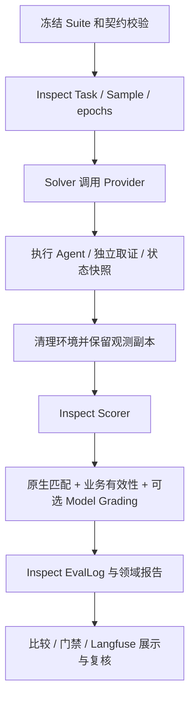

# Inspect AI 主评测框架与迁移边界

2026-10-15：本地源码迁移已实施。默认业务运行使用 Inspect AI 0.3.280 的真实 Task、Solver、Scorer、Epochs 和 EvalLog；2026-10-20 起现有四项正式语义 Judge 也使用 Inspect，旧 DeepEval G-Eval 路径及依赖已删除。2026-10-28 已选定 5 个 DeepEval 专项算法待接入 Inspect Scorer，当前尚未实现；逐项分工见[指标字典](metric_dictionary.md)，Langfuse 接入与单一职责见[当前迁移说明](langfuse.md)。

## 1. 源码与执行位置

上游仓库为 `https://github.com/UKGovernmentBEIS/inspect_ai.git`，本地目录 `third_party/inspect_ai`，固定标签 `0.3.280`、提交 `dfcb169e1cb170a8fbe2c37a0e3befc45c2c2b85`，开发分支 `codex/agent-evaluator-extension`。上游核心保持原样；业务代码作为独立 Python 扩展包迁入该 clone：

```text
third_party/inspect_ai/
  src/inspect_ai/                     # 原生运行时
  extensions/agent_evaluator/
    src/eval_framework/               # 权威业务源码
    packages/agent_trace_sdk/         # 独立证据 SDK
    tests/ datasets/ suites/ examples/
    docs/ schemas/ policies/ scripts/
    pyproject.toml README.md
```

项目根目录的 src、packages、tests、datasets、suites、examples、docs、schemas、policies、scripts 及包配置为相对符号链接，指向上述唯一实现。根目录的凭据、虚拟环境和历史 artifacts 保留在原位。Inspect、扩展包和 SDK 均已 editable 安装，直接修改源码会影响下次运行。此 clone 是独立 Git 仓库，尚未推送远端，也未注册为根仓库 submodule；备份或交接必须同时包含 clone 与扩展文件，不能只保存根目录符号链接。

## 2. 三条迁移原则的实际映射

| 能力 | 当前实现 | 边界 |
| --- | --- | --- |
| 样本调度、重复运行、执行与评分分离 | Inspect Task / Sample / Solver / Scorer / epochs | 每个 epoch 实际创建 Provider 运行时并清理；目前顺序执行 |
| 严格值相等、包含检查 | 原生 pattern / includes | 原始值规范化后直接交给 Scorer；不把预算的布尔值伪装为原生评分 |
| 参数和状态子集、逐轮比对 | 业务投影和证据定位 + 原生值比较 | 保留缺失字段、类型、空白、顺序语义 |
| 原始评测日志、交互记录、查看器 | Inspect .eval / Transcript / inspect view | 业务事件存入 Trial 的原生 trace.inspect.json，主日志记录引用；不伪造原生工具调用 span |
| 冻结契约、哈希、Suite 编译、Provider 注册 | 业务扩展 | 执行前校验，禁止从数据配置导入任意代码 |
| 独立取证、数据库终态、确认时序、证据完整性 | 业务扩展 | 原生通用指标不替代事实核验；缺失证据不等于无违规 |
| 权重、关键项否决、执行/有效性/质量分离 | 领域 Scorer 扩展 | FAIL、INCONCLUSIVE、INVALID 与清理失败继续保留 |
| 稳定性指标 | Inspect Metric 中的业务聚合 | 仅计算一次，Runner 与看板读取快照 |
| 严格基线比较、发布门禁 | 业务扩展 | 读取正式结论和明确基线 |
| 人工复核 | Langfuse Annotation | 自研只校验归因和导入只读修订快照 |
| 正式语义 Judge | Inspect model_graded_qa | 冻结 Rubric、独立模型凭据、统一 Scorer 路径 |
| Inspect 其他原生 Solver、Scorer、模型、Sandbox | 保留原生 API 与 CLI | 可直接编写原生 Task；不表示已全部映射到本项目 Suite JSON |

`native_scoring.py` 使用 `pattern` 的全字符串捕获和 `ignore_case=False`，避免原生宽松匹配改变标点、大小写或空白。每条领域断言的 `native_scores` 保存实际调用的原生评分身份。JSON Schema、工具完成状态与事件关联仍属于业务逻辑。

## 3. 一次业务评测的调用链



Solver 调用现有 Provider 生命周期，并在评分前完成清理；同步调用在受等待的 worker 中执行，不分离后台任务。Scorer 通过评测侧私有映射读取 Oracle，Inspect Sample 的 target 为空，Agent 只接收 ExecutionSpec。该结构是数据传递边界，不是对同一 Python 进程中恶意代码的安全沙箱。

`mockllm/model` 是 Inspect 编排所需的模型占位，本业务 Solver 不调用它生成回答；真实 Agent 和 Judge 的模型及凭据仍由各自客户端管理。原生日志中占位模型名称不代表被测模型身份，应读领域 `model_metadata`。未经声明的后续用户输入不会写成已发生对话。

## 4. 安装与运行

以下命令从外层 agent_evaluator 工作区执行，`../mini_agent` 应替换为实际 Agent 源码目录；已安装时可省略 `--agent-path`：

```bash
python3.11 -m venv .venv
.venv/bin/python scripts/bootstrap_inspect.py --agent-path ../mini_agent
.venv/bin/python -m eval_framework.cli validate --suite suites/mini_agent_module_v1/suite.json
.venv/bin/python examples/stateful_gift.py --output-dir artifacts/inspect_demo
.venv/bin/inspect view --log-dir artifacts/inspect_demo
```

查看器应指向具体运行的 `inspect/` 子目录（可从 `native_artifacts.test_run` 找到）。Langfuse 是协作展示入口；Inspect 原生查看器保留作本地调试，无自研前端。没有调用付费模型的默认验收命令：

```bash
.venv/bin/python -m pytest -q
.venv/bin/ruff check src tests scripts
.venv/bin/python -m pip check
```

原生能力可以直接使用 `inspect_ai.Task`、`inspect_ai.eval`；业务运行结束后仍可调用。正式 Judge 经 `judges/inspect.py` 调用原生 `model_graded_qa`；`inspect_metrics.py` 仅保留业务分母、分组与缺失状态语义，不再包含 DeepEval 桥。

## 5. 结果、复现与兼容

`native_artifacts.test_run` 指向相对路径 `inspect/*.eval`；`write_report` 迁移报告时会复制原生日志，并拒绝越出源运行目录的路径。原生 Score 使用 C/I/N 保存通过、失败或未判定，完整有效性、执行/清理状态、原始领域分数与断言记录在 metadata。不要把原生日志运行成功等同于 Agent 质量通过。

领域 results.json、results.jsonl、report.md、证据、比较与门禁接口保留，旧结果继续可读。`evaluation_backend` 包括版本、上游提交、当前 checkout、实际加载的 Inspect 源码、扩展源码及 SDK 内容 Hash；源码未提交的变更也改变身份。引擎身份不同的结果拒绝直接作回归比较，应在新版本上重跑基线。历史 DeepEval 主引擎不再是默认路径，旧 `deepeval_engine.py` 已删除。

## 6. 已知边界

本机未安装 Docker，未验证 Docker/Kubernetes 沙箱；现有 SQLite Provider 的每 Trial 空账本、独立读取与清理有真实回归覆盖。仅给原生 Task 配置 sandbox，不会自动把宿主机 Provider 或 Agent 放进容器。

同步 Agent 缺少安全取消接口，超时仍是返回后计时标记；本次不声称完成抢占式终止。Suite 的 Judge Profile、通用 Trace Pipeline 及声明式策略等既有未完成入口继续标明未实现。当前实际替换和验收针对已有能力，不包括新建故障注入系统、托管服务或 LangSmith 接入。

完整测试与审查结论见 [迁移验收记录](inspect_migration_acceptance.md)。
