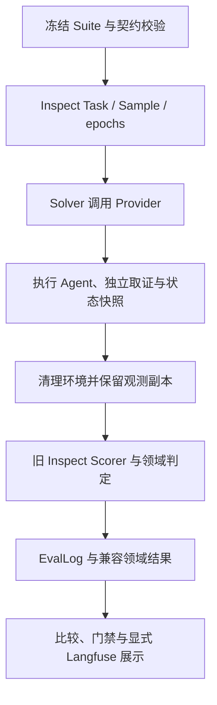

# Inspect 兼容引擎与历史迁移边界

本文说明 `eval_framework.cli` 的旧 Suite／Provider 兼容路径。当前任务基准使用 `eval_framework.benchmark.cli`，由 Inspect 执行与记录、DeepEval 正式评分，见[包入口](../README.md)。旧 Inspect Scorer 的结果不得改标为 DeepEval 结果，也不能与新基准直接比较分数。

## 兼容路径的职责

Inspect 0.3.280 提供 Task、Sample、Solver、Scorer、epochs、Transcript 与 EvalLog；Evaluator 提供冻结契约、Provider 适配、独立业务证据、领域有效性和发布规则。



Solver 在评分前完成清理。Scorer 通过评测侧私有映射读取 Oracle，Inspect Sample 的 target 为空，Agent 只接收 ExecutionSpec。这是数据传递约束，不是抵御同一 Python 进程内恶意代码的安全沙箱。

`mockllm/model` 是 Inspect 编排占位；业务 Solver 不调用它生成回答，真实 Agent 与 Judge 的模型身份应读取领域 `model_metadata`。日志运行成功不等于 Agent 质量通过。

通用值比较使用原生 `pattern`／`includes`。参数子集只投影顶层字段，嵌套对象保持严格相等；`native_scoring.py` 使用完整匹配及 `ignore_case=False`，保留大小写、标点和空白语义。业务扩展继续核验数据库状态、确认时序、证据关联与完整性，保留关键项否决、FAIL、INCONCLUSIVE 和 INVALID。

例如，未观察到禁止工具调用且证据不完整，只能判为未知；已经观察到有效违规调用则可以判为失败。原生工具权限指标对空调用列表的通过结论不能证明记录完整。

## 当前仓库布局与使用

迁移后的业务实现位于 [src/eval_framework](../src/eval_framework/)，证据 SDK 位于 [packages/agent-trace-sdk](../../agent-trace-sdk/)。上游源码未复制到本仓库，Inspect 由固定依赖安装；旧 `third_party/inspect_ai/extensions/agent_evaluator` 与符号链接布局不再适用。来源提交与导入边界见[迁移溯源](../../../docs/migration/provenance.md)。

从仓库根目录安装并检查兼容 Suite：

```bash
python3.11 scripts/setup.py --only evaluator
.venvs/evaluator/bin/python -m eval_framework.cli validate \
  --suite packages/evaluator/suites/mini_agent_module_v1/suite.json
```

运行离线 SQLite 示例时，在包目录执行：

```bash
cd packages/evaluator
../../.venvs/evaluator/bin/python examples/stateful_gift.py \
  --output-dir ../../artifacts/inspect-demo
```

查看器使用 `.venvs/evaluator/bin/inspect view --log-dir <运行目录>/inspect`。`native_artifacts.test_run` 给出具体日志相对路径；Langfuse 接入见[使用说明](langfuse.md)。

## 结果与兼容约束

- `inspect/*.eval` 保存原生执行日志；`results.json`、`results.jsonl`、`report.md` 和独立证据保存领域审计结果。
- `write_report` 复制原生日志时拒绝越出源运行目录；旧结果保持只读兼容。
- `evaluation_backend` 绑定依赖版本与实际源码身份，未提交源码变化也影响身份；引擎身份不同的运行必须重新建立基线。
- 旧语义 Judge 经 Inspect `model_graded_qa` 计算；Conversation Completeness 的专项桥接见[接入说明](conversation_completeness.md)。它们不改变新任务基准的评分入口。
- 文件形式 Suite 的 Judge Profile 尚未完成编译接入，`PROFILE_STAGE_NOT_MIGRATED` 表示入口未实现，不能因配置字段存在就声称已支持。
- SQLite 隔离不等于 Docker／Kubernetes 支持；同步 Provider 不提供强制中断。原生 Inspect API 的能力也不等于全部已映射到本项目 Suite JSON。

## 历史验收事实

2026-10-15 的 Inspect 迁移在原项目完成，固定上游提交为 `dfcb169e1cb170a8fbe2c37a0e3befc45c2c2b85`。当次完整回归为 **355 项通过、2 项付费测试跳过**；Ruff 和依赖检查通过。42 Case Suite 校验通过；SQLite 示例为 8 Trial、2 epochs，4 PASS／4 FAIL，全部 VALID／CLEANED，原生日志包含 8 个 target 为空的 Sample。

该示例的 FAIL 是当时 Agent 无法完成跨轮确认写入的预期观察结果；评测器未补写 Agent 能力。迁移还修复了嵌套参数额外字段被宽松子集比较误判通过的问题，并通过反例验证。

上述数字是历史验收记录，不是本次文档整理重新运行的结果。当时原始日志位于原项目 `artifacts/inspect_migration_acceptance/verification/`，未随本仓库导入。早期 DeepEval 主引擎和语义 Judge 的实现已被兼容路径替换；它们与 2026-11-01 新增的任务基准是不同版本，历史成绩保持原身份。
