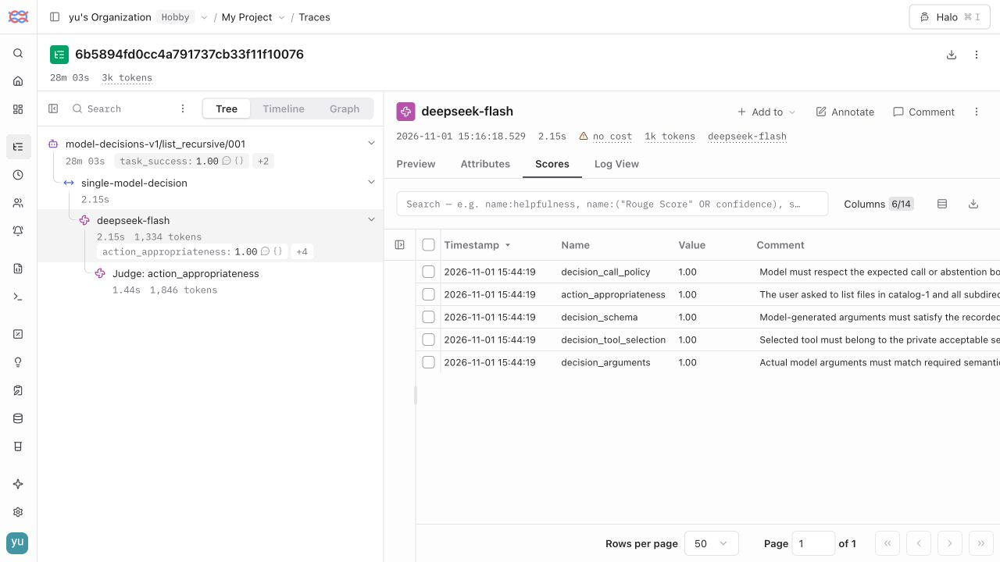

# 工具型 Agent 三层评测作品集

[打开离线报告](index.html) · [汇总数据](summary.json) · [逐次执行摘要](results.jsonl)

真实执行：444 个任务实例、112 个任务族、612 次执行。Judge 重评分另计，不构成新 Agent 执行。

| 范围 | 实例 | 任务族 | 执行次数 | 通过（PASS） | 失败（FAIL） | 执行无效（INVALID） | 证据不足（INCONCLUSIVE） |
|---|---:|---:|---:|---:|---:|---:|---:|
| 程序模块 · 直接调用 | 60 | 12 | 60 | 60 | 0 | 0 | 0 |
| 模型决策模块 · 隔离输入 | 24 | 8 | 72 | 72 | 0 | 0 | 0 |
| 关键链路 · 真实 Agent | 60 | 12 | 180 | 151 | 29 | 0 | 0 |
| 端到端 · 文件工具 Agent | 300 | 80 | 300 | 273 | 27 | 0 | 0 |

[独立人工标注起点](calibration-sample.json)：材料准备不代表人工校准完成。

界面抽查与服务端回读分别说明各自覆盖范围；服务端状态以各运行的来源绑定记录为准。

## 七个问题与未解决部分

1. **模块、关键链路、端到端覆盖：已执行三层**。程序模块 · 直接调用：60 实例 / 60 次执行；模型决策模块 · 隔离输入：24 实例 / 72 次执行；关键链路 · 真实 Agent：60 实例 / 180 次执行；端到端 · 文件工具 Agent：300 实例 / 300 次执行 尚未解决 / 边界：限定已声明任务族；业务域、复杂动态交互与更多模块仍需扩展。

2. **GEval 是否为 LLM Judge：已运行**。GEval 使用评审模型；本报告 3411 条有效诊断分。 尚未解决 / 边界：评分不是概率，不替代确定性终态与硬约束。

3. **Inspect 是否支持逐步评分：已接入**。Inspect 组织执行，自研采证/检查点通过 DeepEval 评分；已记录范围：关键链路、模型决策、任务、工具调用、对话轮次 尚未解决 / 边界：并非所有步骤均有完整语义判分；顺序检查不证明数据流正确。

4. **是否接入 τ-bench：试点已执行**。已记录奖励 1 / 计划 1 次执行；有效奖励均值 1.0。Langfuse 已验证（VERIFIED）；展示状态绑定官方摘要与标准化结果的来源 Hash。不是官方排行榜成绩。 尚未解决 / 边界：领域试点不等于完整官方基准或排行榜成绩；仍需扩大覆盖并固定官方运行条件。

5. **框架分为哪些部分：职责明确**。专用任务生成/冻结 → Inspect → 自研环境与适配/Oracle/轨迹检查点 → DeepEval/GEval → 报告与 Langfuse。 尚未解决 / 边界：原通用 dataset-builder、能力协议与旧兼容代码仍为保留能力；并非此次主链路每步都调用。

6. **Trace 轨迹打分：有节点级分数**。执行指标 7543 条；Judge 指标 3859 条，节点 ID 随摘要保存。 尚未解决 / 边界：Langfuse 上传与读回状态逐运行列出；缺证据节点不能补造分数。

7. **LLM Judge 与指标量化：已量化、未人工校准**。适用 3412 条、已评分 3411 条、错误 1 条、缺失 0 条；另有重复波动和用量。 尚未解决 / 边界：独立人工标签、一致性验收、误放/误杀评估及阈值留出验证仍未完成。

## 口径

- 程序模块、隔离模型决策、关键链路与端到端分开统计；不把模块通过率当作模型成功率。
- 任务实例包含同族参数变体；实例数、任务族数与重复执行次数分别报告。
- tool_schema 只检查参数结构，不等于参数语义正确；tool_order 只检查顺序，不证明数据流正确。
- 关键链路使用显式检查点；尚未证明任意工作流每一步都有完整语义评分。
- GEval 分数是 0～1 的规则尺度，不是正确概率；缺失、错误与不适用不记为成功。
- Judge 重评分复用已有执行证据，不增加 Agent 执行次数；成本与用量单独统计。
- 事后 Judge 所在 Trace 根 Span 跨度包含执行至评审的间隔，不等于 Agent 耗时；Agent latency 沿用原记录。
- 独立人工校准与阈值验证尚未完成；Judge 保持诊断用途，不覆盖正式终态判定。
- 当前主结果仅代表已记录的文件工具任务；不宣称覆盖所有业务领域、插件、MCP 或生产系统。

来源文件 SHA256 见 summary.json；公开摘要不含模型提示词、工具结果、文件内容或运行凭据。
